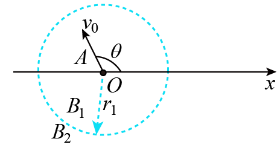

# Physics - 题目 2491

**ID**: 2cf6a7507b194dc08008339a93578992
**年级**: Grade 12
**难度**: Hard
**题型**: Calculation

## 题目
如图所示，在纸面内存在一垂直纸面向外的圆形匀强磁场区域，其半径为r_{1}=1.0m。​​​​​​​‌圆心O处有一粒子源，可以在平面内向各个方向发射速度为v_{0}=1.0×10^{6}m/s的α粒子（即氦核），其电量为q=+3.2×10^{-19}C，质量取m=6.4×10^{-27}kg。现以O点为原点，建立x坐标轴，其中沿与x轴成 $θ=120{\rm{°}}$ 角发射的粒子A，恰好沿x轴正向射出圆形磁场区域。求：（1）α粒子在圆形磁场区域内运动的轨迹半径R_{1}及该磁场的磁感应强度大小B_{1}；（2）若在该圆形磁场区域外存在另一垂直纸面向外的匀强磁场（范围足够大），其磁感应强度大小B_{2}= 0.5B_{1}，请确定粒子A从原点O发射至返回原点O且速度方向与出发时方向相同所经历的时间t；（3）在（2）中引入的匀强磁场B_{2}，若有一个以O点为圆心的圆形外边界，为保证所有粒子源发射的α粒子均能回到O点，则磁场B_{2}的外边界半径r_{2}至少需多大。

## 解答

1. （1）如图所示，作速度的垂线，找到圆心C，半径为OC，画出轨迹圆C，与磁场圆B_{1}的边界相交于F点。
2. 
3. 可得在磁场B_{1}中的轨迹圆心角为120°，利用几何关系可得 $R{{}_{1}}=\frac {r{{}_{1}}}{2{\cos}30{^{\circ }}}=\frac {\sqrt {3}}{3}{\rm{m}}$ ，
4. 由洛伦兹力提供向心力，可得 $qB{{}_{1}}v{{}_{0}}=m\frac {v{{}_{0}^{2}}}{R{{}_{1}}}$ ，
5. 联立解得 $B{{}_{1}}=\frac {mv{{}_{0}}}{qR{{}_{1}}}=2\sqrt {3}\times 10{^{-2}}{\rm{T}}$ 。
6. （2）因为B_{2}= 0.5B_{1}，所以 $R{{}_{2}}=2R{{}_{1}}=\frac {2\sqrt {3}}{3}{\rm{m}}$ ，
7. 找到圆心D，半径为FD，画出轨迹圆D，与磁场圆B_{1}的边界相交于F、G点，回到磁场B_{1}，轨迹圆的圆心为DG的中点E，画出轨迹圆E，回到O点，OE为轨迹半径，速度垂直于轨迹半径。因为OC=CD=DE=OE，
8. 所以四边形OCDE为菱形，OE//CD，
9. 所以粒子A 第一次返回原点O时的速度方向沿x轴的正方向。设从O处出发第一次回到O点的时间为t_{0}，由几何关系知 $s{{}_{\overset{\frown}{{OF}}}}=s{{}_{\overset{\frown}{{OG}}}}=\frac {2πR{{}_{1}}}{3}=\frac {2\sqrt {3}π}{9}{\rm{m}}$ ， $s{{}_{\overset{\frown}{{FHG}}}}=\frac {2}{3}\times 2πR{{}_{2}}=\frac {8\sqrt {3}π}{9}{\rm{m}}$ ，
10. 则粒子在磁场B_{1}中运动时间为 $t{{}_{1}}=2\times \frac {s{{}_{\overset{\frown}{{OF}}}}}{v{{}_{0}}}=\frac {4\sqrt {3}π}{9}\times 10{^{-6}}{\rm{s}}$ ，
11. 粒子在磁场B_{2}中运动时间为 $t{{}_{2}}=\frac {s{{}_{\overset{\frown}{{FHG}}}}}{v{{}_{0}}}=\frac {8\sqrt {3}π}{9}\times 10{^{-6}}{\rm{s}}$ ，
12. 从O处发射到第一次回到O点，速度方向刚好顺时针转过120°，所以从O处发射至返回原点O且速度方向与出发时方向相同所经历的时间为 $t^{′}=3(t{{}_{1}}+t{{}_{2}})=4\sqrt {3}π\times 10{^{-6}}{\rm{s}}$ ，
13. 考虑到运动的周期性，则所经历的时间为 $t=4\sqrt {3}nπ\times 10{^{-6}}{\rm{s}}$ （n取正整数），
14. （3）如图所示，轨迹圆D上离O点最远的点是H点，它在磁场圆和轨迹圆连心线OD的延长线上，OCD为正三角形，所以OD=R_{1}，故有 $r{{}_{2{\rm \min }}}=OD+DH=R{{}_{1}}+R{{}_{2}}=3R{{}_{1}}=\sqrt {3}{\rm{m}}$ 。

## 知识点

**中文**:
  - 带电粒子在有界匀强磁场中的运动

**English**:
  - Motion in Bounded Uniform Magnetic Field

---
