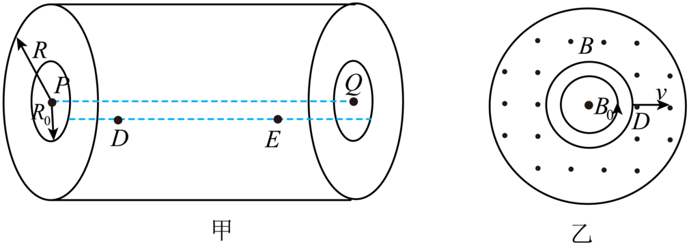

# Physics - 题目 1504

**ID**: 3bae0b4b66014ecaa7e96cde7ec4528c
**年级**: Grade 12
**难度**: Hard
**题型**: Calculation

## 题目
托卡马克装置是一种利用磁约束来实现受控核聚变的环形容器，将容器简化为如图甲所示的足够长的空心圆柱，其半径为 $R=3R{{}_{0}}$ ， $PQ$ 为空心圆柱的中心轴。​​​​​​​‌圆柱内部以半径为 $R{{}_{0}}$ 的圆为边界分成两部分磁场，侧视图如图乙所示，外环分布有垂直纸面向外磁感应强度为 $B=\frac {1}{2}B{{}_{0}}$ 的匀强磁场；内环分布有逆时针的环形磁场，磁感应强度大小处处相等且大小为 $B{{}_{0}}$ 。在 $D$ 点设置一原子核发射装置，可发射电荷量为 $q$ 、质量为 $m$ 的氘核与电荷量为 $q$ 、质量为 $\frac {3}{2}m$ 的氚核，原子核发射时速度方向如图乙中所示沿半径向外，除碰撞外，忽略粒子间的相互作用。（1）若两个动量大小均为 $p$ ，方向相反的氘核与氚核对心碰撞发生核聚变，生成一个质量为 $2m$ 的氦核和质量为 $\frac {1}{2}m$ 的中子，碰后氦核的速度为 $v{{}_{1}}$ ，求该过程释放的核能 $ΔE$ ；（2）氘核发射速度 $v=\frac {qB{{}_{0}}R{{}_{0}}}{3m}$ ，需要经过多长时间氘核第一次回到 $D$ 点同一条轴线上的 $E$ 点；（3）假设原子核发射装置只持续稳定发射速度为 $v=\frac {qB{{}_{0}}R{{}_{0}}}{3m}$ 的氚核粒子，粒子稳定后，轴向单位长度内有 $n$ 个氚核，求圆柱形容器内沿轴线方向的等效电流。

## 解答

1. （1）氘核与氚核的动能分别为 $E{{}_{{\rm{k}}2}}=\frac {p{^{2}}}{2m}$ ， $E{{}_{{\rm{k}}3}}=\frac {p{^{2}}}{3m}$
2. 由动量守恒定律，有 $p-p=2mv{{}_{1}}-\frac {1}{2}mv{{}_{{\rm{n}}}}$
3. 解得 $v{{}_{{\rm{n}}}}=4v{{}_{1}}$
4. 发生核聚变，释放能量，则 ${\rm{Δ}}E=\left ({\frac {1}{2}\times 2mv{{}_{1}^{2}}+\frac {1}{2}\times \frac {1}{2}mv{{}_{{\rm{n}}}^{2}}}\right )-\left ({\frac {p{^{2}}}{2m}+\frac {p{^{2}}}{3m}}\right )=5mv{{}_{1}^{2}}-\frac {5p{^{2}}}{6m}$
5. （2）设氚核做圆周运动的半径为r，则 $qvB=\frac {3}{2}m\frac {v{^{2}}}{r}$
6. 解得 $r=R{{}_{0}}$
7. 根据几何关系可知氚核再次回到内圆边界时，粒子的出射点与入射点对应内圆的圆心角为270°，氚核沿径向进入内圆，在内圆磁场作用下沿轴向运动半个周期后再次回到圆边界沿径向飞出，进入环形磁场B，然后做周期性的运动，运动情况如图甲（侧视图）、乙（正视图）所示
8. 
9. 氚核第一次回到D点同一条轴线上的E点，需要在外环中运动四次，在内圆中运动三次，所用时间为 $t=4\times \frac {3}{4}\times \frac {2π\cdot \frac {3}{2}m}{qB}+3\times \frac {π\cdot \frac {3}{2}m}{qB{{}_{0}}}=\frac {18πm}{qB{{}_{0}}}+\frac {9πm}{2qB{{}_{0}}}=\frac {45πm}{2qB{{}_{0}}}$
10. （3）根据电流的定义式得 $I=\frac {Q}{t}=\frac {n\bar vtq}{t}$
11. 氚核沿轴向的平均速度为 $\bar v=\frac {2r{{}_{0}}}{t{{}_{1}}+t{{}_{2}}}$
12. 又由 $qvB{{}_{0}}=\frac {3}{2}m\frac {v{^{2}}}{r{{}_{0}}}$
13. 得 $r{{}_{0}}=\frac {1}{2}R{{}_{0}}$
14. 而 $t{{}_{1}}=\frac {3}{4}\times \frac {2π\cdot \frac {3}{2}m}{qB}$ ， $t{{}_{2}}=\frac {π\cdot \frac {3}{2}m}{qB{{}_{0}}}$
15. 联立解得等效电流 $I=\frac {nq{^{2}}B{{}_{0}}R{{}_{0}}}{6πm}$

## 知识点

**中文**:
  - 带电粒子在有界匀强磁场中的运动
  - 质量亏损与爱因斯坦质能方程
  - 电流的形成、理解与微观表达式

**English**:
  - Motion in Bounded Uniform Magnetic Field
  - Mass Defect and Einstein's Mass-Energy Equation
  - Formation, Understanding, and Microscopic Expression of Current

---
