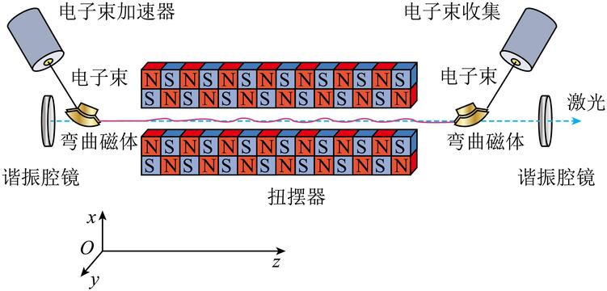

# Physics - 题目 14

**ID**: 3d27a7815ab046e086e7a9226d6006c0
**年级**: Grade 12
**难度**: Hard
**题型**: Calculation

## 题目
自由电子激光器是以自由电子束为工作物质，将相对论性电子束的动能转变成相干的电磁辐射能的装置，其中产生电磁波的核心装置为“扭摆器”（如图所示），由沿z方向交错周期排列的2n对宽度为a的永磁体组成（ $n\gg 10{\rm ，2\mathit{a}}$ 被称为扭摆器的“空间周期”），产生x方向的周期静磁场。​​​​​​​‌本题我们利用高中知识，在被简化的模型中分析注入扭摆器的电子的运动。已知电子质量为m，带电荷-e，一束电子经加速后由弯曲磁体沿yOz平面引入扭摆器，不考虑引入过程速度损失，不考虑任何相对论效应，忽略电磁辐射过程的动能损耗。（1）假设一对永磁体间的磁感应强度恒定为 $B{{}_{0}}$ ，电子束中电子进入扭摆器的初速度与z轴夹角为30°，且能经过扭摆器后被完整收集，求：①电子束加速器的加速电压U；②该电子束中的一个电子在扭摆器中的运动时间T。（2）实际上，扭摆器的一个空间周期内，磁感应强度的大小是有变化的，一对永磁体间沿x轴的磁感应强度随与该对永磁体最左边的水平距离d近似满足 $B{{}_{x}}\left ({d}\right )=B{{}_{0}}\left ({1-\frac {2d}{a}}\right )$ 的线性关系（ $0<d<a$ ， $B{{}_{0}}$ 的方向由N极指向S极），电子束经电压 $U{{}_{0}}=100U$ 加速后沿z轴正方向进入扭摆器，仍然能经过扭摆器后被完整收集，求电子运动过程偏离z轴的最大距离 $Δs{{}_{{\rm \max }}}$ 。（提示：①实验中， $B{{}_{0}}$ 可认为是相当弱的磁场；②可能用到的数学公式： $Δx\to 0$ 时， $\sum \limits_{x=0}^{x{{}_{0}}}\mathop{x{^{n}}Δx}=\frac {1}{n+1}x{{}_{0}^{n+1}}$ ）

## 解答

1. （1）①在一个空间周期内，电子运动的轨迹如图所示，
2. 
3. 根据几何关系有 $R\sin 30{^{\circ }}=\frac {1}{2}a$ ，解得 $R=a$ ，粒子做圆周运动，由洛伦兹力提供向心力，则有 $evB=m\frac {v{^{2}}}{R}$ ，电子加速过程，根据动能定理有 $eU=\frac {1}{2}mv{^{2}}$ ，解得 $U=\frac {eB{{}_{0}^{2}}a{^{2}}}{2m}$ ，②结合题意可知，该扭摆器总共有n个空间周期，结合上述几何关系可知，每个空间周期内有 $t=\frac {\frac {2\mathrm{π}}{360{^{\circ }}}\times 2\times 60{^{\circ }}}{ω}$ ，其中 $v=ωR$ ，则电子束中的一个电子在扭摆器中的运动时间为 $T=nt$ ，解得 $T=\frac {2n\mathrm{π}m}{3eB{{}_{0}}}$ 。
4. （2）根据题意可知，磁感应强度随与该对永磁体最左边的水平距离变化的关系图像如图所示，
5. 
6. 对电子进行分析，在y轴方向，根据动量定理有 $\sum -eB{{}_{x}}v{{}_{z}}Δt=mv{{}_{y}}-0$ ，其中 $B{{}_{x}}\left ({z}\right )=B{{}_{0}}\left ({1-\frac {2z}{a}}\right )$ ， $v{{}_{z}}Δt=Δz$ ，结合题意解得 $v{{}_{y}}\left ({z}\right )=-\frac {eB{{}_{0}}}{m}\left ({z-\frac {z{^{2}}}{a}}\right )$ ，电子在加速过程，根据动能定理有 $eU{{}_{0}}=\frac {1}{2}mv{{}_{0}^{2}}$ ，由于 $B{{}_{0}}$ 是相当弱的磁场，可知，电子在运动过程中速度变化量远远小于 $v{{}_{0}}$ ，则可近似认为 $v{{}_{z}}\left ({t}\right )\propto v{{}_{0}}$ ，则有 $z\left ({t}\right )\approx v{{}_{0}}t$ ，结合上述有 $v{{}_{y}}\left ({z}\right )=-\frac {eB{{}_{0}}v{{}_{0}}}{m}\left ({t-\frac {v{{}_{0}}t{^{2}}}{a}}\right )$ ，电子运动时间 $t{{}_{0}}=\frac {a}{v{{}_{0}}}$ ，作出电子运动过程偏离z轴示意图如图所示，
7. 
8. 则有 ${\rm{Δ}}s{{}_{{\rm \max }}}=\left |{\sum\limits_{t=0}^{t{{}_{0}}}\mathop{}v{{}_{y}}\left ({t}\right ){\rm{Δ}}t}\right |=\frac {eB{{}_{0}}a{^{2}}}{6mv{{}_{0}}}$ ，其中 $v{{}_{0}}=\sqrt {\frac {2eU{{}_{0}}}{m}}=\frac {10eB{{}_{0}}a}{m}$ ，解得 $Δs{{}_{{\rm \max }}}=\frac {a}{60}$ 。

## 知识点

**中文**:
  - 带电粒子在组合场中的运动

**English**:
  - Motion in Combined Fields

---
