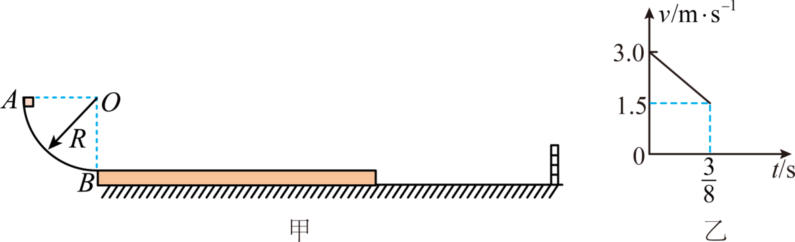

# Physics - 题目 2280

**ID**: 40aa6ea349a84a01a761f7f54839efb1
**年级**: Grade 12
**难度**: Hard
**题型**: Calculation

## 题目
如图甲所示，半径为R=0.8m的光滑 $\frac {1}{4}$ 圆弧轨道AB固定在光滑水平地面上，A点与圆心O等高，圆弧轨道与放在地面上质量为M=1kg的长木板上表面相切于B点，木板右侧距离为x处固定弹性挡板。​​​​​​​‌现将质量m=3kg的小物块从A点由静止释放，小物块从B点离开圆弧后滑上长木板，一段时间后长木板与右侧弹性挡板发生第一次弹性碰撞（碰撞时间忽略不计），第一次碰撞完瞬间开始的 $\frac {3}{8}{\rm{s}}$ 内物块的v-t图像如图乙所示，小物块始终没有滑离木板。重力加速度 $g=10{\rm{m}}{\rm{/}}{\rm{s}}{^{{{2}}}}$ ，求：（1）小物块滑至圆弧末端B点时对圆弧的压力大小；（2）x应满足什么条件；（3）长木板的最小长度及当x取最小值时整个过程中长木板运动的路程。

## 解答

1. （1）根据题意，小物块由A到B过程中，根据机械能守恒定律有 $mgR=\frac {1}{2}mv{{}_{0}^{2}}$
2. 解得 $v{{}_{0}}=4{\rm{m}}/{\rm{s}}$
3. 在B点时，根据牛顿第二定律有 $F-mg=m\frac {v{{}_{0}^{2}}}{R}$
4. 解得 $F=90{\rm{N}}$
5. 根据牛顿第三定律可知，小物块滑至圆弧末端B点时对圆弧的压力大小为90N；
6. （2）根据速度-时间图像的斜率表示加速度，由图乙可知 $a=\frac {Δv}{Δt}=\frac {3.0-1.5}{\frac {3}{8}}{\rm{m}}/{\rm{s}}{^{2}}=4{\rm{m}}/{\rm{s}}{^{2}}$
7. 根据牛顿第二定律 ${\rm μm}g=ma$
8. 解得 $μ=0.4$
9. 小物块在长木板上滑行，系统动量守恒，则有 $mv{{}_{0}}=Mv{{}_{1}}+mv{{}_{2}}$
10. 解得 $v{{}_{1}}=3{\rm{m}}/{\rm{s}}$
11. 可知长木板与挡板碰撞前已共速，所以共速碰撞时 $x$ 最小，对长木板根据动能定理有 ${\rm μm}gx=\frac {1}{2}Mv{{}_{1}^{2}}$
12. 解得 $x=0.375{\rm{m}}$
13. 即 $x$ 应满足 $x⩾0.375{\rm{m}}$
14. （3）经过多次碰撞，长木板最终停在挡板处，对系统的全过程，根据能量守恒可得 ${\rm μm}gL=\frac {1}{2}mv{{}_{0}^{2}}$
15. 解得 $L=2{\rm{m}}$
16. 小物块滑上木板后，木板的加速度大小为 $a{{}_{1}}=\frac {{\rm μm}g}{M}$
17. 解得 $a{{}_{1}}=12{\rm{m}}{\rm{/}}{\rm{s}}{^{{{2}}}}$
18. 木板与挡板第一次碰撞前，小物块与木板刚好共速，木板与挡板C第一次碰撞后，向左减速到速度为0运动的距离为 $x{{}_{1}}=\frac {v{{}_{1}^{2}}}{2a{{}_{1}}}$
19. 解得 $x{{}_{1}}=\frac {3}{8}{\rm{m}}$
20. 然后向右匀加速运动直到与物块共速，有 $mv{{}_{1}}-Mv{{}_{1}}=(m+M)v{{}_{2}}$
21. 由于 $v{{}_{2}}<v{{}_{1}}$ ，所以物块和木板会先共速，再与挡板发生二次碰撞，碰后速度反向，大小不变，加速度不变，向左运动的位移为 $x{{}_{2}}=\frac {v{{}_{1}^{2}}}{2a{{}_{1}}}$
22. 解得 $x{{}_{2}}=\frac {3}{32}{\rm{m}}$
23. 同理可知木板和物块会再次共速然后和挡板发生碰撞反弹向左运动， $x{{}_{1}}$ ， $x{{}_{2}}$ ， $x{{}_{3}}{\rm ···}$ 构成等比数列， 的总路程 $s=x+2x{{}_{1}}+2x{{}_{2}}+2x{{}_{3}}+\cdot \cdot \cdot $
24. 解得 $s=1.375{\rm{m}}$

## 知识点

**中文**:
  - 动量和能量的综合应用
  - 动量守恒中的多次碰撞问题

**English**:
  - Integration of Momentum and Energy
  - Multiple Collisions in Momentum Conservation

---
