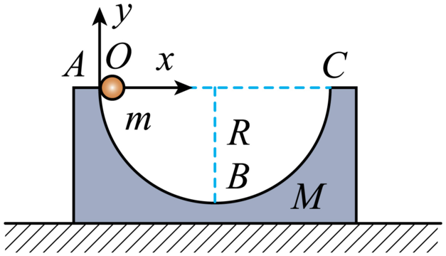

# Physics - 题目 1013

**ID**: 4a1c3ca87ec04ab4b6ba72b19b97c36b
**年级**: Grade 12
**难度**: Hard
**题型**: Calculation

## 题目
如图所示，在足够大的光滑水平地面上，静置一质量为M、半径为R且圆弧面光滑的半圆弧槽。​​​​​​​‌一质量为m（ $m>M$ ）的小球从圆弧槽左端最高点A由静止释放，小球可视为质点，整个过程圆弧槽不翻转，重力加速度为g。以A点的初始位置为坐标原点，AC方向为x轴正方向，竖直向上为y轴正方向，建立直角坐标系xOy。（1）求小球第一次运动到圆弧面右侧时能够到达的最高处的位置坐标；（2）求小球运动的轨迹方程；（3）若小球从A点由静止释放前，地面上紧贴半圆弧槽左侧放有质量为 $m{{}_{0}}=m-M$ 的滑块（与槽不粘连），求小球第n次运动到最低点B处时的速度及小球对半圆弧槽的压力。

## 解答

1. （1）假设小球第一次运动到圆弧面右侧时能够到达的最高处与A的竖直高度差为h，此时圆弧槽、小球速度相等，设为v
2. 水平方向由动量守恒有 $0=\left ({M+m}\right )v$
3. 由机械能守恒有 $mgh=\frac {1}{2}\left ({M+m}\right )v{^{2}}$
4. 解得 $v=0$ ， $h=0$
5. 说明小球恰能运动到与A等高处，且此时圆弧槽、小球速度均为0
6. 设某一时刻小球水平分速度为 $v{{}_{mx}}$ ，圆弧槽速度为 $v{{}_{M}}$
7. 对圆弧槽、小球，水平方向由动量守恒有 $0=mv{{}_{mx}}+Mv{{}_{M}}$
8. 经过一段时间微元 ${\rm{Δ}}t$ ，有 $0=mv{{}_{mx}}Δt+Mv{{}_{M}}Δt$
9. 设从释放到小球第一次运动到圆弧面右侧到达最高处的过程，小球及圆弧槽对地的位移分别为 $x{{}_{m}}$ 、 $x{{}_{M}}$
10. 求和可得 $0=mx{{}_{m}}+Mx{{}_{M}}$
11. 又有 $x{{}_{m}}-x{{}_{M}}=2R$
12. 解得 $x{{}_{m}}=\frac {2M}{M+m}R$
13. 可得小球第一次运动到圆弧面右侧时能够到达的最高处的位置坐标为 $\left ({\frac {2M}{M+m}R,0}\right )$
14. （2）设某一时刻小球的位置坐标为 $\left ({x,y}\right )$ ，圆弧面圆心P的坐标为 $\left ({x{{}_{P}},0}\right )$ 有 $0=m\left ({x-0}\right )+M\left ({x{{}_{P}}-R}\right )$
15. 此时小球到圆心距离仍为R，有 ${\left({0-y}\right)^{2}}+{\left({x{{}_{P}}-x}\right)^{2}}=R{^{2}}$
16. 可得 $\frac {{\left({x-\frac {M}{M+m}R}\right)^{2}}}{{\left({\frac {M}{M+m}R}\right)^{2}}}+\frac {y{^{2}}}{R{^{2}}}=1\left ({0⩽x⩽\frac {2M}{M+m}R,-R⩽y⩽0}\right )$
17. （3）小球从释放到第一次运动到最低点B的过程，圆弧槽向左加速，圆弧槽和滑块没有分开，小球第一次运动到最低点B时，圆弧槽与滑块向左的速度达到最大。
18. 设此时小球的速度为 $v{{}_{m}}$ ，圆弧槽与滑块的速度为 $v^{′}{{{}_{M}}}$
19. 系统水平方向动量守恒，有 $0=mv{{}_{m}}+\left ({M+m{{}_{0}}}\right )v^{′}{{{}_{M}}}$
20. 系统机械能守恒，有 $mgR=\frac {1}{2}mv{{}_{m}^{2}}+\frac {1}{2}\left ({M+m{{}_{0}}}\right )v^{′}{{{}_{M}^{2}}}$
21. 又 $m=M+m{{}_{0}}$
22. 解得 $v{{}_{m}}=\sqrt {gR}$ ， $v^{′}{{{}_{M}}}=-\sqrt {gR}$
23. 之后圆弧槽和滑块分离，不再接触。设小球第n次运动到最低点B处时小球及圆弧槽速度分别为 $v{{}_{mn}}$ 、 $v{{}_{Mn}}$
24. 小球与圆弧槽水平方向动量守恒，有 $mv{{}_{m}}+Mv^{′}{{{}_{M}}}=mv{{}_{mn}}+Mv{{}_{Mn}}$
25. 小球与圆弧槽机械能守恒，有 $\frac {1}{2}mv{{}_{m}^{2}}+\frac {1}{2}Mv^{′}{{{}_{M}^{2}}}=\frac {1}{2}mv{{}_{mn}^{2}}+\frac {1}{2}Mv{{}_{Mn}^{2}}$
26. 可得 $v{{}_{mn}}=\sqrt {gR}$ ， $v{{}_{Mn}}=-\sqrt {gR}$ （第一组解）
27. 或 $v{{}_{mn}}=\frac {m-3M}{m+M}\sqrt {gR}$ ， $v{{}_{Mn}}=\frac {3m-M}{m+M}\sqrt {gR}$ （第二组解）
28. 第一组解表示小球第1、3、5、7……次到最低点时二者的速度，小球相对圆弧槽的速度 $v{{}_{mM}}=2\sqrt {gR}$
29. 方向向右；
30. 第二组解表示小球第2、4、6、8……次到最低点时二者的速度，小球相对圆弧槽的速度 $v{{}_{mM}}=-2\sqrt {gR}$
31. 方向向左；
32. 小球每次到达圆弧槽最低点时，圆弧槽的加速度为0，以圆弧槽为参考系，小球相对圆弧槽做圆周运动，相对速度大小均相等
33. 对小球由牛顿第二定律有 $F{{}_{{\rm{N}}}}-mg=m\frac {v{{}_{mM}^{2}}}{R}$
34. 得 $F{{}_{{\rm{N}}}}=5mg$
35. 由牛顿第三定律可知小球对槽底的压力 $F^{′}{{{}_{{\rm{N}}}}}=5mg$
36. 方向向下
37. 小球奇数次到最低点时的速度为 $\sqrt {gR}$ ，方向沿x轴正方向
38. 小球偶数次到最低点时的速度方向讨论如下：
39. 若 $m-3M<0$ ，即 $M<m<3M$ ， $v{{}_{mn}}$ 为负值，则此次小球到达最低点时的速度大小为 $\frac {3M-m}{m+M}\sqrt {gR}$ ；
40. 方向沿x轴负方向
41. 若 $m-3M=0$ ，即 $m=3M$ ，则 $v{{}_{mn}}=0$ ；
42. 若 $m-3M>0$ ，即 $m>3M$ ，则 $v{{}_{mn}}$ 为正值，此次小球到达最低点时的速度大小为 $\frac {m-3M}{m+M}\sqrt {gR}$ ，方向沿x轴正方向。

## 知识点

**中文**:
  - 动量和能量的综合应用
  - 动量守恒中的多次碰撞问题
  - 竖直面内圆周运动问题

**English**:
  - Integration of Momentum and Energy
  - Multiple Collisions in Momentum Conservation
  - Circular Motion in Vertical Plane

---
