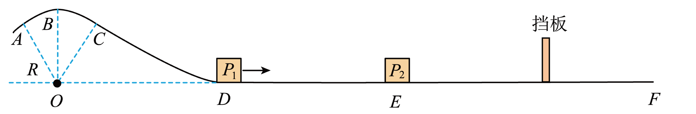
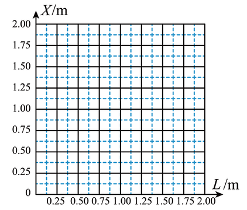

# Physics - 题目 207

**ID**: 4b0879f14c204506a01bb9c7ecb882e0
**年级**: Grade 12
**难度**: Hard
**题型**: Calculation

## 题目
某款闯关游戏简化过程如图所示。​​​​​​​‌轨道固定在竖直平面内，水平段的DE光滑、EF粗糙，EF段有一竖直固定挡板，ABCD光滑并与水平段平滑连接，ABC是以O为圆心的圆弧，B为圆弧最高点。物块 $P{{}_{2}}$ 静止于E处，物块 $P{{}_{1}}$ 从D点以初速度 $v{{}_{0}}=5{\rm{m}}/{\rm{s}}$ 水平向右运动并与 $P{{}_{2}}$ 发生弹性碰撞，且碰撞时间极短。已知： $P{{}_{1}}$ 的质量 $m{{}_{1}}=0.3{\rm{k}}{\rm{g}}$ ， $P{{}_{2}}$ 的质量 $m{{}_{2}}=0.7{\rm{k}}{\rm{g}}$ ； $P{{}_{2}}$ 与EF轨道之间的动摩擦因数 $μ=0.3$ ，与挡板碰撞时无机械能损失；圆弧半径为 $R=0.15{\rm{m}}$ ； $P{{}_{1}}$ 、 $P{{}_{2}}$ 可视为质点且运动紧贴轨道；取 $g=10{\rm{m}}/{\rm{s}}{^{2}}。$（1）求 $P{{}_{2}}$ 被碰后获得的速度大小；（2） $P{{}_{1}}$ 经过B时对圆弧的压力；（3）用L表示挡板与E的水平距离。若 $P{{}_{2}}$ 最终停在了EF段距离E为x的某处，试通过分析与计算，在图中作出 $x-L$ 图线。

## 解答

1. （1）对P_{1}、P_{2}碰撞前后，由动量守恒和能量守恒有 $m{{}_{1}}v{{}_{0}}=m{{}_{1}}v{{}_{P10}}+m{{}_{2}}v{{}_{P20}}$ ， $\frac {1}{2}m{{}_{1}}v{{}_{0}^{2}}=\frac {1}{2}m{{}_{1}}v{{}_{P10}^{2}}+\frac {1}{2}m{{}_{2}}v{{}_{P20}^{2}}$
2. 解得 $v{{}_{P}}{{}_{20}}=3{\rm{m}}{\rm{/}}{\rm{s}}$  $v{{}_{P10}}=-2{\rm{m}}{\rm{/}}{\rm{s}}$
3. （2）对P_{1}由碰后到B点，由动能定理得 $-m{{}_{1}}gR=\frac {1}{2}m{{}_{1}}v{{}_{P11}^{2}}-\frac {1}{2}m{{}_{1}}v{{}_{P10}^{2}}$
4. 对P_{1}在B点，由牛顿第二定律得： $m{{}_{1}}g-N=m{{}_{1}}\frac {v{{}_{P11}^{2}}}{R}$
5. 解得 $N=1{\rm{N}}$ ；
6. 根据牛顿第三定律，P_{1}经过B时对圆弧的压力大小为1N，方向竖直向下；
7. （3）P_{2}在水平面上运动 $（$ 不管向右还是向左运动 $）$ ： ${\rm }{\rm μm}{{}_{2}}g=m{{}_{2}}a{{}_{2}}{\rm \mathit{，}}$  $a{{}_{2}}=3{\rm{m}}{\rm{/}}{\rm{s}}{^{{{2}}}}$
8. 若挡板离E点足够远，则物块直接匀减速到0后静止
9. $0-v{{}_{0}^{2}}=-2a{{}_{2}}x$
10. 解得 $x=1.5{\rm{m}}$
11. 即 $L>1.5{\rm{m}}$ 时，物块停在距E点 $x=1.5{\rm{m}}$ 处
12. 若P_{2}与挡板碰撞一次后返回静止，由动能定理得 $-{\rm μm}{{}_{2}}g(2L-x)=0-\frac {1}{2}m{{}_{2}}v{{}_{P20}^{2}}$
13. 解得 $x=2L-1.5$
14. 其中 $0.75{\rm{m}}<x<1.5{\rm{m}}$
15. 若P_{2}与挡板碰撞一次后滑上B点，且速度不为0，则不存在x
16. 对P_{2}由碰后到恰好运动到B点，由动能定理得 $-{\rm μm}{{}_{2}}g\cdot 2L-m{{}_{2}}gR=0-\frac {1}{2}m{{}_{2}}v{{}_{P20}^{2}}$
17. 解得 $L=0.5{\rm{m}}$
18. 即 $L<0.5{\rm{m}}$ 时，物块不会停止E与挡板之间；
19. 若物块与挡板碰撞一次后滑上圆弧，并从圆弧滑回，能从圆弧滑下到E点的最大速度为物块恰好从运动到B点时对应经过E点的速度 $v{{}_{E}}{^{2}}=3{\rm{m}}{^{{{2}}}}{\rm{/}}{\rm{s}}{^{{{2}}}}$
20. 此时停下点到E点的距离 $x=\frac {0-v{{}_{E}^{2}}}{-2a{{}_{2}}}=0.5{\rm{m}}$
21. 则物块与挡板最多只能碰撞一次；
22. 对P_{2}由碰后到最终静止在EF上，由动能定理得 $-{\rm μm}{{}_{2}}g(2L+x)=0-\frac {1}{2}m{{}_{2}}v{{}_{P20}^{2}}$
23. 解得 $x=1.5-2L$
24. 其中 $0.5{\rm{m}}<x<0.75{\rm{m}}$
25. 综上， ${\rm \mathit{x}}-L$ 关系图像如图
26. 

## 知识点

**中文**:
  - 动量和能量的综合应用
  - 竖直面内圆周运动问题

**English**:
  - Integration of Momentum and Energy
  - Circular Motion in Vertical Plane

---
