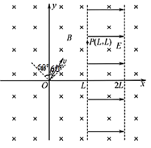

# Physics - 题目 2657

**ID**: 5185d93ca18143d49c44c8bdb199199e
**年级**: Grade 12
**难度**: Hard
**题型**: Calculation

## 题目
如图所示，在xOy平面内存在区域足够大的方向垂直纸面向里的匀强磁场，磁感应强度大小为B。​​​​​​​‌位于坐标原点O处的离子源能在xOy平面内持续发射质量为m、电荷量为q的负离子，其速度方向与y轴夹角θ的最大值为60°，且各个方向速度大小随θ变化的关系为 $v=\frac {v{{}_{0}}}{{\rm{c}}{\rm{o}}{\rm{s}}θ}$ ，式中v_{0}为未知定值，且 $θ=0$ 的离子恰好通过坐标为（L，L）的P点。不计离子的重力及离子间的相互作用，并忽略磁场的边界效应。（1）求关系式 $v=\frac {v{{}_{0}}}{{\rm{c}}{\rm{o}}{\rm{s}}θ}$ 中v_{0}的值；（2）求离子到达界面 $x=L$ 之前在磁场中运动的最短时间与最长时间；（3）为回收离子，在界面 $x=L$ 右侧加一宽度为 $L$ 且平行于+x轴的匀强电场，如图所示，为使所有离子都不能穿越电场区域，求电场强度的最小值E。

## 解答

1. （1）当 $θ=0$ 时，粒子的速度为 $v=\frac {v{{}_{0}}}{{\rm{c}}{\rm{o}}{\rm{s}}θ}=v{{}_{0}}$
2. 根据题意，以v_{0}速度沿+y方向从O点入射的离子恰好通过坐标为（L，L）的P点。
3. 其轨道半径为 $R=L$
4. 根据牛顿第二定律得 $qv{{}_{0}}B=m\frac {v{{}_{0}^{2}}}{R}$
5. 解得 $v{{}_{0}}=\frac {qBL}{m}$
6. （2）根据牛顿第二定律得 $qvB=m\frac {v{^{2}}}{r}$
7. 根据题意得 $v=\frac {v{{}_{0}}}{{\rm{c}}{\rm{o}}{\rm{s}}θ}$
8. 解得 $r=\frac {L}{{\cos}θ}$
9. 则所有离子运动轨迹圆心均在 $x=L$ 的界面上，并且所有离子均垂直打在 $x=L$ 界面上。
10. 沿与+y方向成60°角从O点向左上方入射的离子，到达界面 $x=L$ 之前，在磁场中运动时间最长 $t{{}_{{\rm \max }}}=\frac {150{}\degree }{360{}\degree }T$
11. 离子运动的周期为 $T=\frac {2πm}{qB}$
12. 解得 $t{{}_{{\rm \max }}}=\frac {5πm}{6qB}$
13. 沿与+y方向成60°角从O点向右上方入射的离子，到达界面 $x=L$ 之前，在磁场中运动的时间最短 $t{{}_{{\rm \min }}}=\frac {30{}\degree }{360{}\degree }T$
14. 解得 $t{{}_{{\rm \min }}}=\frac {πm}{6qB}$
15. （3）当速度最大的离子不能穿越电场区域时，所有离子都不能穿越电场区域，最大速度为 $v{{}_{{\rm{m}}}}=\frac {v{{}_{0}}}{{\rm{c}}{\rm{o}}{\rm{s}}60{}\degree }=2v{{}_{0}}$
16. 设离子在叠加场中运动Δt时间，速度的竖直分量为v_{y}，由动量定理可得 $qv{{}_{x}}BΔt=mv{{}_{y}}$
17. 离子到达 $x=2L$ 界面时的水平速度为0，设离子到达 $x=2L$ 界面时的竖直速度为v_{2}。
18. 对 $qv{{}_{x}}BΔt=mv{{}_{y}}$ 两边求和得 $qBL=mv{{}_{2}}$
19. 解得 $v{{}_{2}}=v{{}_{0}}$
20. 在叠加场中根据动能定理得 $-qEL=\frac {1}{2}mv{{}_{0}^{2}}-\frac {1}{2}mv{{}_{{\rm{m}}}^{2}}$
21. 解得 $E=\frac {3qB{^{2}}L}{2m}$

## 知识点

**中文**:
  - 带电粒子在组合场中的运动

**English**:
  - Motion in Combined Fields

---
