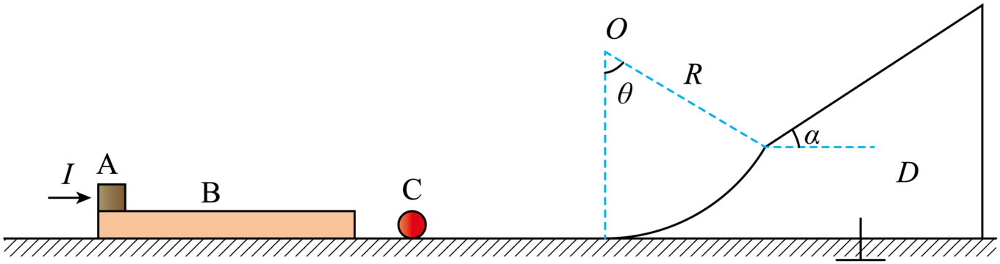

# Physics - 题目 1458

**ID**: 5216b01479bb460e9a449d9e877e18bf
**年级**: Grade 12
**难度**: Hard
**题型**: Calculation

## 题目
如图所示，水平地面上固定一滑槽D，其上表面由底部与地面相切且圆心角为 $θ$ 的圆弧面和与水平方向成倾角为 $α\left ({α<θ}\right )$ 的足够长斜面连接组成，滑槽的左侧地面上放有物块A、长平板B和小球C，其中A放在B的左端。​​​​​​​‌现对A施加一方向水平向右的瞬时冲量 $I=0.7{\rm{N}}\cdot {\rm{s}}$ ，使A获得一个初速度，一段时间后B、C发生碰撞，碰后C恰好能到达圆弧的最上端，此时A与B已共速。已知圆弧的半径为 $R=0.4{\rm{m}}$ ， $θ=60{}\degree {\rm ，A}$ 、B、C的质量分别为 $m{{}_{{\rm{A}}}}=0.1{\rm{k}}{\rm{g}}$ 、 $m{{}_{{\rm{B}}}}=0.2{\rm{k}}{\rm{g}}$ 、 $m{{}_{{\rm{C}}}}=0.2{\rm{k}}{\rm{g}}{\rm ，A}$ 和C均可视为质点，所有的碰撞均为弹性碰撞且时间极短，除A与B间有摩擦力外，不计其它一切阻力，长平板B不会冲上滑槽D。求：（1）C滑上圆弧轨道最低点时，圆弧轨道对C的支持力大小；（2）B、C第一次碰撞结束时，A的速度大小；（3）B、C第二次碰撞前，A、B间摩擦产生的内能；（4）若C以一定的速度从圆弧上端沿切向飞出，要使C原路返回圆弧，则斜面倾角α应满足什么条件。（答案用含字母α、θ的三角函数表示）

## 解答

1. （1）碰后C恰好能到达圆弧的最上端，则它在底部时的动能等于升至顶端所增加的重力势能。则有 $\frac {1}{2}m{{}_{{\rm{C}}}}v{{}_{{\rm{C}}}}{^{2}}=m{{}_{{\rm{C}}}}gR(1-{\cos}θ)$ ，
2. 解得小球C在底部的速度v_{C}_{ }= 2 m/s，
3. 在最低点，圆弧对小球的支持力 $N=m{{}_{{\rm{C}}}}g+m{{}_{{\rm{C}}}}\frac {v{{}_{{\rm{C}}}}²}{R}=4{\rm{N}}$ 。
4. （2）A、 B系统在水平方向上只受最初冲量I= 0.7 N·s，故有动量定理可得，和C碰撞前，A、 B的总动量 $p{{}_{AB�}}=I=�0.7�kg·{\rm{m}}/{\rm{s}}$ ，
5. 设第一次碰撞前瞬间 B 的速度为v_{B1}，A 的速度为v_{A1}；C初始静止且与B质量相等，则一次弹性碰撞后B速度变为零、C 获得速度 $v{{}_{{\rm{C}}}}=v{{}_{{\rm{B}}1}}=2{\rm{m}}/{\rm{s}}$ ，
6. 由A、 B总动量守恒有 $m{{}_{{\rm{A}}}}v{{}_{{\rm{A}}1�}}+m{{}_{{\rm{B}}}}v{{}_{{\rm{B}}1}}=p{{}_{AB}}�$ ，
7. 解得v_{A1}= 3 m/s，
8. 由于碰撞极短且A并未与C接触，碰撞前后A的速度不变，因此第一次碰撞结束时A的速度为3 m/s。
9. （3）开始时 $v{{}_{{\rm{A}}}}=\frac {I}{m{{}_{{\rm{A}}}}}=7{\rm{m}}{\rm{/}}{\rm{s}}$ ，
10. 到B与C碰撞前有v_{A1}= 3 m/s，v_{B1}= 2 m/s，
11. 此过程摩擦产生的热量 $Q{{}_{1}}=\frac {1}{2}m{{}_{{\rm{A}}}}v{{}_{{\rm{A}}}}{^{2}}-(\frac {1}{2}m{{}_{{\rm{A}}}}v{{}_{{\rm{A}}{{1}}}}{^{2}}+\frac {1}{2}m{{}_{{\rm{B}}}}v{{}_{{\rm{B}}{{1}}}}{^{2}})=1.6{\rm{J}}$ ，
12. 从第一次碰撞结束时v_{A1}'=v_{A1}= 3 m/s，v_{B1}'= 0，
13. 到第二次碰撞前A、B“共速”有 $m{{}_{{\rm{A}}}}v{{}_{{\rm{A}}1}}^{′}+m{{}_{{\rm{B}}}}v{{}_{{\rm{B}}1}}^{′}=\left ({m{{}_{A}}+m{{}_{B}}}\right )v{{}_{共}}$ ，
14. 解得v_{共}= 1 m/s，
15. 此过程摩擦产生的热量 $Q{{}_{2}}=\frac {1}{2}m{{}_{{\rm{A}}}}v{{}_{{\rm{A}}{{1}}}}^{′}{^{2}}-\frac {1}{2}\left ({m{{}_{{\rm{A}}}}+m{{}_{{\rm{B}}}}}\right )v{{}_{共}}{^{^{′}2}}=0.3{\rm{J}}$ ，
16. 所以在B、C第二次碰撞前，A、B间摩擦产生的内能 $Q=Q{{}_{1}}+Q{{}_{2}}=1.9{\rm{J}}$ 。
17. （4）满足题目条件有两种情形，如图：
18. 
19. 将C的速度和加速度沿斜面和垂直斜面分解：
20. 沿斜面分量： $v{{}_{x}}=v{\cos}\left ({θ-α}\right ),a{{}_{x}}=g\sin α$ ，
21. 垂直斜面分量： $v{{}_{y}}=v\sin \left ({θ-α}\right ),a{{}_{y}}=g{\cos}α$ ，
22. 由于C和斜面的碰撞为弹性碰撞，但是无速度损失，则 $t{{}_{0}}=\frac {v{{}_{y}}}{a{{}_{y}}}=\frac {v\sin \left ({θ-α}\right )}{g{\cos}α}$ ，
23. 第一种情况最后垂直打到斜面，沿斜面方向速度减到0，则需要满足 $v{\cos}\left ({θ-α}\right )=g\sin α\times 2kt{{}_{0}}$ ，其中 $k=1,2,3,\cdots $
24. 第二种情况是最后一次打到斜面之后垂直斜面方向速度为0时，沿着斜面方向的速度同时为0（即最后一次打到斜面后的C竖直上抛），此情况 $v{\cos}\left ({θ-α}\right )=g\sin α\times \left ({2k+1}\right )t{{}_{0}}$ ，其中 $k=0,1,2,3,\cdots $
25. 综合可得要使C原路返回圆弧，需要满足 $v{\cos}\left ({θ-α}\right )=g\sin α\times nt{{}_{0}}$ ，其中 $n=1,2,3,\cdots $
26. 化简得 ${\tan}α\cdot {\tan}\left ({θ-α}\right )=\frac {1}{n},n=2，3\cdots $ （ $θ=60{}\degree ，n=1$ 时无解）。

## 知识点

**中文**:
  - 动量和能量的综合应用
  - 动量守恒中的多次碰撞问题

**English**:
  - Integration of Momentum and Energy
  - Multiple Collisions in Momentum Conservation

---
