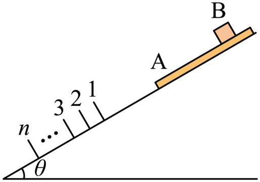

# Physics - 题目 1323

**ID**: 53e6ddd0370848a4a0a8a9c9265fabc4
**年级**: Grade 12
**难度**: Hard
**题型**: Calculation

## 题目
如下图所示，有一足够长的斜面固定在水平地面上，它与水平方向的夹角 $θ=30{^{\circ }}$ ，斜面上每隔 $d=0.4{\rm{m}}$ 固定一个挡板，从上往下依次标记为 $1,2,3\cdots n\left ({n\to \infty }\right )$ 。​​​​​​​‌挡板1的上方某处有一厚度均匀、质量为 $m$ 的长木板A，A的上表面放有一质量为 $m$ 的小物块B，B与A之间动摩擦因数 $μ{{}_{1}}=\frac {\sqrt {3}}{2}{\rm ，A}$ 与斜面之间动摩擦因数 $μ{{}_{2}}=\frac {\sqrt {3}}{3}$ ，最初A、B均处于静止状态。现给物块B一个平行于木板斜向下、大小 $F=mg$ 的作用力，经 $0.9{\rm{s}}$ 后撤去。再经 $1{\rm{s}}$ 后，木板A与挡板1发生碰撞。若木板A每次与挡板碰撞都以碰前的速度反弹，且每次与挡板碰后立即撤离被碰挡板，物块B始终没有与挡板相碰，B也始终没有滑离木板A，重力加速度 $g=10{\rm{m}}/{\rm{s}}{^{2}}$ ，最大静摩擦力与滑动摩擦力大小相等。求：（1） $F$ 作用的 $0.9{\rm{s}}$ 内A、B的加速度大小；（2）A与挡板1碰撞时的速度大小；（3）B在A上面滑行时，B相对于A滑行的总路程（结果保留2位有效数字）。

## 解答

1. （1）设F作用的内A、B的加速度大小分别为 $a{{}_{1}}$ 、 $a{{}_{2}}$ ，则对A、B分别受力分析，由牛顿第二定律可得 $mg\sin θ+μ{{}_{1}}mg{\cos}θ-μ{{}_{2}}\cdot 2mg{\cos}θ=ma{{}_{1}}$ ， $F+mg\sin θ-μ{{}_{1}}mg{\cos}θ=ma{{}_{2}}$ ，代入数据可得 $a{{}_{1}}=2.5{\rm{m}}{\rm{/}}{\rm{s}}{^{2}}$ ， $a{{}_{2}}=7.5{\rm{m}}{\rm{/}}{\rm{s}}{^{2}}$ 。
2. （2）刚撤去F时A的加速度不变，B的加速度设为 $a{{}_{3}}$ ，对B受力分析，由牛顿第二定律得 $μ{{}_{1}}mg{\cos}θ-mg\sin θ=ma{{}_{3}}$ ，代入数据可得 $a{{}_{3}}=2.5{\rm{m}}{\rm{/}}{\rm{s}}{^{2}}{\rm ，A}$ 继续加速B以减速直至共速，设F作用的时间为t，撤去F后经 $t^{′}$ 两者达到共同速度 $v{{}_{1}}$ ，则 $v{{}_{1}}=a{{}_{2}}t-a{{}_{3}}t^{′}=a{{}_{1}}(t+t^{′})$ ，代入数据可得 $v{{}_{1}}=4.5{\rm{m}}{\rm{/}}{\rm{s}}$ ， $t^{′}=0.9{\rm{s}}$ ，因 $μ{{}_{1}}>μ{{}_{2}}={\tan}θ$ ，之后0.1s两者一起匀速直至与第一个固定挡板碰撞，A与挡板1碰撞时的速度大小 $v{{}_{1}}=4.5{\rm{m}}{\rm{/}}{\rm{s}}$ 。
3. （3）与第一个挡板碰前B相对于A滑行的路程 $s{{}_{0}}=\frac {1}{2}a{{}_{2}}t{^{2}}+\frac {a{{}_{2}}t+v{{}_{1}}}{2}t^{′}-\frac {v{{}_{1}}}{2}(t+t^{′})=4.05{\rm{m}}$ ，与第一个挡板碰后瞬间B速度不变之后以减速，A速度大小不变方向相反，设其加速度为 $a{{}_{4}}$ ，受力分析由牛顿第二定律可得 $mg\sin θ+μ{{}_{1}}mg{\cos}θ+μ{{}_{2}}\cdot 2mg{\cos}θ=ma{{}_{4}}$ ，代入数据可得 $a{{}_{4}}=22.5{\rm{m}}{\rm{/}}{\rm{s}}{^{2}}$ ，则A速度先减速到0，其位移 $x{{}_{{{1}}}}$ 及所用时间 $t{{}_{1}}$ 为 $x{{}_{1}}=\frac {v{{}_{1}^{2}}}{2a{{}_{4}}}=0.45{\rm{m}}$ ， $t{{}_{1}}=\frac {v{{}_{1}}}{a{{}_{4}}}=0.2{\rm{s}}$ ，之后A以 $a{{}_{1}}$ 反向沿斜面向下加速B仍 $a{{}_{3}}$ 以减速至达到共同速度 $v{{}_{2}}$ ，用时 $t^{′}{{{}_{1}}}$ ，则 $v{{}_{2}}=v{{}_{1}}-a{{}_{3}}(t{{}_{1}}+t^{′}{{{}_{1}}})=a{{}_{1}}t^{′}{{{}_{1}}}$ ，代入数据可得 $v{{}_{2}}=2{\rm{m}}{\rm{/}}{\rm{s}}$ ， $t^{′}{{{}_{1}}}=0.8{\rm{s}}{\rm ，A}$ 沿斜面加速的位移 $x^{′}{{{}_{1}}}$ 为 $x{{}_{2}}=\frac {v{{}_{2}^{2}}}{2a{{}_{1}}}=0.8{\rm{m}}$ ，由几何关系可知此时A距离第二个固定挡板还有 $\Delta x=d+x{{}_{1}}-x{{}_{2}}=0.05{\rm{m}}$ ，因为 $μ{{}_{1}}>μ{{}_{2}}={\tan}θ$ ，两者一起匀速直至与第二个固定挡板碰撞，与第一个固定挡板碰撞到与第二个固定挡板碰撞这个过程B相对于A滑行 $s{{}_{1}}=\frac {v{{}_{1}^{2}}-v{{}_{2}^{2}}}{2a{{}_{3}}}+x{{}_{1}}-x{{}_{2}}=2.9{\rm{m}}$ ，之后的过程与此类似，可以以此类推设，与第n个固定挡板碰撞时的速度为 $v{{}_{n}}$ ，则有 $v{{}_{n+1}}=v{{}_{n}}-a{{}_{3}}(\frac {v{{}_{n}}}{a{{}_{4}}}+\frac {v{{}_{n+1}}}{a{{}_{1}}})$ ，即 $v{{}_{n+1}}=\frac {4}{9}v{{}_{n}}$ ，与第n个固定挡板碰撞后至与第n+1个固定挡板碰撞前B相对于A滑行的路程 $s{{}_{n}}=\frac {v{{}_{n}^{2}}-v{{}_{n+1}^{2}}}{2a{{}_{3}}}+\frac {v{{}_{n}^{2}}}{2a{{}_{4}}}-\frac {v{{}_{n+1}^{2}}}{2a{{}_{1}}}$ ， $s{{}_{n+1}}=\frac {v{{}_{n+1}^{2}}-v{{}_{n+2}^{2}}}{2a{{}_{3}}}+\frac {v{{}_{n+1}^{2}}}{2a{{}_{4}}}-\frac {v{{}_{n+2}^{2}}}{2a{{}_{1}}}$ ，即 $s{{}_{n+1}}=\frac {16}{81}s{{}_{n}}{\rm ，B}$ 在A上面滑行时，B相对于A滑行的总路程 $s{{}_{n}}=s{{}_{0}}+s{{}_{1}}+s{{}_{2}}+\cdots +s{{}_{n}}=4.05+2.9\times [1+\frac {16}{81}+(\frac {16}{81}){^{2}}+\cdots +(\frac {16}{81}){^{n-1}}]{\rm{m}}\approx {{7}}{{.}}{{7}}{\rm{m}}$ 。

## 知识点

**中文**:
  - 动量守恒中的多次碰撞问题

**English**:
  - Multiple Collisions in Momentum Conservation

---
