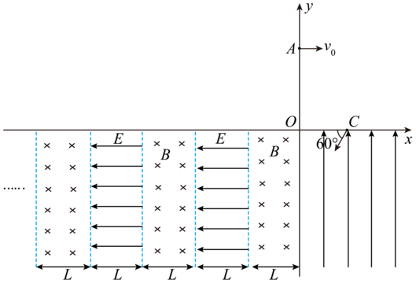

# Physics - 题目 177

**ID**: 69eea1bcc9294cacbcef4eb4325f9280
**年级**: Grade 12
**难度**: Hard
**题型**: Calculation

## 题目
如图所示，在第一象限中有一匀强磁场（图中未画出），一带正电的粒子（不计重力）从y轴上A点沿x轴正向以初速度 $v{{}_{0}}$ 进入匀强磁场区域，A点坐标为 $\left ({0，\frac {3}{2}L}\right )$ ，从x轴上的C点出磁场并进入第四象限的匀强电场区域，方向与x轴负向成60°角。​​​​​​​‌粒子经过此电场区域后恰好垂直于y轴进入第三象限的电、磁场区域，它们的宽度都为L，其中磁感应强度为 $B=\frac {mv{{}_{0}}}{4qL}$ ，电场强度为 $E=\frac {mv{{}_{0}^{2}}}{8qL}$ ，粒子的质量为m、电荷量为q，虚线边界有电场。求：（1）第一象限中匀强磁场的磁感应强度 $B{{}_{1}}$ 的大小和方向；（2）粒子刚进入第三象限中的第二个磁场区域时的速度大小；（3）整个运动过程中，粒子距离y轴最远的水平距离。

## 解答

1. （1）带电粒子在第一象限的磁场中做匀速圆周运动，如图所示，
2. 
3. 由几何关系有 $r\left ({1+{\cos}θ}\right )=\frac {3}{2}L$ ，解得 $r{\rm =\mathit{L}}$ ，洛伦兹力提供向心力，有 $qv{{}_{0}}B=m\frac {v{{}_{0}^{2}}}{r}$ ，解得 $B=\frac {mv{{}_{0}}}{qL}$ ，方向垂直于纸面向里。
4. （2）设粒子刚进入第三象限磁场时的速度为 $v{{}_{1}}$ ，粒子恰好垂直于y轴进入第三象限，在第四象限内运动时，竖直方向上的速度变为0，水平方向上的速度不变，则 $v{{}_{1}}=v{{}_{0}}{\cos}60{}^\circ =\frac {v{{}_{0}}}{2}$ ，粒子在磁场中做匀速圆周运动，有 $qv{{}_{1}}B=m\frac {v{{}_{1}^{2}}}{r^{′}}$ ，则 $r^{′}=\frac {mv{{}_{1}}}{qB}=2L$ ，即 $\frac {L}{r^{′}}=\frac {1}{2}$ ，由几何关系可得，粒子出磁场时与水平方向的夹角为30°，则粒子刚进入电场区域时水平方向的速度为 $v{{}_{1x}}=v{{}_{1}}{\cos}30{}^\circ =\frac {\sqrt {3}v{{}_{0}}}{4}$ ，竖直方向的速度为 $v{{}_{1y}}=v{{}_{1}}\sin 30{}^\circ =\frac {v{{}_{0}}}{4}$ ，由运动学公式有 $v{{}_{2x}^{2}}-v{{}_{1x}^{2}}=2aL$ ，根据牛顿第二定律，有 $qE=ma$ ，所以粒子刚进入第三象限中的第二个磁场区域时的速度大小为 $v{{}_{2}}=\sqrt {v{{}_{2x}}{^{2}}+v{{}_{1y}}{^{2}}}=\frac {\sqrt {2}}{2}v{{}_{0}}$ 。
5. （3）方法一：设粒子在第三象限运动过程中，从右向左在第n层磁场中运动速度为 $v{{}_{n}}$ ，轨道半径为 $r{{}_{n}}$ ，则有 $\left ({n-1}\right )qEL=\frac {1}{2}mv{{}_{n}^{2}}-\frac {1}{2}mv{{}_{1}^{2}}$ ， $qv{{}_{n}}B=m\frac {v{{}_{n}^{2}}}{r{{}_{n}}}$ ，则 $v{{}_{n}}=\frac {\sqrt {n}}{2}v{{}_{0}}$ ， $r{{}_{n}}=2\sqrt {n}L$ ，粒子进入第n层电场时，速度方向与水平方向的夹角为 $α{{}_{n}}$ ，从第n层电场左边界穿出时速度方向与水平方向的夹角为 $θ{{}_{n}}$ ，粒子在电场中运动时，垂直电场线方向的速度分量不变，有 $v{{}_{n-1}}\sin α{{}_{n-1}}=v{{}_{n}}\sin θ{{}_{n-1}}$ ， $r{{}_{n}}\sin α{{}_{n}}-r{{}_{n}}\sin θ{{}_{n-1}}=L$ ，解得 $r{{}_{n}}\sin α{{}_{n}}-r{{}_{n-1}}\sin α{{}_{n-1}}=L$ ，可知 $r{{}_{1}}\sin α{{}_{1}}$ 、 $r{{}_{2}}\sin α{{}_{2}}$ 、 $r{{}_{3}}\sin α{{}_{3}}$ 、……、 $r{{}_{n}}\sin α{{}_{n}}$ 是一组等差数列，公差为L，可得 $r{{}_{n}}\sin α{{}_{n}}=r{{}_{1}}\sin α{{}_{1}}+\left ({n-1}\right )L=nL$ ，将 $r{{}_{n}}=2\sqrt {n}L$ 代入，得 $\sin α{{}_{n}}=\frac {\sqrt {n}}{2}$ ，由于 $\sin α{{}_{n}}\leqslant 1$ ，则 $n\leqslant 4$ ，由于 $n>1$ ，且为整数，n的最大值为4，此时 $\sin θ{{}_{4}}=\frac {v{{}_{4}}}{v{{}_{5}}}\sin α{{}_{4}}=\frac {2\sqrt {5}}{5}$ ， $r{{}_{5}}=2\sqrt {5}L$ ，即粒子在第5层磁场中达到轨迹最左端，此时速度竖直向下，由几何关系得轨迹最左端距离第5层磁场右边界距离为 $Δx=r{{}_{5}}-r{{}_{5}}\sin θ{{}_{4}}=\left ({2\sqrt {5}-4}\right )L$ ，综上，轨迹最左端离y轴的水平距离为 $x{{}_{{\rm{m}}}}=n\cdot 2L+ΔS=\left ({4+2\sqrt {5}}\right )L$ 。
6. 方法二：设在第n个磁场中最远，则由动量定理有 $\sum ^{}\mathop{}qv{{}_{x}}B\cdot Δt=mΔv{{}_{y}}$ ， $qBx{{}_{磁}}=mv{{}_{y}}$ ，由能量守恒定律，有 $qE\left ({n-1}\right )L=\frac {1}{2}mv{{}_{y}^{2}}-\frac {1}{2}mv{{}_{1}^{2}}$ ， $x{{}_{磁}}=2\sqrt {n}L$ ， $\left ({n-1}\right )L<x{{}_{磁}}<nL$ ， $3-2\sqrt {2}<n<3+2\sqrt {2}$ ，则 $n=5$ ，解得 $x{{}_{{\rm{m}}}}=\left ({4+2\sqrt {5}}\right )L$ 。

## 知识点

**中文**:
  - 带电粒子在组合场中的运动

**English**:
  - Motion in Combined Fields

---
