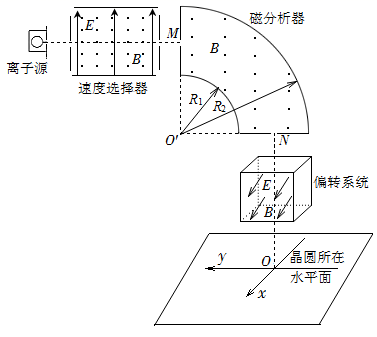

# Physics - 题目 1427

**ID**: 73e975cedebc4e738f529bef065d7f0f
**年级**: Grade 12
**难度**: Hard
**题型**: Calculation

## 题目
在芯片制造过程中，离子注入是其中一道重要的工序。​​​​​​​‌如图所示是离子注入工作原理示意图，离子经加速后沿水平方向进入速度选择器，然后通过磁分析器，选择出特定比荷的离子，经偏转系统后注入处在水平面内的晶圆（硅片）。速度选择器、磁分析器和偏转系统中的匀强磁场的磁感应强度大小均为B，方向均垂直纸面向外；速度选择器和偏转系统中的匀强电场场强大小均为E，方向分别为竖直向上和垂直纸面向外。磁分析器截面是内外半径分别为R_{1}和R_{2}的四分之一圆环，其两端中心位置M和N处各有一个小孔；偏转系统中电场和磁场的分布区域是同一边长为L的正方体，其偏转系统的底面与晶圆所在水平面平行，间距也为L。当偏转系统不加电场及磁场时，离子恰好竖直注入到晶圆上的O点（即图中坐标原点，x轴垂直纸面向外）。整个系统置于真空中，不计离子重力，打在晶圆上的离子，经过电场和磁场偏转的角度都很小。当α很小时，有 ${\sin}α\approx {\tan}α\approx α$ ， ${\cos}α\approx 1-\frac {1}{2}α{^{2}}$ 。求：(1)离子通过速度选择器后的速度大小v和磁分析器选择出来离子的比荷；(2)偏转系统仅加电场时离子注入晶圆的位置，用坐标(x，y)表示；(3)偏转系统仅加磁场时离子注入晶圆的位置，用坐标(x，y)表示；(4)偏转系统同时加上电场和磁场时离子注入晶圆的位置，用坐标(x，y)表示，并说明理由。

## 解答

1. (1)通过速度选择器离子的速度
2. ${\rm v=\frac {E}{B}}$
3. 从磁分析器中心孔N射出离子的运动半径为
4. ${\rm R=\frac {R{{}_{1}}+R{{}_{2}}}{2}}$
5. 由 ${\rm \frac {mv{^{2}}}{R}=qvB}$ 得
6. ${\rm \frac {q}{m}=\frac {v}{RB}=\frac {2E}{(R{{}_{1}}+R{{}_{2}})B{^{2}}}}$
7. (2)经过电场后，离子在x方向偏转的距离
8. ${\rm x{{}_{1}}=\frac {1}{2}\frac {qE}{m}{\left({\frac {L}{v}}\right)^{2}}}$
9. ${\rm {\tan}θ=\frac {qEL}{mv{^{2}}}}$
10. 离开电场后，离子在x方向偏移的距离
11. ${\rm x{{}_{2}}=L{\tan}θ=\frac {qEL{^{2}}}{mv{^{2}}}}$
12. ${\rm x=x{{}_{1}}+x{{}_{2}}=\frac {3qEL{^{2}}}{2mv{^{2}}}=\frac {3L{^{2}}}{R{{}_{1}}+R{{}_{2}}}}$
13. 位置坐标为( ${\rm \frac {3L{^{2}}}{R{{}_{1}}+R{{}_{2}}}}$ ，0)
14. (3)离子进入磁场后做圆周运动半径
15. ${\rm r=\frac {mv}{qB}}$
16. ${\rm {\sin}α=\frac {L}{r}}$
17. 经过磁场后，离子在y方向偏转距离
18. ${\rm y{{}_{1}}=r(1-{\cos}α)\approx \frac {L{^{2}}}{R{{}_{1}}+R{{}_{2}}}}$
19. 离开磁场后，离子在y方向偏移距离
20. ${\rm y{{}_{2}}=L{\tan}α\approx \frac {2L{^{2}}}{R{{}_{1}}+R{{}_{2}}}}$
21. 则
22. ${\rm y=y{{}_{1}}+y{{}_{2}}\approx \frac {3L{^{2}}}{R{{}_{1}}+R{{}_{2}}}}$
23. 位置坐标为(0， ${\rm \frac {3L{^{2}}}{R{{}_{1}}+R{{}_{2}}}}$ )
24. 
25. (4)注入晶圆的位置坐标为( ${\rm \frac {3L{^{2}}}{R{{}_{1}}+R{{}_{2}}}}$ ， ${\rm \frac {3L{^{2}}}{R{{}_{1}}+R{{}_{2}}}}$ ),电场引起的速度增量对y方向的运动不产生影响。

## 知识点

**中文**:
  - 带电粒子在叠加场中的运动
  - 带电粒子在组合场中的运动
  - 速度选择器

**English**:
  - Motion in Superimposed Fields
  - Motion in Combined Fields
  - Velocity Selector

---
