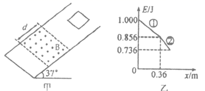

# Physics - 题目 2290

**ID**: 75edb098ba8e4ab980c17109739c85ad
**年级**: Grade 12
**难度**: Hard
**题型**: Calculation

## 题目
如图甲所示，斜面倾角为θ=37^{°}，一宽为d=0.​​​​​​​‌65m的有界匀强磁场垂直于斜面向上，磁场边界与斜面底边平行．在斜面上由静止释放一矩形金属线框，线框沿斜面下滑，下边与磁场边界保持平行．取斜面底部为重力势能零势能面，从线框开始运动到恰好完全进入磁场的过程中，线框的机械能E和位移x之间的关系如图乙所示，图中①、②均为直线段．已知线框的质量为M=0.1 kg，电阻为R=0.06 Ω．（取g=10m·s^{-2}, sin 37^{°}=0.6, cos 37^{°}=0.8)求：(1)线框与斜面间的动摩擦因数μ；(2)线框刚进入磁场到恰好完全进入磁场所用的时间t：(3)线框穿越磁场的过程中，线框中的最大电功率P_{m}．

## 解答

1. （1）由能量守恒定律，线框减小的机械能等于克服摩擦力做功，则 $ΔE{{}_{1}}=W{{}_{f1}}={\rm μm}g{\rm{c}}{\rm{o}}{\rm{s}}30^\circ x{{}_{1}}$
2. 其中x_{1}=0.36m； $ΔE{{}_{1}}=\left ({1.000-0.856}\right )J=0.144J$
3. 解得μ=0.5
4. （2）金属线框进入磁场的过程中，减小的机械能等于克服摩擦力和安培力做的功，机械能均匀减小，因此安培力也是恒力，线框做匀速运动，速度为v_{1}
5. v_{1}^{2}=2ax_{1}
6. $mg{\rm{s}}{\rm{i}}{\rm{n}}37^\circ -{\rm μm}g{\rm{c}}{\rm{o}}{\rm{s}}37^\circ =ma$
7. 解得a=2m/s^{2}v_{1}=1.2m/s
8. $ΔE{{}_{2}}=W{{}_{f2}}+W{{}_{A}}=\left ({f+F{{}_{A}}}\right )x{{}_{2}}$
9. 其中 $ΔE{{}_{2}}=\left ({0.856-0.736}\right )J=0.12J$    $f+F{{}_{A}}=mg{\rm{s}}{\rm{i}}{\rm{n}}37^\circ =0.6N$  x_{2}为线框的侧边长，即线框进入磁场过程中运动的距离，可求出x_{2}=0.2m，
10. 则 $t=\frac {x{{}_{2}}}{v{{}_{1}}}=\frac {0.2}{0.2}s=\frac {1}{6}s$
11. （3）线框刚出磁场时速度最大，线框内电功率最大 $P{{}_{m}}=\frac {B{^{2}}L{^{2}}v{{}_{2}^{2}}}{R}$
12. 由 $v{{}_{2}^{2}}-v{{}_{1}^{2}}=2a\left ({d-x{{}_{2}}}\right )$  可求得v_{2}=1.8m/s
13. 根据线框匀速进入磁场时： $F{{}_{A}}+{\rm μm}g{\rm{c}}{\rm{o}}{\rm{s}}37^\circ =mg{\rm{s}}{\rm{i}}{\rm{n}}37^\circ $
14. 可得F_{A}=0.2N
15. 又因为 $F{{}_{A}}=\frac {B{^{2}}L{^{2}}v{{}_{1}}}{R}$
16. 可得 $B{^{2}}L{^{2}}=0.01\left ({T{^{2}}\cdot m{^{2}}}\right )$
17. 将v_{2}、B^{2}L^{2}带入可得： $P{{}_{m}}=\frac {B{^{2}}L{^{2}}v{{}_{2}^{2}}}{R}{\rm{=}}0.54W$

## 知识点

**中文**:
  - 电磁感应现象中的功能问题
  - 线框模型

**English**:
  - Work-Energy Problems in EM Induction
  - Wire Frame Model

---
