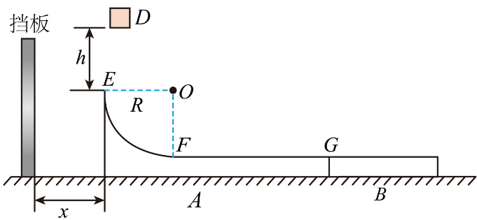

# Physics - 题目 89

**ID**: 7a4ccac5931140ccaceb9abd8c733cd3
**年级**: Grade 12
**难度**: Hard
**题型**: Calculation

## 题目
如图所示，在水平面上静止放置轨道A，其由半径为R=0.4 m的光滑 $\frac {1}{4}$ 圆弧轨道EF和水平轨道FG两部分组成，左侧x=0.325 m处固定一竖直挡板，右侧紧挨着一木板B与其等厚。​​​​​​​‌现由E点正上方h=0.2 m处由静止释放物块D。一段时间后物块D沿轨道A滑到最右端C且二者恰好达到向右的共同速度。已知轨道A的质量m_{A}=3 kg，木板B的质量m_{B}=9 kg，物块D的质量m_{D}=1 kg。不计轨道A与水平面间的摩擦，物块D与水平轨道FC间的动摩擦因数为 $μ{{}_{1}}$ =0.5，与木板B的动摩擦因数为 $μ{{}_{2}}$ =0.2。木板B与水平面问的动摩擦因数 $μ{{}_{3}}$ =0.02。轨道A与左侧竖直挡板碰后，速度等大反弹。A与B的碰撞为弹性碰撞。所有碰撞时间均极短不计。木板B足够长，重力加速度为g=10 m/s^{2}，忽略空气阻力。求：（1）物块D到达F点时的速度大小；（2）轨道A与竖直挡板第一次碰撞时的速度大小；（3）轨道A与木板B第一次碰撞和第二次碰撞的时间间隔 $Δt$ ；（4）轨道A与木板B第一次碰撞和第二次碰撞的时间间隔内，物块D相对于B滑动的距离记作 $Δx{{}_{1}}$ ，轨道A与木板B第二次碰撞和第三次碰撞的时间间隔内，物块D相对于B滑动的距离记作 $Δx{{}_{2}}$ ，试求 $\frac {Δx{{}_{1}}}{Δx{{}_{2}}}$ 。

## 解答

1. （1）物块D到达F点的过程中，其与A组成的系统水平方向动量守恒，同时机械能也守恒，设物块D到达F点时的速度大小为 $v{{}_{1}}$ ，A的速度大小为 $v{{}_{2}}$ ，则水平方向根据动量守恒定律和机械能守恒定律有 $m{{}_{D}}g(h+R)=\frac {1}{2}m{{}_{D}}v{{}_{D1}^{2}}+\frac {1}{2}m{{}_{A}}v{{}_{A1}^{2}}$ ， $m{{}_{D}}v{{}_{D1}}=m{{}_{A}}v{{}_{A1}}$ ，联立解得 $v{{}_{D1}}=3{\rm{m}}{\rm{/}}{\rm{s}}$ ， $v{{}_{A1}}=1{\rm{m}}{\rm{/}}{\rm{s}}$ ，根据水平方向动量守恒可得物块D与A满足 $m{{}_{D}}x{{}_{1}}=m{{}_{A}}x{{}_{2}}$ ， $x{{}_{1}}+x{{}_{2}}=R$ ，解得 $x{{}_{1}}=0.3{\rm{m}}$ ， $x{{}_{2}}=0.1{\rm{m}}$ ，由于 $x{{}_{2}}<x$ 可知在物块D到达F点时，A与挡板未相撞，因此上述过程合理，即物块D到达F点时的速度大小为3m/s。
2. （2）设轨道A与竖直挡板第一次碰撞时A、D的速度大小分别为 $v{{}_{A2}}$ 、 $v{{}_{D2}}$ ，此时D对地的水平位移大小为 $L{{}_{D}}$ ，则水平方向由动量守恒定律有 $m{{}_{A}}v{{}_{A2}}=m{{}_{D}}v{{}_{D2}}$ ， $m{{}_{A}}x=m{{}_{D}}L{{}_{D}}$ ，由能量守恒定律有 $m{{}_{D}}g(h+R)=μ{{}_{1}}m{{}_{D}}g(x+L-R)+\frac {1}{2}m{{}_{D}}v{{}_{D2}^{2}}+\frac {1}{2}m{{}_{A}}v{{}_{A2}^{2}}$ ，解得 $v{{}_{A2}}=0.5{\rm{m}}{\rm{/}}{\rm{s}}$ ， $v{{}_{D2}}=1.5{\rm{m}}{\rm{/}}{\rm{s}}$  $L{{}_{D}}=0.975{\rm{m}}$ 。
3. （3）A与挡板碰撞后反弹，速度大小不变，反弹后两者最终达到共速，由动量守恒定律有 $m{{}_{A}}v{{}_{A2}}+m{{}_{D}}v{{}_{D2}}=(m{{}_{A}}+m{{}_{D}})v$ ，A与B发生第一次碰撞，碰撞后速度分别为 $v{{}_{A3}}$ 、 $v{{}_{B1}}$ ，碰撞过程中由动量守恒定律和机械能守恒定律有 $m{{}_{A}}v=m{{}_{A}}v{{}_{A3}}+m{{}_{B}}v{{}_{B1}}$ ， $\frac {1}{2}m{{}_{A}}v{^{2}}=\frac {1}{2}m{{}_{A}}v{{}_{A3}^{2}}+\frac {1}{2}m{{}_{B}}v{{}_{B1}^{2}}$ ，联立以上各式解得 $v=\frac {3}{4}{\rm{m}}{\rm{/}}{\rm{s}}$ ， $v{{}_{A3}}=-\frac {3}{8}{\rm{m}}{\rm{/}}{\rm{s}}$ ， $v{{}_{B1}}=\frac {3}{8}{\rm{m}}{\rm{/}}{\rm{s}}$ ，轨道A与B碰撞后反弹，物块D滑上木板B，在木板B上做匀减速直线运动，一段时间后物块D与木板B达到共速，根据牛顿第二定律可得 $a{{}_{D}}=μ{{}_{2}}g$ ， $a{{}_{B1}}=\frac {μ{{}_{2}}m{{}_{D}}g-μ{{}_{3}}(m{{}_{D}}+m{{}_{B}})g}{m{{}_{B}}}=0$ ，可知木板B做匀速直线运动，D与B共速的过程中有 $v-v{{}_{B1}}=a{{}_{D}}t{{}_{1}}$ ，该过程中木板B的位移为 $x{{}_{B1}}=v{{}_{B1}}t{{}_{1}}$ ，物块D与木板B共速后又一起做减速运动，直至速度减为0，根据牛顿第二定律可得一起减速时的加速度大小为 $a=μ{{}_{2}}g$ ，减速所用时间为 $t{{}_{2}}=\frac {v{{}_{B1}}}{a}$ ，木板B再次发生的位移大小为 $x{{}_{B2}}=\frac {v{{}_{B1}}}{2}\cdot t{{}_{2}}$ ，由以上各式解得 $t{{}_{1}}=\frac {3}{16}{\rm{s}}$ ， $x{{}_{B1}}=\frac {9}{128}{\rm{m}}$ ， $t{{}_{2}}=\frac {15}{8}{\rm{s}}$ ， $x{{}_{B2}}=\frac {45}{128}{\rm{m}}$ ，可判断得到木板B停止运动时，A尚未追上B，所以可得轨道A与木板B第一次碰撞和第二次碰撞的时间间隔 $Δt=\frac {x{{}_{B1}}+x{{}_{B2}}+2x}{-v{{}_{A3}}}=\frac {343}{120}{\rm{s}}$ 。
4. （4）由以上分析可得 $Δx{{}_{1}}=\frac {v+v{{}_{B1}}}{2}\cdot t{{}_{1}}-v{{}_{B1}}\cdot t{{}_{1}}$ ，轨道A与木板B第二次碰撞，根据动量守恒定律与机械能守恒定律有 $m{{}_{A}}(-v{{}_{A3}})=m{{}_{A}}v{{}_{A4}}+m{{}_{B}}v{{}_{B2}}$ ， $\frac {1}{2}m{{}_{A}}(-v{{}_{A3}}){^{2}}=\frac {1}{2}m{{}_{A}}v{{}_{A4}^{2}}+\frac {1}{2}m{{}_{B}}v{{}_{B2}^{2}}$ ，联立解得 $v{{}_{A4}}=-\frac {3}{16}{\rm{m}}{\rm{/}}{\rm{s}}$ ， $v{{}_{B2}}=\frac {3}{16}{\rm{m}}{\rm{/}}{\rm{s}}$ ，轨道A再次反弹，木板B做匀减速直线运动，木块D做匀加速直线运动，有 $a{{}_{B2}}=\frac {μ{{}_{2}}m{{}_{D}}g+μ{{}_{3}}(m{{}_{D}}+m{{}_{B}})g}{m{{}_{B}}}$ ，物块D的加速度大小不变，二者又用 $t{{}_{3}}$ 达到共速 $v{{}_{共}}$ ，再共同做匀减速运动直至停止，有 $v{{}_{B2}}-a{{}_{B2}}t{{}_{3}}=a{{}_{D}}t{{}_{3}}=v{{}_{共}}$ ，木板B停止运动时A仍未追上，可得 $Δx{{}_{2}}=\frac {v{{}_{B2}}+v{{}_{共}}}{2}\cdot t{{}_{3}}-\frac {v{{}_{共}}}{2}\cdot t{{}_{3}}$ ，代入数据解得 $Δx{{}_{1}}=\frac {9}{256}{\rm{m}}$ ， $Δx{{}_{2}}=\frac {81}{11264}{\rm{m}}$ ，可得 $\frac {Δx{{}_{1}}}{Δx{{}_{2}}}=\frac {44}{9}$ 。

## 知识点

**中文**:
  - 动量守恒与板块模型相结合

**English**:
  - Momentum Conservation with Plate Models

---
