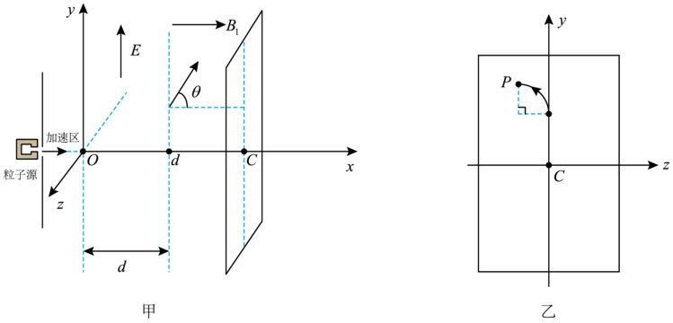

# Physics - 题目 1878

**ID**: 7c0e8db4b09e4596bbdd11f6fcecc2ef
**年级**: Grade 12
**难度**: Hard
**题型**: Calculation

## 题目
如图甲所示，在三维坐标系 $Oxyz$ 中， $0<x<d$ 的空间内，存在沿 $y$ 轴正方向的匀强电场， $x>d$ 的空间内存在沿 $x$ 轴正方向的匀强磁场，苂光屏垂直 $x$ 轴放置，其中心 $C$ 位于 $x$ 轴上并且荧光屏可以沿 $x$ 轴水平移动。​​​​​​​‌从粒子源不断飘出电荷量为 $q$ 、质量为 $m$ 的带正电粒子，加速后以初速度 $v_{0}$ 沿 $x$ 轴正方向经过 $O$ 点，经电场进磁场后打在荧光屏上。已知粒子刚进入磁场时速度方向与 $x$ 轴正方向的夹角 $θ=60{}^\circ $ ，忽略粒子间的相互作用，不计粒子重力。（1）求匀强电场电场强度的大小 $E$ ；（2）当粒子打到荧光屏后，沿 $x$ 轴缓慢移动荧光屏，沿 $x$ 轴正方向看去，观察到荧光屏上出现如图乙所示的荧光轨迹（箭头方向为荧光移动方向），轨迹最高点 $P$ 的 $y$ 轴坐标值为 $\frac {5\sqrt {3}d}{6}$ ，求匀强磁场磁感应强度的大小 $B_{1}$ 以及荧光屏中心C初始位置可能的 $x$ 轴坐标；（3）若将苂光屏中心C固定于 $x$ 轴上 $x=d+\frac {\sqrt {3}d}{6}$ 处，在 $x>d$ 的空间内附加一沿 $y$ 轴负方向的匀强磁场，磁感应强度大小 $B_{2}=\frac {\sqrt {3}mv_{0}}{qd}$ ，求附加匀强磁场 $B_{2}$ 后进入磁场的粒子打在荧光屏上的位置坐标。

## 解答

1. （1）粒子在电场中运动时，则
2. d=v_{0}t
3. qE=ma
4. $v_{y}=\sqrt {3}v_{0}=at$
5. 解得匀强电场电场强度的大小
6. $E=\frac {\sqrt {3}mv_{0}^{2}}{qd}$
7. （2）在电场中的偏转距离
8. $y_{1}=\frac {v_{y}}{2}t$
9. 在磁场中运动的半径
10. $R_{1}=y_{2}-y_{1}=\frac {\sqrt {3}}{3}d$
11. 根据
12. $qB_{1}v_{y}=m\frac {v_{y}^{2}}{R_{1}}$
13. 解得
14. $B_{1}=\frac {3mv_{0}}{qd}$
15. 周期
16. $T=\frac {2πm}{qB_{1}}=\frac {2πd}{3v_{0}}$
17. $t=nT=\frac {2nπd}{3v_{0}}\quad (n=0,1,2,3\cdots \cdots )$
18. 则荧光屏中心C初始位置可能的 $x$ 轴坐标
19. $x=d+v_{0}t{\rm{=}}d+\frac {2nπd}{3}\quad (n=0,1,2,3\ldots .....)$
20. （3）由题意可知
21. $B=\sqrt {B_{1}^{2}+B_{2}^{2}}=\frac {2\sqrt {3}mv_{1}}{qd}$
22. B与速度2v_{0}方向垂直；则
23. $R_{2}=\frac {m\cdot 2v_{0}}{qB}=\frac {\sqrt {3}}{3}d$
24. 圆轨道与荧光屏相切；则
25. $y=y_{1}+R_{2}{\sin}60^{{}^\circ }=\frac {\sqrt {3}+1}{2}d$
26. $z=-R_{2}=-\frac {\sqrt {3}}{3}d$
27. 粒子打在荧光屏上的位置坐标（ $d+\frac {\sqrt {3}d}{6},\frac {\sqrt {3}+1}{2}d,-\frac {\sqrt {3}}{3}d$ ）

## 知识点

**中文**:
  - 带电粒子在匀强电场中的运动
  - 带电粒子在匀强磁场中的运动

**English**:
  - Motion in Uniform Electric Field
  - Motion of Charged Particles in Uniform Magnetic Field

---
