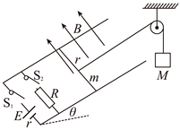

# Physics - 题目 27

**ID**: 8e7d950cbf2c40fa906c2d6bcdf5e6ec
**年级**: Grade 12
**难度**: Hard
**题型**: Calculation

## 题目
如图所示，间距为L=1m的平行光滑金属导轨倾斜固定放置，导轨足够长，导轨平面的倾角为θ=30°，导轨下端分别连接有阻值为1Ω的定值电阻R，电动势E=3V、内阻r=1 $Ω$ 的直流电源，质量为m=0.5kg，长为L、电阻为r=1Ω的金属棒放在导轨上，绕轻质定滑轮的细线一端连接在杆的中点，另一端悬吊质量为M=1kg的重物，导轨处在垂直于导轨平面向上的匀强磁场中，金属棒运动过程中始终与导轨垂直并接触良好，金属棒与定滑轮间的细线与导轨平行，只闭合开关S_{1}，金属棒处于静止状态，重力加速度为g=10m/s^{2}，重物离地足够高，金属导轨电阻不计，求：（1）匀强磁场磁感应强度大小；（2）再闭合开关S_{2}，闭合S_{2}的一瞬间，重物的加速度大小；（3）在金属棒静止时，若断开S_{1}，同时闭合S_{2}，当通过电阻R的电量为5C时，重物已做匀速运动；至此时电阻R产生的焦耳热为多少。​​​​​​​‌

## 解答

1. （1）流过金属棒的电流
2. $I{{}_{1}}=\frac {E}{r+r}=1.5{\rm{A}}$
3. 由于金属棒处于静止状态，因此
4. $BI{{}_{1}}L+mg{\sin}θ=Mg$
5. 代入数据可得
6. $B=5{\rm{T}}$
7. （2）闭合S_{2}的一瞬间，流过金属棒的电流为 $I{{}_{2}}$ ，根据闭合电路欧姆定律
8. $I{{}_{2}}r+(I{{}_{2}}+\frac {I{{}_{2}}r}{R})r=E$
9. 可得
10. $I{{}_{2}}=1{\rm{A}}$
11. 对金属棒，根据牛顿第二定律
12. $T-mg{\sin}θ-BI{{}_{2}}L=ma$
13. 对重物
14. $Mg-T=Ma$
15. 联立解得
16. $a=\frac {5}{3}{\rm{m}}{\rm{/}}{\rm{s}}{^{{\rm{2}}}}$
17. （3）金属棒上升的过程中，平均感应电动势
18. $\bar E=\frac {Δφ}{Δt}=\frac {BLx}{Δt}$
19. 平均电流
20. $\bar I=\frac {\bar E}{R+r}$
21. 流过某截面的电量
22. $q=\bar I\cdot Δt$
23. 代入数据可得，金属棒上升的距离
24. $x=2{\rm{m}}$
25. 重物做匀速运动的速度为 $v$ ，根据平衡条件
26. $Mg=mg{\sin}θ+BI{{}_{3}}L$
27. 而
28. $I{{}_{3}}=\frac {BLv}{R+r}$
29. 代入数据可得，重物运行的速度
30. $v=0.6{\rm{m}}{\rm{/}}{\rm{s}}$
31. 根据能量守恒定律
32. $Mgx=mgx{\sin}θ+\frac {1}{2}(M+m)v{^{2}}+Q$
33. 而
34. $Q{{}_{R}}=\frac {R}{R+r}Q$
35. 解得
36. $Q{{}_{R}}=7.365{\rm{J}}$

## 知识点

**中文**:
  - 单杆模型
  - 电磁感应现象中的功能问题

**English**:
  - Single Rod Model
  - Work-Energy Problems in EM Induction

---
