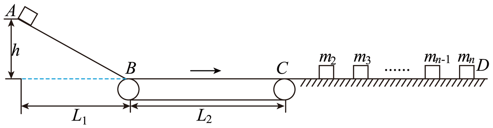

# Physics - 题目 2563

**ID**: 92065bec6df84cac9823ddeecc5850f7
**年级**: Grade 12
**难度**: Hard
**题型**: Calculation

## 题目
某传送装置的示意图如图所示，整个装置由三部分组成，左侧为粗糙倾斜直轨道 $AB$ ，中间为水平传送带 $BC$ ，传送带顺时针匀速运动，其速度的大小可以由驱动系统根据需要设定，右侧为光滑水平面 $CD$ 。​​​​​​​‌倾斜轨道末端及水平面 $CD$ 与传送带两端等高并平滑对接，质量分别为 $m{{}_{2}}、m{{}_{3}}\cdots \cdots m{{}_{n-1}}、m{{}_{n}}$ 的 $n-1$ 个物块在水平面 $CD$ 上沿直线依次静止排列。质量为 $m{{}_{1}}$ 的物块从斜面的最高点 $\mathrm{A}$ 由静止开始沿轨道下滑，已知 $\mathrm{A}$ 点距离传送带平面的高度 $h=2.5{\rm{m}}$ ，水平距离 $L{{}_{1}}=3.5{\rm{m}}$ ，传送带两轴心间距 $L{{}_{2}}=7{\rm{m}}$ ，物块与倾斜直轨道、传送带间的动摩擦因数均为 $μ=0.2$ ，取重力加速度 $g=10{\rm{m}}/{\rm{s}}{^{2}}$ ，所有物块均可视为质点。（1）求物块刚滑上传送带时的速度大小；（2）改变传送带的速度，求物块从传送带右侧滑出时的最大速度 $v$ ；（3）若物块 $m{{}_{1}}$ 以速度 $v{{}_{0}}$ （已知）离开传送带，滑到水平轨道上与 $m{{}_{2}}$ 发生碰撞，从而引起各物块的依次碰撞，碰撞前后各物块的运动方向处于同一直线上，各物块间碰撞无机械能损失，且各物块之间不发生第二次碰撞。经过依次碰撞后，定义第 $n$ 个物块 $m{{}_{n}}$ 获得的动能 $E{{}_{{\rm{k}}n}}$ 与第1个物块的初动能 $E{{}_{{\rm{k}}0}}$ 之比为第1个物块对第 $n$ 个物块的动能传递系数 $k{{}_{1n}}$ ，求 $k{{}_{13}}$ ；（4）接第（3）问，若 $m{{}_{3}}=m{{}_{4}}=\cdots \cdots m{{}_{n-1}}=m{{}_{n}}=\frac {m{{}_{1}}}{4}$ ，求 $m{{}_{2}}$ 为何值时，第 $n$ 个物块获得的速度最大，并求出第 $n$ 个物块的最大速度 $v{{}_{{\rm{n}}{\rm{m}}}}$ 。

## 解答

1. （1）对物块，由A运动到B的过程，根据动能定理有 $m{{}_{1}}gh-{\rm μm}{{}_{1}}g{\rm{c}}{\rm{o}}{\rm{s}}θ\frac {L{{}_{1}}}{{\rm{c}}{\rm{o}}{\rm{s}}θ}=\frac {1}{2}m{{}_{1}}v{{}_{0}^{2}}$
2. 解得 $v{{}_{0}}=6{\rm{m}}/{\rm{s}}$
3. （2）当传送带的速度较大时，物块在传送带上一直做匀加速运动，物块从传送带右侧滑出时的速度 $v$ 最大，由动能定理有 ${\rm μm}{{}_{1}}gL{{}_{2}}=\frac {1}{2}m{{}_{1}}v{^{2}}-\frac {1}{2}m{{}_{1}}v{{}_{0}^{2}}$
4. 解得 $v=8{\rm{m}}/{\rm{s}}$
5. （3）两物块碰撞过程系统动量守恒，以向右为正方向
6. 由动量守恒定律得 $m{{}_{1}}v{{}_{0}}=m{{}_{1}}v{{}_{1}}+m{{}_{2}}v{{}_{2}}$
7. 碰撞过程无机械能损失，由机械能守恒定律得 $\frac {1}{2}m{{}_{1}}v{{}_{0}^{2}}=\frac {1}{2}m{{}_{1}}v{{}_{1}^{2}}+\frac {1}{2}m{{}_{2}}v{{}_{2}^{2}}$
8. 解得 $v{{}_{2}}=\frac {2m{{}_{1}}v{{}_{0}}}{m{{}_{1}}+m{{}_{2}}}$
9. 物块的动能 $E{{}_{k1}}=\frac {1}{2}m{{}_{1}}v{{}_{0}^{2}}$ ， $E{{}_{k2}}=\frac {1}{2}m{{}_{2}}v{{}_{2}^{2}}$
10. 对物块1、2，动能传递系数 $k{{}_{12}}=\frac {E{{}_{k2}}}{E{{}_{k1}}}=\frac {4m{{}_{1}}m{{}_{2}}}{{\left({m{{}_{1}}+m{{}_{2}}}\right)^{2}}}$
11. 同理可得， $m{{}_{2}}$ 和 $m{{}_{3}}$ 碰撞后的动能传递系数
12. $k{{}_{13}}=\frac {E{{}_{k3}}}{E{{}_{k1}}}=\frac {E{{}_{k2}}}{E{{}_{k1}}}\times \frac {E{{}_{k3}}}{E{{}_{k2}}}=\frac {4m{{}_{1}}m{{}_{2}}}{{\left({m{{}_{1}}+m{{}_{2}}}\right)^{2}}}\times \frac {4m{{}_{2}}m{{}_{3}}}{{\left({m{{}_{2}}+m{{}_{3}}}\right)^{2}}}=\frac {16m{{}_{1}}m{{}_{2}^{2}}m{{}_{3}}}{{\left({m{{}_{1}}+m{{}_{2}}}\right)^{2}}{\left({m{{}_{2}}+m{{}_{3}}}\right)^{2}}}$
13. （4）质量相等的物块碰撞时没有机械能损失，碰撞过程系统动量守恒、机械能守恒，由动量守恒定律与机械能守恒定律可知，物块碰撞后交换速度，则 $m{{}_{3}}$ 与后面的物块碰撞后依次交换速度， $m{{}_{3}}$ 的最大速度等于第n个物块的最大速度 $v{{}_{{\rm{n}}{\rm{m}}}}$
14. 又 $m{{}_{3}}=m{{}_{4}}=\cdots \cdots m{{}_{n-1}}=m{{}_{n}}=\frac {m{{}_{1}}}{4}$
15. 则 $k{{}_{13}}=\frac {16m{{}_{1}}m{{}_{2}^{2}}m{{}_{3}}}{{\left({m{{}_{1}}+m{{}_{2}}}\right)^{2}}{\left({m{{}_{2}}+m{{}_{3}}}\right)^{2}}}=64m{{}_{1}^{2}}\left [\frac {m{{}_{2}}}{\left ({m{{}_{1}}+m{{}_{2}}}\right )\left ({4m{{}_{2}}+m{{}_{1}}}\right )}\right ]{^{2}}=64m{{}_{1}^{2}}\frac {1}{\left [4m{{}_{2}}+\frac {m{{}_{1}^{2}}}{m{{}_{2}}}+5m{{}_{1}}\right ]{^{2}}}$
16. 当 $4m{{}_{2}}=\frac {m{{}_{1}^{2}}}{m{{}_{2}}}$ ，即 $m{{}_{2}}=\frac {m{{}_{1}}}{2}$
17. 此时分母最小， $k{{}_{13}}$ 最大为 $k{{}_{{{1}}{{3}}{\rm{m}}}}=\frac {64}{81}$ ，此时第n个物块的速度最大，有 $\frac {1}{2}m{{}_{n}}v{{}_{{\rm{n}}{\rm{m}}}^{2}}=k{{}_{{{1}}{{3}}{\rm{m}}}}\times \frac {1}{2}m{{}_{1}}v{{}_{0}^{2}}$
18. 解得 $v{{}_{{\rm{n}}{\rm{m}}}}=\frac {16v{{}_{0}}}{9}$ 。

## 知识点

**中文**:
  - 动量和能量的综合应用
  - 动量守恒中的多次碰撞问题

**English**:
  - Integration of Momentum and Energy
  - Multiple Collisions in Momentum Conservation

---
