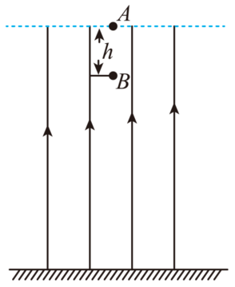

# Physics - 题目 47

**ID**: 9525b15401714358a08c6a857204fb5e
**年级**: Grade 12
**难度**: Hard
**题型**: Calculation

## 题目
如图，在地面上方、水平虚线下方存在一种特殊的相互作用区，作用区对小球A没有力的作用，对小球B有竖直向上的大小等于重力的力的作用。​​​​​​​‌两小球A和B的质量均为m，初始时小球B静止在虚线边界下方h高处，小球A从B正上方的虚线边界处由静止释放。小球A与小球B发生的碰撞为弹性碰撞，碰撞的时间极短。求：（1）两小球发生第一次碰撞的过程中，B受到A的冲量大小；（2）两小球发生第一次碰撞后至第二次碰撞前，A、B间的最大距离；（3）要使两小球能发生n次碰撞（n>1），水平虚线距地面的距离至少为多少？

## 解答

1. （1）设小球A与小球B第一次碰撞前瞬间的速度大小为v_{0}，根据运动学公式有 $v{{}_{0}^{2}}=\sqrt {2gh}$    ①
2. 设碰撞后A、B的速度大小分别为为v_{A1}、v_{B1}，根据动量守恒定律和机械能守恒定律分别有 $mv{{}_{0}}=mv{{}_{A1}}+mv{{}_{B1}}$  ②， $\frac {1}{2}mv{{}_{0}^{2}}=\frac {1}{2}mv{{}_{A1}^{2}}+\frac {1}{2}mv{{}_{B1}^{2}}$  ③
3. 联立①②③解得 $v{{}_{A1}}=0$    ④， $v{{}_{B1}}=\sqrt {2gh}$    ⑤
4. 根据动量定理可知，两小球发生第一次碰撞的过程中，B受到A的冲量大小为 ${\rm{Δ}}p{{}_{B1}}=mv{{}_{B1}}=m\sqrt {2gh}$  ⑥
5. （2）A、B两球发生第一次碰撞后，A开始做自由落体运动，B竖直向下以速度v_{B1}做匀速直线运动，设经过时间t二者速度相等，此时二者间距离最大，则 $v{{}_{B1}}=gt$    ⑦
6. 根据位移关系可得A、B间的最大距离为 ${\rm{Δ}}s{{}_{{\rm{m}}}}=v{{}_{B1}}t-\frac {1}{2}gt{{}^{2}}$  ⑧
7. 联立⑤⑦⑧解得 ${\rm{Δ}}s{{}_{{\rm{m}}}}=h$    ⑨
8. （3）作出两小球运动的v-t图像如图所示（红线代表A、蓝线代表B），设A释放后经时间t_{0}与B发生第一次碰撞，根据v-t图像与t轴所围面积表示位移以及图中几何图形的对称性可推知，A、B发生第一次碰撞后经时间2t_{0}发生第二次碰撞，且第二次碰撞前瞬间A的速度大小为2v_{0}，之后A与B交换速度后，B以2v_{0}做匀速直线运动，A以v_{0}为初速度、g为加速度的匀加速直线运动，再经过2t_{0}时间，发生A、B发生第三次碰撞，碰撞前瞬间A的速度大小为3v_{0}，之后A与B再交换速度，B以3v_{0}做匀速直线运动，A以2v_{0}为初速度、g为加速度做匀加速直线运动……两小球如此反复上述过程。因此，第一次碰撞前瞬间A下落的位移大小为 $h{{}_{1}}=\frac {v{{}_{0}}}{2}t{{}_{0}}=h$
9. 第一次与第二次碰撞过程之间A下落的位移大小为 $h{{}_{2}}=v{{}_{0}}\cdot 2t{{}_{0}}=4h$
10. 第二次与第三次碰撞过程之间A下落的位移大小为 $h{{}_{3}}=2v{{}_{0}}\cdot 2t{{}_{0}}=8h$
11. 第三次与第四次碰撞过程之间A下落的位移大小为 $h{{}_{4}}=3v{{}_{0}}\cdot 2t{{}_{0}}=12h$
12. ……
13. 第n－1次碰撞与第n次碰撞过程之间A下落的位移大小为 $h{{}_{n}}=(n-1)v{{}_{0}}\cdot 2t{{}_{0}}=4(n-1)h{\rm （\mathit{n}＞1）}$
14. 要使两小球能发生n次碰撞（n>1），水平虚线距地面的距离至少为 $H=h{{}_{1}}+h{{}_{2}}+…+h{{}_{n}}=\left [2(n-1)n+1\right ]h{\rm （\mathit{n}＞1）}$
15. 

## 知识点

**中文**:
  - 动量守恒中的多次碰撞问题

**English**:
  - Multiple Collisions in Momentum Conservation

---
