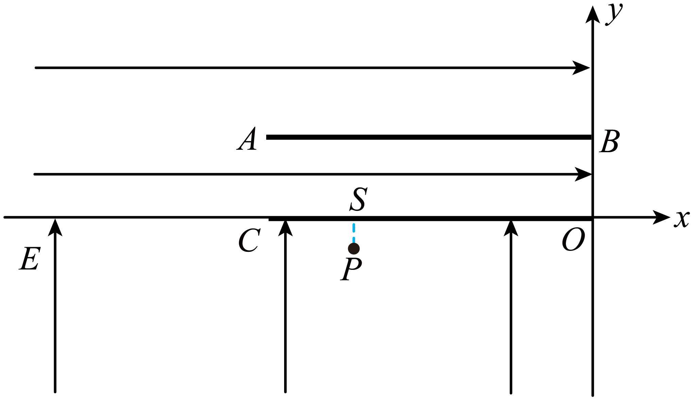

# Physics - 题目 546

**ID**: 955d513d1bdf4eae8a57891baae2ed83
**年级**: Grade 12
**难度**: Hard
**题型**: Calculation

## 题目
如图所示的直角坐标系xOy中，在第三象限内存在方向沿y轴正方向，大小为E的匀强电场，在第二象限内存在方向沿x轴正方向的匀强电场，大小未知，AB、CO为两块平行绝缘挡板，S处为一小孔，OS=9L，OB=3L，从点P（-9L，-L）处静止释放一质量为m、电荷量为q的带正电的粒子，经过x轴后直接运动到B点，不与挡板发生碰撞，不计粒子重力，则：（1）求第二象限中的电场强度大小E_{1}；（2）为使粒子能穿过小孔S后与挡板发生碰撞，保持释放点横坐标不变，改变释放点的纵坐标，当释放点纵坐标不同时，粒子穿过S后与AB板发生第1次碰撞前瞬间的动能也不相同，求使得这一动能取得最小值时，粒子对应释放点的纵坐标；（3）在满足（2）问要求的释放点将粒子静止释放后，粒子与两挡板发生多次碰撞后经过y轴，求粒子经过y轴时的纵坐标。​​​​​​​‌（已知粒子与挡板碰撞前后平行于板的速度大小、方向均不变，垂直于板的速度大小不变、方向相反）

## 解答

1. （1）粒子在第三象限中根据动能定理可得 $\frac {1}{2}mv{{}_{S}^{2}}=EqL$
2. 解得粒子在S处的速度为 $v{{}_{S}}=\sqrt {\frac {2EqL}{m}}$
3. 粒子在第二象限中做类平抛运动，在y轴方向做匀速直线运动，则有 $v{{}_{S}}t=3L$
4. 在x轴方向做匀加速直线运动，则有 $\frac {1}{2}\cdot \frac {E{{}_{1}}q}{m}\cdot t{^{2}}=9L$
5. 联立解得电场强度大小为 $E{{}_{1}}=4E$
6. （2）假设释放点的纵坐标绝对值为l，则粒子在S处的速度为 $v{{}_{S}}=\sqrt {\frac {2Eql}{m}}$
7. 粒子在第二象限中做类平抛运动，在y轴方向做匀速直线运动，则粒子穿过S后与AB板发生第1次碰撞前瞬间有 $v{{}_{S}}t{{}_{1}}=3L$
8. 在x轴方向做匀加速直线运动，则粒子穿过S后与AB板发生第1次碰撞前瞬间x轴方向的速度为 $v{{}_{x}}=\frac {4Eq}{m}t{{}_{1}}=\frac {12EqL}{mv{{}_{S}}}=6L\sqrt {\frac {2Eq}{ml}}$
9. 则粒子穿过S后与AB板发生第1次碰撞前瞬间的动能为 $E{{}_{{\rm{k}}}}=\frac {1}{2}mv{{}_{S}^{2}}+\frac {1}{2}mv{{}_{x}^{2}}=Eql+\frac {36EqL{^{2}}}{l}$
10. 则当 $Eql=\frac {36EqL{^{2}}}{l}$ ，即 $l=6L$
11. 此时动能最小，粒子对应释放点的纵坐标为-6L；
12. （3）粒子在第三象限中根据动能定理可得 $\frac {1}{2}mv{{}_{S}^{2}}=6EqL$
13. 解得粒子穿过S的速度为 $v{{}_{S}}=\sqrt {\frac {12EqL}{m}}$
14. 粒子在第二象限运动时，在x轴方向做匀加速直线运动，则有 $\frac {1}{2}\cdot \frac {4Eq}{m}\cdot t{^{2}}=9L$
15. 解得 $t=\sqrt {\frac {9{\rm mL}}{2Eq}}$
16. 在y轴方向做匀速直线运动，则从一块板运动到另一块板所需时间为 $Δt=\frac {3L}{v{{}_{S}}}=\sqrt {\frac {3{\rm mL}}{4Eq}}$
17. 则粒子在第二象限运动期间一共上下运动的次数为 $n=\frac {t}{Δt}=\sqrt {6}\approx 2.4$
18. 说明粒子穿过S后与AB板发生一次碰撞，然后再与CO板发生碰撞，最后在向上运动过程中到达了y轴，最后一段向上运动的时间为 $t^{′}=t-2Δt=\sqrt {\frac {9{\rm mL}}{2Eq}}-2\sqrt {\frac {3{\rm mL}}{4Eq}}$
19. 则粒子经过y轴时的纵坐标为 $y=v{{}_{S}}t^{′}=\left ({3\sqrt {6}-6}\right )L$

## 知识点

**中文**:
  - 带电粒子在匀强电场中的运动

**English**:
  - Motion in Uniform Electric Field

---
