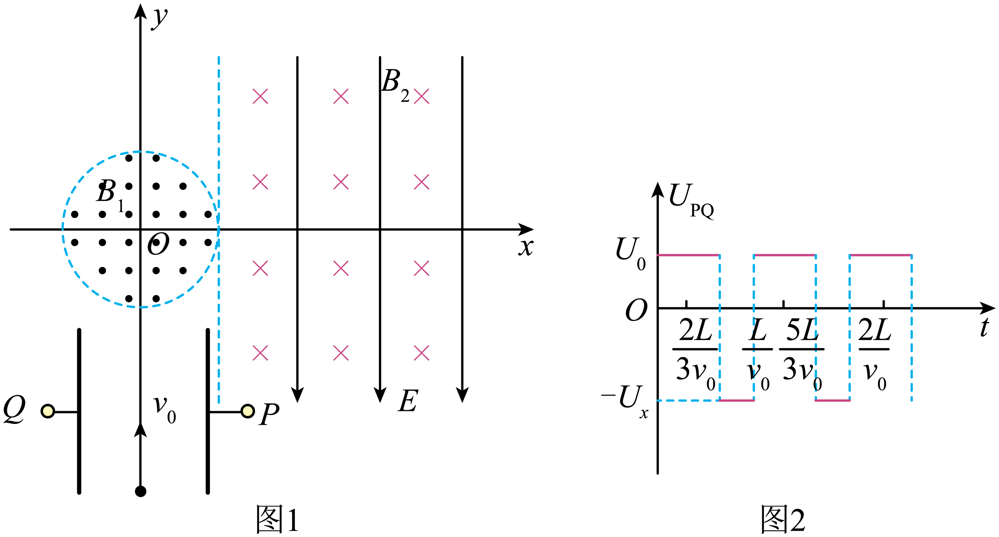

# Physics - 题目 2963

**ID**: ad1fbcebd69445d1bc349cac1662f655
**年级**: Grade 12
**难度**: Hard
**题型**: Calculation

## 题目
如图1所示， $xOy$ 坐标平面内，以 $O$ 点为圆心， $R$ 为半径的圆形区域内存在垂直 $xOy$ 平面向外的匀强磁场，两平行金属板 $P$ 、 $Q$ 长为 $L$ ， $y$ 轴为两金属板的中轴线， $PQ$ 间加如图2所示的交变电压，图中 $U{{}_{x}}$ 未知， $U{{}_{0}}$ 已知，周期为 $\frac {L}{v{{}_{0}}}$ 。​​​​​​​‌大量带正电的粒子以速度 $v{{}_{0}}$ 沿 $y$ 轴持续射入电场，恰好所有粒子均能离开电场且平行于 $y$ 轴射入磁场，已知从 $\left ({0,-R}\right )$ 点入射的粒子恰能从 $\left ({R,0}\right )$ 点出射。粒子比荷均为 $\frac {q}{m}$ ，不计粒子重力及粒子间相互作用，忽略极板的边缘效应， $\sin 37\mathrm{°}=0.6$ 。（1）求圆形区域磁场的磁感应强度大小 $B{{}_{1}}$ ；（2）求 $U{{}_{x}}$ 及金属板 $P$ 、 $Q$ 间的距离 $d$ ；（3）若在 $x>R$ 的右侧空间存在垂直于纸面向里、磁感应强度大小为 $B{{}_{2}}$ 的匀强磁场和沿 $y$ 轴负方向、场强大小为 $0.8B{{}_{2}}v{{}_{0}}$ 的匀强电场，求从圆周上 $x=0.6R$ 的点沿 $y$ 轴正方向射入圆形磁场区域的粒子，进入复合场后，运动的最大速度 $v{{}_{{\rm{m}}}}$ 和离 $x$ 轴的最远距离 $y{{}_{{\rm{m}}}}$ 。

## 解答

1. （1）由题意，从点 $\left ({0,-R}\right )$ 入射的粒子射入磁场时的速度为 $v{{}_{0}}$ ，在磁场中运动的半径为 $R$ ，则 $qv{{}_{0}}B{{}_{1}}=m\frac {v{{}_{0}^{2}}}{R}$
2. 解得 $B{{}_{1}}=\frac {mv{{}_{0}}}{qR}$
3. （2）粒子通过两板时间 $t=\frac {L}{v{{}_{0}}}=T$
4. 从 $t=0$ 时刻开始，粒子在两板间运动时每个电压变化周期的前三分之二时间内的加速度大小 $a{{}_{1}}=\frac {qU{{}_{0}}}{md}$
5. 方向垂直极板向左
6. 在每个电压变化周期的后三分之一时间内加速度大小 $a{{}_{2}}=\frac {qU{{}_{x}}}{md}$
7. 方向垂直极板向右。所有粒子均以速度 $v{{}_{0}}$ 沿平行于极板的方向射出电场，即所有粒子在出电场时垂直极板方向的速度 $v{{}_{x}}=0$
8. 不同时刻进入电场的粒子在电场方向的速度 $v{{}_{x}}$ 随时间 $t$ 变化的关系如图1所示
9. 
10. $a{{}_{1}}\cdot \frac {2}{3}T-a{{}_{2}}\cdot \frac {1}{3}T=0$
11. 解得 $U{{}_{x}}=2U{{}_{0}}$
12. 由 $\frac {d}{2}=\frac {1}{2}\left ({a{{}_{1}}\cdot \frac {2}{3}T}\right )\cdot T$
13. 解得 $d=\frac {L}{v{{}_{0}}}\sqrt {\frac {2qU{{}_{0}}}{3m}}$
14. （3）由题意，所有粒子都会经过点 $\left ({R,0}\right )$ ，画出所研究的粒子在圆形区域磁场中运动的轨迹如图2所示，设粒子从点 $\left ({R,0}\right )$ 出射时与 $x$ 轴正方向夹角为 $θ$ ，则 $R-R\sin θ+0.6R=R$
15. 
16. 粒子在右侧复合场中做摆线运动，将速度 $v{{}_{0}}$ 分解为 $v{{}_{1}}$ 和 $v{{}_{2}}$ ，如图3所示
17. 
18. 解得 $v{{}_{1}}=0.8v{{}_{0}}$ ， $v{{}_{2}}=0.6v{{}_{0}}$
19. 其中 $Eq=B{{}_{2}}qv{{}_{1}}$
20. 则粒子运动的最大速度 $v{{}_{{\rm{m}}}}=v{{}_{1}}+v{{}_{2}}=1.4v{{}_{0}}$
21. 根据动能定理有 $Eqy{{}_{{\rm{m}}}}=\frac {1}{2}mv{{}_{{\rm{m}}}^{2}}-\frac {1}{2}mv{{}_{0}^{2}}$
22. 解得 $y{{}_{{\rm{m}}}}=\frac {3mv{{}_{0}}}{5B{{}_{2}}q}$

## 知识点

**中文**:
  - 带电粒子在叠加场中的运动
  - 带电粒子在组合场中的运动

**English**:
  - Motion in Superimposed Fields
  - Motion in Combined Fields

---
