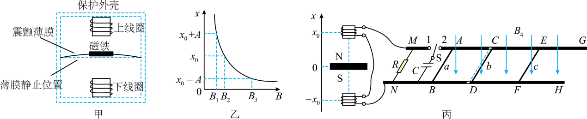

# Physics - 题目 580

**ID**: af4ed5a9b95f4543a66302e6a2fddb71
**年级**: Grade 12
**难度**: Hard
**题型**: Calculation

## 题目
图甲为某种发电装置，轻质钕磁铁固定在带状薄膜上，上下各固定一个完全相同的线圈。​​​​​​​‌两线圈与磁铁共轴，以薄膜平衡位置为原点O建立竖直向上x轴，线圈中心与磁铁相距均为 $x{{}_{0}}$ ，当周期性外力作用时，薄膜带动磁铁在竖直方向上下振动，振幅为A。已知线圈的匝数为n、横截面积为S、磁铁中轴线上各点磁感应强度B的大小与该点到磁铁中心距离x的关系如图乙所示，忽略线圈长度，线圈内各处磁感应强度的竖直分量近似等于线圈中心位置的磁感应强度大小，不计线圈电阻和自感互感的影响，电路连接如图丙所示。定值电阻 $R=5Ω$ ，电容器的电容 $C=0.2{\rm{F}}$ ，足够长的光滑平行金属导轨 $AG$ 、 $BH$ 固定于水平面内，相距为 $L=2{\rm{m}}$ ，处于竖直向下、大小为 $B{{}_{4}}=1{\rm{T}}$ 的匀强磁场中，轨道在C、D处各被一小段正对的绝缘材料隔开，质量为 $m{{}_{{\rm{a}}}}=1{\rm{k}}{\rm{g}}$ 的金属棒a静置于导轨 $AB$ 处，质量为 $m{{}_{{\rm{b}}}}=3{\rm{k}}{\rm{g}}$ 的金属棒b紧贴 $CD$ 右侧放置，质量为 $m{{}_{{\rm{c}}}}=1{\rm{k}}{\rm{g}}$ 的金属棒c静置于b棒右侧 $s{{}_{0}}=2{\rm{m}}$ 的 $EF$ 处。a、b棒的接入电阻相同， $R{{}_{{\rm{a}}}}=R{{}_{{\rm{b}}}}=2\Omega $ ，c棒的接入电阻 $R{{}_{{\rm{c}}}}=4\Omega $ ，所有导轨的电阻均不计。初始时单刀双掷开关S与触点“1”闭合。（1）若磁铁从O点运动到最高点历时 $Δt$ ，判断此过程流过电阻R中电流方向及流过R的电荷量；（2）磁铁上升过程某时刻，电容器带电荷量 $Q{{}_{1}}=2{\rm{C}}$ 时，将开关S拨到触点“2”。当金属棒a运动至 $CD$ 时电容器的电压 $U=6{\rm{V}}$ ，此时a、b两棒相碰结合为一个“双棒”整体，最终各棒运动达到稳定状态，求最终“双棒”整体与c棒的距离以及从a、b棒碰后到各棒稳定的过程中a棒中产生的焦耳热；（3）图乙中B与x关系式满足 $B=\frac {k}{x}$ （其中k为未知常数），图中 $B{{}_{1}}$ 、 $B{{}_{2}}$ 、 $B{{}_{3}}$ 为已知量，写出磁铁以速率 $v{{}_{0}}$ 向上经平衡位置时，电阻 $R$ 的电功率表达式。

## 解答

1. （1）由题意可知，当磁铁从O点向上运动到最高点，穿过上线圈的磁通量增大，下线圈的磁通量减少，由楞次定律可知，流过电阻R的电流方向从M到N；由电磁感应定律可得线圈产生的平均感应电动势为 $\bar E=\bar E{{}_{上}}+\bar E{{}_{下}}=n\frac {\left ({B{{}_{3}}-B{{}_{2}}}\right )S}{{\rm{Δ}}t}+n\frac {\left ({B{{}_{2}}-B{{}_{1}}}\right )S}{{\rm{Δ}}t}=n\frac {\left ({B{{}_{3}}-B{{}_{1}}}\right )S}{{\rm{Δ}}t}$ ，流过R的电荷量 $Q=\bar I{\rm{Δ}}t=\frac {\bar E}{R}\cdot {\rm{Δ}}t=n\frac {\left ({B{{}_{3}}-B{{}_{1}}}\right )S}{R}$
2. （2）电容器带电荷量 $Q{{}_{1}}=2{\rm{C}}$ 时，将开关S拨到触点“2”，电容器放电，棒a运动到CD时电容器的电压 $U=6{\rm{V}}$ ，此时电容器所带电荷量为 $Q{{}_{2}}=CU=0.2\times 6{\rm{C}}=1.2{\rm{C}}$ ，该过程电容器放电 $ΔQ=Q{{}_{1}}-Q{{}_{2}}=0.8{\rm{C}}$ ，对棒a，由动量定理可得 $\bar I{{}_{1}}B{{}_{4}}LΔt{{}_{1}}=m{{}_{{\rm{a}}}}v{{}_{1}}$ ，又有 $ΔQ=\bar I{{}_{1}}Δt{{}_{1}}$ ，解得 $v{{}_{1}}=1.6{{\rm{m}}}/{{\rm{s}}}$a、b两棒相碰结合为一个“双棒”整体，由动量守恒定律可得 $m{{}_{{\rm{a}}}}v{{}_{1}}=\left ({m{{}_{{\rm{a}}}}+m{{}_{{\rm{b}}}}}\right )v{{}_{2}}$ ，解得 $v{{}_{2}}=0.4{{\rm{m}}}/{{\rm{s}}}$ ，此后，abc棒组成的系统动量守恒，最后速度相同 $v{{}_{3}}$ ，由动量守恒定律可得 $\left ({m{{}_{{\rm{a}}}}+m{{}_{{\rm{b}}}}}\right )v{{}_{2}}=\left ({m{{}_{{\rm{a}}}}+m{{}_{{\rm{b}}}}+m{{}_{{\rm{c}}}}}\right )v{{}_{3}}$ ，解得 $v{{}_{3}}=0.32{{\rm{m}}}/{{\rm{s}}}$ ，对c棒，由动量定理可得 $\frac {B{{}_{4}}L\bar v}{R{{}_{总}}}\cdot B{{}_{4}}LΔt{{}_{2}}=m{{}_{{\rm{c}}}}v{{}_{3}}$ ，其中 $Δs{{}_{相}}=\bar v\cdot Δt{{}_{2}}$ ， $R{{}_{总}}=R{{}_{{\rm{c}}}}+\frac {R{{}_{{\rm{a}}}}R{{}_{{\rm{b}}}}}{R{{}_{{\rm{a}}}}+R{{}_{{\rm{b}}}}}=5Ω$ ，解得 $Δs{{}_{相}}=0.4{\rm{m}}$ ，最终“双棒”整体与c棒的距离 $s=s{{}_{0}}-Δs{{}_{相}}=2{\rm{m}}-0.4{\rm{m}}=1.6{\rm{m}}$ ，碰撞后abc棒组成的系统能量守恒，可得 $Q{{}_{总}}=\frac {1}{2}\left ({m{{}_{{\rm{a}}}}+m{{}_{{\rm{b}}}}}\right )v{{}_{2}^{2}}-\frac {1}{2}\left ({m{{}_{{\rm{a}}}}+m{{}_{{\rm{b}}}}+m{{}_{{\rm{c}}}}}\right )v{{}_{3}^{2}}=0.064{\rm{J}}$ ，从a、b棒碰后到各棒稳定的过程中a棒中产生的焦耳热 $Q{{}_{{\rm{a}}}}=\frac {R{{}_{并}}}{R{{}_{并}}+R{{}_{{\rm{c}}}}}\times \frac {1}{2}Q{{}_{总}}=\frac {1}{5}\times \frac {1}{2}Q{{}_{总}}=\frac {1}{10}\times 0.064{\rm{J}}=0.0064{\rm{J}}$
3. （3）磁铁以速率 $v{{}_{0}}$ 向上经平衡位置时，取极小的一段时间 ${\rm{Δ}}t$ （ ${\rm{Δ}}t$ 趋于零），上移极小位移 $Δ{\rm{x}}$ ，则有 $E^{′}{{{}_{上}}}=n\frac {{\rm{Δ}}BS}{{\rm{Δ}}t}=n\frac {\left ({\frac {k}{x{{}_{0}}-{\rm{Δ}}x}-\frac {k}{x{{}_{0}}}}\right )S}{{\rm{Δ}}t}=\frac {nSk{\rm{Δ}}x}{\left ({x{{}_{0}}-{\rm{Δ}}x}\right )x{{}_{0}}{\rm{Δ}}t}$ ，其中 $\frac {k}{x{{}_{0}}}=B{{}_{0}}$ ， $\frac {Δx}{Δt}=v{{}_{0}}$ ，解得 $E^{′}{{{}_{上}}}=\frac {nSB{{}_{0}}v{{}_{0}}}{\left ({x{{}_{0}}-{\rm{Δ}}x}\right )}$ ，同理可得 $E^{′}{{{}_{下}}}=\frac {nSB{{}_{0}}v{{}_{0}}}{\left ({x{{}_{0}}+{\rm{Δ}}x}\right )}$ ，线圈中产生的感应电动势为 $E^{′}=E^{′}{{{}_{上}}}+E^{′}{{{}_{下}}}=\frac {2nSB{{}_{0}}v{{}_{0}}x{{}_{0}}}{\left [x{{}_{0}^{2}}-{\left({{\rm{Δ}}x}\right)^{2}}\right ]}=\frac {2nSB{{}_{0}}v{{}_{0}}}{x{{}_{0}}}$ ，此时电阻 $R$ 的电功率表达式 $P{{}_{{\rm{R}}}}=\frac {E^{′}{{^{2}}}}{R}=\frac {4n{^{2}}S{^{2}}B{{}_{0}^{2}}v{{}_{0}^{2}}}{Rx{{}_{0}^{2}}}$

## 知识点

**中文**:
  - 动量和能量的综合应用
  - 电磁感应定律的应用
  - 电磁感应现象中的功能问题

**English**:
  - Integration of Momentum and Energy
  - Applications of Faraday's Law
  - Work-Energy Problems in EM Induction

---
