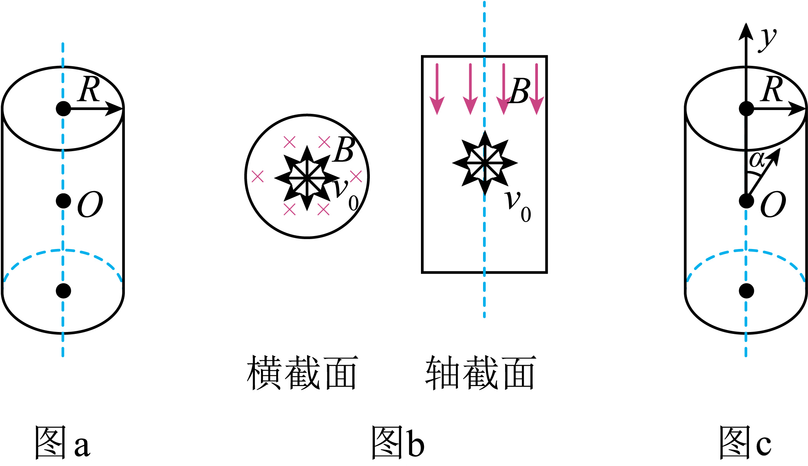

# Physics - 题目 996

**ID**: b0df8c93fbe9491eaba2c54e797db563
**年级**: Grade 12
**难度**: Hard
**题型**: Calculation

## 题目
一圆筒面与中心轴线构成的圆柱体系统，结构简化如图（a）所示，圆筒足够长，半径R。​​​​​​​‌在O点有一电子源，向空间中各个方向发射速度大小为 $v{{}_{0}}$ 、质量是m、电量为e的电子，某时刻起筒内加大小可调节且方向沿中心轴向下的匀强磁场，筒的横截面及轴截面示意图如图（b）所示，当磁感应强度大小调至 $B{{}_{0}}$ 时，恰好没有电子落到筒壁上。忽略场的边界效应、电子受到的重力及电子间相互作用力。若电子碰到筒壁，则被吸收且电中和，R、 $v{{}_{0}}$ 、m、e均为已知量。（1）求 $B{{}_{0}}$ 的大小；（2）接第（1）问，当磁感应强度大小调至 $B=\frac {1}{2}B{{}_{0}}$①求垂直中心轴发射的电子，从发射到落到筒壁上的时间；②求筒壁上落有电子的区域面积S；③如图c若电子发射速度与中心轴夹角为α，可经过离O点正上方距离为 $y=\sqrt {3}{\rm{π}}R$ 的点，求α角的可能值。

## 解答

1. （1）当磁场的磁感应强度为 $B{{}_{0}}$ 时，电子刚好不会落到筒壁上。则电子以速度 $v{{}_{0}}$ 垂直轴线方向射出，电子在磁场中做匀速圆周运动，轨迹恰好与圆筒壁相切，轨迹半径为 $R{{}_{0}}=\frac {R}{2}$ ，根据洛伦兹力提供向心力可得 $eB{{}_{0}}v{{}_{0}}=\frac {mv{{}_{0}^{2}}}{R{{}_{0}}}$
2. 联立解得 $B{{}_{0}}=\frac {2mv{{}_{0}}}{eR}$
3. （2）①当 $B=\frac {B{{}_{0}}}{2}$ ，电子轨道半径 $r=R$ ，如下图所示P点为电子在筒壁落点 $△AOO^{′}P$ 为等边三角形
4. 
5. 所以 $t=\frac {60{}\degree }{360{}\degree }\times \frac {{{2}}{\rm{π}}R}{v{{}_{0}}}=\frac {{\rm{π}}R}{3v{{}_{0}}}$
6. ②磁感应强度调整为 $\frac {B{{}_{0}}}{2}$ 后，将速度方向与中心轴夹角为θ的电子运动分解为垂直轴线方向上做匀速圆周运动，平行轴线方向上做匀速直线运动，速度沿垂直轴线和平行轴线方向进行分解 $v{{}_{x}}=v{{}_{0}}{\rm{s}}{\rm{i}}{\rm{n}}θ$ ， $v{{}_{y}}=v{{}_{0}}{\rm{c}}{\rm{o}}{\rm{s}}θ$
7. 电子击中筒壁距离粒子源的最远点时，其垂直轴线方向的圆周运动轨迹与筒壁相切，则轨迹圆半径为 $R{{}_{0}}=\frac {R}{2}$
8. 
9. 根据洛伦兹力提供向心力可得 $e\frac {B{{}_{0}}}{2}v{{}_{x}}=\frac {mv{{}_{x}^{2}}}{R{{}_{0}}}$
10. 联立解得 $v{{}_{x}}=\frac {v{{}_{0}}}{2}$ ， $θ=30{}\degree $
11. 解得 $v{{}_{y}}=v{{}_{0}}{\rm{c}}{\rm{o}}{\rm{s}}θ=\frac {\sqrt {3}v{{}_{0}}}{2}$
12. 电子发出到与筒壁相切时间 $t=\frac {{\rm{π}}R{{}_{0}}}{v{{}_{x}}}=\frac {{\rm{π}}R}{v{{}_{0}}}$
13. 电子发射方向上下对称，则打在筒壁沿轴方向长度 $y{{}_{{\rm{m}}}}=2v{{}_{y}}t=\sqrt {3}{\rm{π}}R$
14. 可知最大面积 $S=2\pi R{y}_{m}=2\sqrt{3}{\pi }^{2}{R}^{2}$
15. ③根据题意可知 $α=0{}\degree $ 时电子不受洛伦兹力，可匀速直线运动过 $y=\sqrt {3}{\rm{π}}R$ 点。
16. 当 $\alpha \ne 0°$ 电子水平方向圆周运动周期为 $T=\frac {2{\rm{π}}m}{eB}=\frac {2{\rm{π}}R}{v{{}_{0}}}$
17. 竖直方向匀速直线运动 $y=nT{v}_{0}\cos \alpha (n=1,2,3\cdots )$
18. 解得 $\cos \alpha =\frac{y}{nT{v}_{0}}=\frac{\sqrt{3}}{2n}(n=1,2,3\cdots )$
19. 当n=1时 $α=30{}\degree $ ；
20. 当n>1时 $α>30{}\degree $ ，电子打在筒壁上，不符合要求。
21. 综上所述：经过O点正上方距离为 $y=\sqrt {3}{\rm{π}}R$ 的点α角的可能值是 $0{}\degree $ 或 $30{}\degree $ 。

## 知识点

**中文**:
  - 带电粒子在有界磁场中运动的临界极值问题

**English**:
  - Critical Extremum Problems in Bounded Magnetic Fields

---
