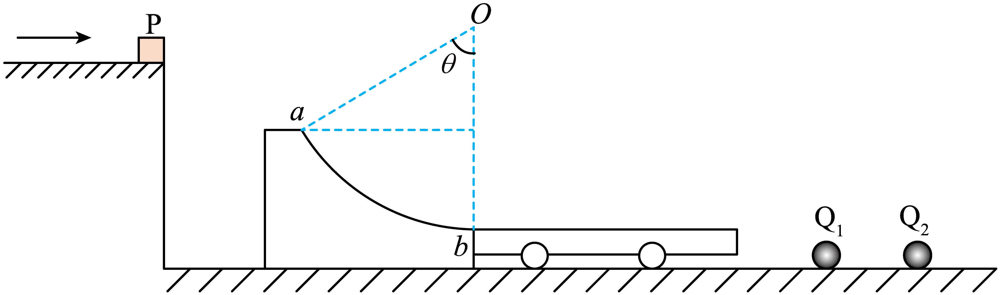

# Physics - 题目 2936

**ID**: bae221accf8e403d82bfe3e22020291c
**年级**: Grade 12
**难度**: Hard
**题型**: Calculation

## 题目
如图所示，一圆弧槽固定在水平面上，圆弧两端点 $a$ 、 $b$ 对应的圆心角为 $θ=60{^{\circ }}$ ， $a$ 、 $b$ 两点的高度差为 $0.6{\rm{m}}$ ， $b$ 点与圆心 $O$ 的连线竖直。​​​​​​​‌圆弧槽右侧是光滑的水平面，质量为 $1{\rm{k}}{\rm{g}}$ 的小车紧靠圆弧槽右端放置，且小车上表面与圆弧槽 $b$ 点等高，质量均为 $2{\rm{k}}{\rm{g}}$ 的相同小球 ${\rm{Q}}{{}_{{{1}}}}$ 和 ${\rm{Q}}{{}_{{{2}}}}$ 放在小车右侧。光滑水平台面上放有一个质量为 $2.97{\rm{k}}{\rm{g}}$ 的滑块 ${\rm{P}}$ ，一质量为 $0.03{\rm{k}}{\rm{g}}$ 的子弹以 $100{\rm{m}}{\rm{/}}{\rm{s}}$ 的初速度水平打到滑块 ${\rm{P}}$ 内并嵌入其中，滑块 ${\rm{P}}$ 运动到 $a$ 点时速度刚好与圆弧相切。已知滑块与小车之间的动摩擦因数为0.1，小球间的碰撞均为弹性碰撞，重力加速度 $g$ 取 $10{\rm{m}}{\rm{/}}{\rm{s}}{^{{{2}}}}$ 。（1）求滑块 ${\rm{P}}$ 从圆弧 $b$ 点离开时的速度大小；（2）当滑块与小车第1次共速时小车与球 ${\rm{Q}}{{}_{{{1}}}}$ 刚好发生弹性碰撞，当滑块与小车第2次共速时，小车与球 ${\rm{Q}}{{}_{{{1}}}}$ 再次发生弹性碰撞，求初始时球 ${\rm{Q}}{{}_{{{1}}}}$ 与小车右端的距离以及球 ${\rm{Q}}{{}_{{{1}}}}$ 、 ${\rm{Q}}{{}_{{{2}}}}$ 之间的距离各是多少；（3）若在球 ${\rm{Q}}{{}_{{{2}}}}$ 的右侧放置无限多个与 ${\rm{Q}}{{}_{{{1}}}}$ 、 ${\rm{Q}}{{}_{{{2}}}}$ 完全相同的球，每当滑块与小车共速时，小车就与球 ${\rm{Q}}{{}_{{{1}}}}$ 发生弹性碰撞，最终滑块恰好未从小车上掉下。求小车的长度以及小车向右运动的总位移大小。

## 解答

1. （1）子弹打入滑块，设共同速度为 $v^{′}$ ，子弹、滑块质量分别用 $m{{}_{0}}$ 、 $m$ 表示，由动量守恒定律有 $m{{}_{0}}v{{}_{0}}=\left ({m{{}_{0}}+m}\right )v^{′}$
2. 解得 $v^{′}=\frac {m{{}_{0}}v{{}_{0}}}{m{{}_{0}}+m}=\frac {0.03\times 100}{0.03+2.97}=1{\rm{m}}/{\rm{s}}$
3. 设滑块落到圆弧 $a$ 点时的速度为 $v{{}_{a}}$ ，滑块 ${\rm{P}}$ 落到圆弧的 $a$ 点上时刚好与圆弧相切，则 ${\rm{c}}{\rm{o}}{\rm{s}}60{^{\circ }}=\frac {v^{′}}{v{{}_{a}}}$
4. 解得 $v{{}_{a}}=2v^{′}=2{\rm{m}}/{\rm{s}}$
5. 设滑块离开 $b$ 点时速度 $v{{}_{b}}$ ，滑块从 $a$ 到 $b$ 机械能守恒，则有 $\frac {1}{2}\left ({m{{}_{0}}+m}\right )v{{}_{b}}{^{2}}-\frac {1}{2}\left ({m{{}_{0}}+m}\right )v{{}_{a}}{^{2}}=\left ({m{{}_{0}}+m}\right )gh$
6. 解得 $v{{}_{b}}=4{\rm{m}}/{\rm{s}}$
7. （2）设滑块与小车第一次共同速度为 $v{{}_{共{{1}}}}$ ，小车质量用 $M$ 表示，小车的右端与球 $Q{{}_{1}}$ 之间的距离 $d{{}_{1}}$ ，由动量守恒定律有 $\left ({m{{}_{0}}+m}\right )v{{}_{b}}=\left ({m{{}_{0}}+m+M}\right )v{{}_{共1}}$
8. 解得滑块小车共同速度为 $v{{}_{共1}}=\frac {3}{4}v{{}_{b}}=3{\rm{m}}/{\rm{s}}$
9. 小车加速度 $a=\frac {μ\left ({m{{}_{0}}+m}\right )g}{M}=3{\rm{m}}/{\rm{s}}{^{2}}$
10. 小车加速前进的距离 $d{{}_{1}}=\frac {v{{}_{共1}}{^{2}}}{2a}=1.5{\rm{m}}$
11. 所以球 ${\rm{Q}}{{}_{{{1}}}}$ 与小车右端的距离为 $d{{}_{1}}=1.5{\rm{m}}$
12. 设小车与球 ${\rm{Q}}{{}_{{{1}}}}$ 第1次碰后，小车速度为 $v{{}_{车1}}$ ，球的速度 $v{{}_{1}}$ ，球的质量为 $2M$ ，由动量守恒定律和能量守恒定律有 $Mv{{}_{共1}}=Mv{{}_{车1}}+2Mv{{}_{1}}$ ， $\frac {1}{2}Mv{{}_{共1}}{^{2}}=\frac {1}{2}Mv{{}_{车1}}{^{2}}+\frac {1}{2}\times 2Mv{{}_{1}}{^{2}}$
13. 由于 $v{{}_{共1}}=\frac {3}{4}v{{}_{b}}$
14. 解得 $v{{}_{车1}}=-\frac {1}{4}v{{}_{b}}=-1{\rm{m}}/{\rm{s}}$ ， $v{{}_{1}}=\frac {1}{2}v{{}_{b}}=2{\rm{m}}/{\rm{s}}$
15. 设滑块与小车第二次达到相同速度为 $v{{}_{共2}}$ ，由动量守恒定律有 $\left ({m{{}_{0}}+m}\right )v{{}_{共1}}+Mv{{}_{车1}}=\left ({m{{}_{0}}+m+M}\right )v{{}_{共2}}$
16. 对小车由动能定理有 $μ\left ({m{{}_{0}}+m}\right )gd{{}_{2}}=\frac {1}{2}Mv{{}_{共2}}{^{2}}-\frac {1}{2}Mv{{}_{车1}}{^{2}}$
17. 解得 $v{{}_{共2}}=\frac {1}{2}v{{}_{b}}$ ， $d{{}_{2}}=\frac {v{{}_{b}^{2}}}{32μg}=0.5{\rm{m}}$
18. 所以球 ${\rm{Q}}{{}_{{{1}}}}$ 与 ${\rm{Q}}{{}_{{{2}}}}$ 之间的距离为 $d{{}_{2}}=0.5{\rm{m}}$
19. （3）球 ${\rm{Q}}{{}_{{{1}}}}$ 、 ${\rm{Q}}{{}_{{{2}}}}$ 碰撞后速度发生交换， ${\rm{Q}}{{}_{{{2}}}}$ 获得的速度为 $\frac {1}{2}v{{}_{b}}$ ，小车与 $Q{{}_{1}}$ 第二次碰撞有 $Mv{{}_{共2}}=Mv{{}_{车2}}+2Mv{{}_{2}}$ ， $\frac {1}{2}Mv{{}_{共2}}{^{2}}=\frac {1}{2}Mv{{}_{车2}}{^{2}}+\frac {1}{2}\times 2Mv{{}_{2}}{^{2}}$
20. 解得 $v{{}_{车2}}=-\frac {1}{3}v{{}_{共2}}$ ， $v{{}_{2}}=\frac {2}{3}v{{}_{共2}}$
21. 小车与 ${\rm{Q}}{{}_{{{1}}}}$ 第二次碰后到小车与滑块第3次共速，则有 $\left ({m{{}_{0}}+m}\right )v{{}_{共2}}+Mv{{}_{车2}}=\left ({m{{}_{0}}+m+M}\right )v{{}_{共3}}$
22. 解得 $v{{}_{共3}}=\frac {2}{3}v{{}_{共2}}$
23. 依次推理可得 $v{{}_{共n}}={\left({\frac {2}{3}}\right)^{n-1}}v{{}_{共1}}=3\times {\left({\frac {2}{3}}\right)^{n-1}}{\rm{m}}/{\rm{s}}$ ， $v{{}_{车n}}=-\frac {1}{3}v{{}_{共n}}=-{\left({\frac {2}{3}}\right)^{n-1}}{\rm{m}}/{\rm{s}}\left ({n=1,2,3\cdots }\right )$
24. 滑块与小车的相对加速度为 $a{{}_{相}}=μg+\frac {μ\left ({m{{}_{0}}+m}\right )g}{M}=4{\rm{m}}/{\rm{s}}{^{2}}$
25. 第 $n$ 次碰后相对速度为 $v{{}_{相}}=3\times {\left({\frac {2}{3}}\right)^{n-1}}-\left ({-{\left({\frac {2}{3}}\right)^{n-1}}}\right )=4\times {\left({\frac {2}{3}}\right)^{n-1}}{\rm{m}}/{\rm{s}}$
26. 第 $n$ 次碰后，滑块在小车上滑行的路程为 $l{{}_{n}}=\frac {v{{}_{相}}{^{2}}}{2a{{}_{相}}}=2\times {\left({\frac {4}{9}}\right)^{n-1}}\left ({n=1,2,3\cdots }\right )$
27. 无穷多次碰撞后，滑块在小车上滑行的路程为 $l=2\times {\left({1-\frac {4}{9}}\right)^{-1}}{\rm{m}}=3.6{\rm{m}}$
28. 小车的长度为 $L=\frac {v{{}_{b}^{2}}}{2\times a{{}_{相}}}+l$
29. 解得 $L=5.6{\rm{m}}$
30. 小车与 ${\rm{Q}}{{}_{{{1}}}}$ 第一次碰后到第二次相碰小车向右运动 $d{{}_{2}}=0.5{\rm{m}}$ ，小车与 ${\rm{Q}}{{}_{{{1}}}}$ 第二次碰后到第三次相碰小车向右运动 $d{{}_{3}}=\frac {2}{9}{\rm{m}}$ ，小车与 ${\rm{Q}}{{}_{{{1}}}}$ 第三次碰后到第四次相碰小车向右运动 $d{{}_{4}}=\frac {8}{81}{\rm{m}}$ ，形成公比为 $\frac {4}{9}$ 的等比数列根据以上分析可知小车全过程运动的总位移为 $x=d{{}_{1}}+d{{}_{2}}+\cdots =d{{}_{1}}+\frac {d{{}_{2}}\times \left [1-{\left({\frac {4}{9}}\right)^{n}}\right ]}{1-\frac {4}{9}}=2.4{\rm{m}}$

## 知识点

**中文**:
  - 动量守恒中的多次碰撞问题

**English**:
  - Multiple Collisions in Momentum Conservation

---
