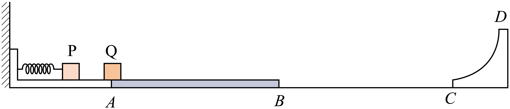

# Physics - 题目 701

**ID**: ca80d1d9e2594137b2bd66a41ef65ac0
**年级**: Grade 12
**难度**: Hard
**题型**: Calculation

## 题目
如图所示，质量M=1kg的L形轨道靠墙放置在光滑水平地面上，AB段的上表面粗糙，其余部分光滑。​​​​​​​‌距离L形轨道足够远处有一半径R=0.3m、质量m_{1}=1kg、表面光滑的四分之一圆弧轨道放在光滑水平地面上，D为四分之一圆弧轨道的最高点，圆弧轨道底端上表面与L形轨道右端上表面等高，当L形轨道的B端与四分之一圆弧轨道接触时（未碰撞），L形轨道会立即被锁定。L形轨道左端连有轻质弹簧，物块P与弹簧不拴接，物块Q静止于A点。物块P、Q均可视为质点，质量均为m_{2}=2kg。现向左推动物块P，至弹簧弹性势能E_{p}=100J时（弹簧未超出弹性限度）由静止释放物块P，弹簧恢复原长后，P与Q发生碰撞（时间极短）并立即粘在一起成为组合块向右运动，组合块与AB段的上表面之间的动摩擦因数μ=0.1，且B与C接触前，组合块恰好在L形轨道右端，并与L形轨道共速。不计空气阻力，取重力加速度大小g=10m/s^{2}。（1）求P、Q碰撞过程中损失的机械能；（2）求组合块在圆弧轨道上上升的最大高度；（3）若仅改变L形轨道的长度（轨道质量不变），并使圆弧轨道固定在地面上，组合块不从L形轨道掉落且恰能到达D点，求AB的长度；（4）若仅改变L形轨道的长度（轨道质量不变），并使圆弧轨道固定在地面上，要使组合块能经过D位置且最终恰好停在圆弧轨道的底端，求AB的长度。

## 解答

1. （1）从释放物块P到其刚离开弹簧的过程，由能量守恒定律有 $E{{}_{{\rm{p}}}}=\frac {1}{2}m{{}_{2}}v{{}_{0}^{2}}$
2. 解得 $v{{}_{0}}=10{\rm{m}}{\rm{/}}{\rm{s}}$
3. P、Q碰撞过程中动量守恒，有 $m{{}_{2}}v{{}_{0}}=2m{{}_{2}}v{{}_{1}}$
4. 解得 $v{{}_{1}}=5{\rm{m}}{\rm{/}}{\rm{s}}$
5. 由能量守恒定律有 $\frac {1}{2}m{{}_{2}}v{{}_{0}^{2}}=\frac {1}{2}\cdot 2m{{}_{2}}v{{}_{1}^{2}}+ΔE$
6. 解得 $\Delta E=50{\rm{J}}$
7. （2）组合块到达圆弧轨道前，组合块与L形轨道共速，由动量守恒定律有 $2m{{}_{2}}v{{}_{1}}=(2m{{}_{2}}+M)v{{}_{2}}$
8. 解得 $v{{}_{2}}=4{\rm{m}}{\rm{/}}{\rm{s}}$
9. 设组合块在圆弧轨道上上升的最大高度为h，组合块与圆弧轨道在水平方向上共速。水平方向上，由动量守恒定律有 $2m{{}_{2}}v{{}_{2}}=(2m{{}_{2}}+m{{}_{1}})v{{}_{3}}$
10. 解得 $v{{}_{3}}=3.2{\rm{m}}{\rm{/}}{\rm{s}}$
11. 组合块在圆弧轨道上上升的过程，由能量守恒定律有 $\frac {1}{2}\cdot 2m{{}_{2}}v{{}_{2}^{2}}=\frac {1}{2}(2m{{}_{2}}+m{{}_{1}})v{{}_{3}^{2}}+2m{{}_{2}}gh$
12. 解得 $h=0.16{\rm{m}}$
13. （3）组合块在L形轨道上相对A点滑动的距离为s_{1}时，组合块与L形轨道恰好共速，由能量守恒定律有 $\frac {1}{2}\cdot 2m{{}_{2}}v{{}_{1}^{2}}=\frac {1}{2}(2m{{}_{2}}+M)v{{}_{2}^{2}}+μ\cdot 2m{{}_{2}}gs{{}_{1}}$
14. 解得 $s{{}_{1}}=2.5{\rm{m}}$
15. L形轨道与圆弧轨道接触后，组合块恰好运动到D点的过程，由能量守恒定律有 $\frac {1}{2}\cdot 2m{{}_{2}}v{{}_{2}^{2}}=μ\cdot 2m{{}_{2}}gs{{}_{2}}+2m{{}_{2}}gR$
16. 解得 $s{{}_{2}}=5{\rm{m}}$
17. 所以AB的长度 $x=s{{}_{1}}+s{{}_{2}}=7.5{\rm{m}}$
18. （4）设L形轨道与圆弧轨道接触瞬间，组合块与圆弧轨道底端的距离为s_{3}，从L形轨道与圆弧轨道接触瞬间到最终组合块停在圆弧轨道底端的全过程，由能量守恒定律有 $\frac {1}{2}\cdot 2m{{}_{2}}v{{}_{2}^{2}}=μ\cdot 2m{{}_{2}}gs{{}_{3}}+μ\cdot 2m{{}_{2}}g(s{{}_{1}}+s{{}_{3}})\cdot 2k$ （k=1，2，3……）
19. 解得 $s{{}_{3}}=\frac {8-5k}{2k+1} {\rm{m}}$ （k=1，2，3……）
20. 当k=1时， $s{{}_{3}}=1{\rm{m}}$ ， $L=s{{}_{1}}+s{{}_{3}}$
21. 解得 $L=3.5{\rm{m}}$

## 知识点

**中文**:
  - 动量和能量的综合应用

**English**:
  - Integration of Momentum and Energy

---
