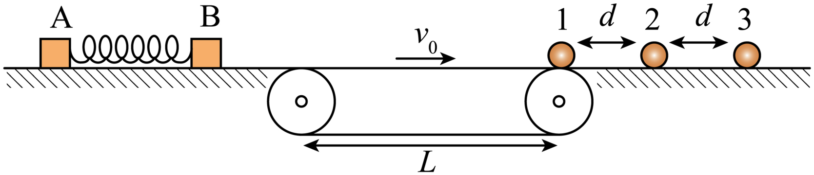

# Physics - 题目 1244

**ID**: cb8cf94306604dee857369dfdccb4d57
**年级**: Grade 12
**难度**: Hard
**题型**: Calculation

## 题目
如图所示，一水平传送带的左右两端均与水平地面平滑连接，左侧地面粗糙，右侧地面光滑，传送带两轮轴间的距离 $L=5.5{\rm{m}}$ ，传送带以 $v{{}_{0}}=3{\rm{m}}/{\rm{s}}$ 的速度顺时针传动。​​​​​​​‌质量m均为1kg的A、B两物块间有一压缩的轻弹簧（弹簧与两物块不连接），开始弹簧的压缩量 $Δx=25{\rm{c}}{\rm{m}}$ ，弹性势能 $E{{}_{{\rm{p}}}}=25.5{\rm{J}}$ 。两物块与左侧地面和传送带间的动摩擦因数 $μ$ 均为0.2。紧靠传送带右端地面上依次排放着三个完全相同的小球1、2、3，质量M均为2kg，相邻两小球间的距离d均为1m。现由静止同时释放A、B两物块，B脱离弹簧时恰好滑上传送带，此时开始计时。物块A、B和三个小球均在同一直线上，所有的碰撞为弹性碰撞，且碰撞时间忽略不计，物块和小球都可视为质点，取重力加速度 $g=10{\rm{m}}/{\rm{s}}{^{2}}$ 。求：（1）物块B滑上传送带时的速度大小；（2）小球3开始运动的时间；（3）物块B与传送带间由于摩擦产生的总热量。

## 解答

1. （1）对A、B和弹簧组成的系统根据动量守恒 $mv{{}_{{\rm{A}}}}=mv{{}_{{\rm{B}}}}$ ，根据能量守恒 $E{{}_{{\rm{p}}}}=\frac {1}{2}mv{{}_{{\rm{A}}}^{2}}+\frac {1}{2}mv{{}_{{\rm{B}}}^{2}}+{\rm μm}g\cdot {\rm{Δ}}x$ ，联立，解得 $v{{}_{{\rm{B}}}}=5{\rm{m}}{\rm{/}}{\rm{s}}$ 。
2. （2）因为 $v{{}_{{\rm{B}}}}=5{\rm{m}}{\rm{/}}{\rm{s}}>v{{}_{0}}=3{\rm{m}}/{\rm{s}}$ ，所以B在传送带上减速，假设B可以减速到与传送带共速，则设经过 $t{{}_{1}}$ 时间与传送带共速，根据牛顿第二定律 ${\rm }{\rm μm}g=ma$ ，根据运动学公式有 $v{{}_{0}}=v{{}_{{\rm{B}}}}-at{{}_{1}}{\rm }$ ，联立，解得 $t{{}_{1}}=1{\rm{s}}$ ，减速的位移大小为 $x{{}_{1}}=v{{}_{{\rm{B}}}}t{{}_{1}}-\frac {1}{2}at{{}_{1}^{2}}=4{\rm{m}}<L$ ，所以假设成立。则匀速的位移大小为 $x{{}_{2}}=L-x{{}_{1}}=1.5{\rm{m}}$ ，匀速的时间为 $t{{}_{2}}=\frac {x{{}_{2}}}{v{{}_{0}}}=0.5{\rm{s}}$ ，物块B与小球1碰撞，根据动量守恒 $mv{{}_{{\rm{B}}}}=mv{{}_{{\rm{B}}{{1}}}}+Mv{{}_{1}}$ ，根据动能守恒 $\frac {1}{2}mv{{}_{{\rm{B}}}^{2}}=\frac {1}{2}mv{{}_{{\rm{B}}{{1}}}^{2}}+\frac {1}{2}Mv{{}_{1}^{2}}$ ，解得 $v{{}_{{\rm{B}}{{1}}}}=-1{\rm{m}}{\rm{/}}{\rm{s}}$ ， $v{{}_{1}}=2{\rm{m}}{\rm{/}}{\rm{s}}$ ，因为小球1、2、3完全相同，所以小球1与小球2发生弹性碰撞后，交换速度，所以从小球1运动到小球3运动所需时间为 $t{{}_{3}}=\frac {2d}{v{{}_{1}}}=1{\rm{s}}$ ，小球3开始运动的时间为 $t=t{{}_{1}}+t{{}_{2}}+t{{}_{3}}=2.5{\rm{s}}$ 。
3. （3）物块B第一次在传送带上相对传送带的路程为 ${\rm{Δ}}x{{}_{1}}=x{{}_{1}}-v{{}_{0}}t{{}_{1}}=1{\rm{m}}$ ，物块B第一次与小球1碰撞后返回到传送带上，与传动带作用后以相同的速度大小反向再次与小球1发生碰撞，物块B第二次在传送带上相对传送带的路程为 ${\rm{Δ}}x{{}_{2}}=v{{}_{0}}\cdot \frac {2\left |{v{{}_{{\rm{B}}{{1}}}}}\right |}{a}=3{\rm{m}}$ ，物块B与小球1第二次碰撞，根据动量守恒和能量守恒可得 $mv{{}_{{\rm{B}}{{1}}}}=mv{{}_{{\rm{B}}{{2}}}}+Mv{{}_{1}}{^{\prime }}$ ， $\frac {1}{2}mv{{}_{{\rm{B}}{{1}}}^{2}}=\frac {1}{2}mv{{}_{{\rm{B}}{{2}}}^{2}}+\frac {1}{2}Mv{{}_{1}}{^{\prime }}{^{2}}$ ，解得 $v{{}_{{\rm{B}}{{2}}}}=-\frac {1}{3}{\rm{m}}{\rm{/}}{\rm{s}}$ ，物块B第三次在传送带上相对传送带的路程为 ${\rm{Δ}}x{{}_{3}}=v{{}_{0}}\cdot \frac {2\left |{v{{}_{{\rm{B}}{{2}}}}}\right |}{a}=1{\rm{m}}$ ，物块B与小球1第三次碰撞，根据动量守恒和能量守恒可得 $mv{{}_{{\rm{B}}{{2}}}}+Mv{{}_{1}}{^{\prime }}=mv{{}_{{\rm{B}}{{3}}}}+Mv{{}_{1}}{^{\prime \prime }}$ ， $\frac {1}{2}mv{{}_{{\rm{B}}{{2}}}^{2}}+\frac {1}{2}Mv{{}_{1}}{^{\prime }}{^{2}}=\frac {1}{2}mv{{}_{{\rm{B}}{{3}}}^{2}}+\frac {1}{2}Mv{{}_{1}}{^{\prime \prime }}{^{2}}$ ，解得 $v{{}_{{\rm{B}}{{3}}}}=-\frac {1}{9}{\rm{m}}{\rm{/}}{\rm{s}}$ ，物块B第四次在传送带上相对传送带的路程为 ${\rm{Δ}}x{{}_{4}}=v{{}_{0}}\cdot \frac {2\left |{v{{}_{{\rm{B}}{{3}}}}}\right |}{a}=\frac {1}{3}{\rm{m}}$ ，所以，物块B与传送带间由于摩擦产生的总热量为 $Q={\rm μm}g（{\rm{Δ}}x{{}_{1}}+{\rm{Δ}}x{{}_{2}}+{\rm{Δ}}x{{}_{3}}+{\rm{Δ}}x{{}_{4}}）=\frac {32}{3}{\rm{J}}$

## 知识点

**中文**:
  - 动量和能量的综合应用
  - 动量守恒中的多次碰撞问题

**English**:
  - Integration of Momentum and Energy
  - Multiple Collisions in Momentum Conservation

---
