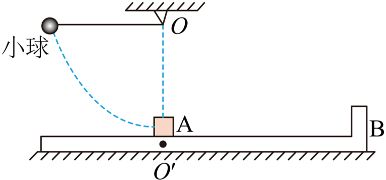

# Physics - 题目 6

**ID**: cbd7721bc5c14b82b7848235bc9662fb
**年级**: Grade 12
**难度**: Hard
**题型**: Calculation

## 题目
如图所示，“L”型平板B静置在地面上，小物块A处于平板B上的O′点，平板O′点左侧粗糙，右侧光滑。​​​​​​​‌用长为l的不可伸长的轻绳将质量为M的小球悬挂在O′点正上方的O点，轻绳处于水平拉直状态。将小球由静止释放，下摆至最低点与小物块A发生碰撞，碰后小球继续沿原方向上升到距离B板最大高度为h=0.2m的位置，A以一定的初速度沿平板滑动直至与B右侧挡板发生弹性碰撞。一段时间后，A返回到O点的正下方时，相对于地面的速度减为零，此过程中小球与A没有再次碰撞。已知小球的质量M=0.2kg，绳长l=0.8m，A的质量m_{A}=0.1kg，B的质量m_{B}=0.3kg，A与B之间的动摩擦因数μ_{1}=0.4，B与地面间的动摩擦因数μ_{2}=0.225，取重力加速度g=10m/s^{2}。整个过程中A始终在B上，所有碰撞时间忽略不计，不计空气阻力，小球和小物块A均视为质点，求：（1）小球与A碰撞后，A的速度v_{0}；（2）B光滑部分的长度d；（3）运动过程中A与B之间由于摩擦所产生的热量Q。

## 解答

1. （1）设小球与A碰前的速度为 $v{{}_{1}}$ ，碰后的速度为 $v{{}_{2}}$ ，则由机械能守恒定律知： $Mgl=\frac {1}{2}Mv{{}_{1}^{2}}$ ， $Mgh=\frac {1}{2}Mv{{}_{2}^{2}}$ ，对小球与A的碰撞过程，由动量守恒定律知 $Mv{{}_{1}}=Mv{{}_{2}}+m{{}_{A}}v{{}_{0}}$ ，解得 $v{{}_{0}}=4{\rm{m}}{\rm{/}}{\rm{s}}$ 。
2. （2）A向右运动的过程中，B一直处于静止状态；由于A与B的碰撞过程为弹性碰撞，取A的初速度方向为正方向，由动量守恒定律知 $m{{}_{{\rm{A}}}}v{{}_{0}}=m{{}_{{\rm{A}}}}v{{}_{{\rm{A}}}}+m{{}_{{\rm{B}}}}v{{}_{{\rm{B}}}}$ ，由能量守恒定律知 $\frac {1}{2}m{{}_{{\rm{A}}}}v{{}_{0}^{2}}$  $=\frac {1}{2}m{{}_{{\rm{A}}}}v{{}_{{\rm{A}}}^{2}}$  $+\frac {1}{2}m{{}_{{\rm{B}}}}v{{}_{{\rm{B}}}^{2}}$ ，联立解得 $v{{}_{{\rm{A}}}}=\mathrm{-}2{\rm{m}}{\rm{/}}{\rm{s}}$ ，方向水平向左， $v{{}_{{\rm{B}}}}=2{\rm{m}}{\rm{/}}{\rm{s}}$ ，方向水平向右，设A与B碰后再次回到 $O^{′}$ 点时，做匀速运动的时间为 $t{{}_{1}}$ ，做减速运动的时间为 $t{{}_{2}}$ ，在 $t{{}_{1}}$ 时间内，B做匀减速直线运动，由牛顿第二定律知B的加速度 $a{{}_{{\rm{B}}}}=\frac {μ{{}_{2}}\left ({m{{}_{{\rm{A}}}}+m{{}_{{\rm{B}}}}}\right )g}{m{{}_{{\rm{B}}}}}=3{\rm{m}}{\rm{/}}{\rm{s}}{^{{{2}}}}$ ，在 $t{{}_{2}}$ 时间内，A的加速度 $a{{}_{{\rm{A}}}}=\frac {μ{{}_{1}}m{{}_{{\rm{A}}}}g}{m{{}_{{\rm{A}}}}}=μ{{}_{1}}g=4{\rm{m}}{\rm{/}}{\rm{s}}{^{{{2}}}}{\rm ，B}$ 的加速度为 $a{{}_{{\rm{B}}}}^{′}=\frac {μ{{}_{1}}m{{}_{{\rm{A}}}}g+μ{{}_{2}}\left ({m{{}_{{\rm{A}}}}+m{{}_{{\rm{B}}}}}\right )g}{m{{}_{{\rm{B}}}}}=\frac {13}{3}{\rm{m}}{\rm{/}}{\rm{s}}{^{2}}$ ，在 $t{{}_{1}}$ 这段时间内A运动的位移与B运动的位移大小之和等于d，则有 $\left |{v{{}_{{\rm{A}}}}}\right |t{{}_{1}}+v{{}_{{\rm{B}}}}t{{}_{1}}-\frac {1}{2}a{{}_{{\rm{B}}}}t{{}_{1}^{2}}$  $=d$ ，而A在 $t{{}_{1}}+t{{}_{2}}$ 这段时间内运动的总位移也等于d，则有 $\left |{v{{}_{{\rm{A}}}}}\right |t{{}_{1}}+\frac {v{{}_{{\rm{A}}}^{2}}}{2a{{}_{{\rm{A}}}}}$  $=d$ ，联立解得 $t{{}_{1}}=\frac {1}{3}{\rm{s}}$ ， $t{{}_{1}}=1{\rm{s}}$ （舍去）， $d=\frac {7}{6}{\rm{m}}$ 。
3. （3）由（2）问中分析可知 $t{{}_{2}}=\frac {v{{}_{{\rm{A}}}}}{a{{}_{{\rm{A}}}}}=0.5{\rm{s}}$ ，在 $t{{}_{1}}$ 时刻B的速度为 $v{{}_{{\rm{B}}}}^{′}=v{{}_{{\rm{B}}}}-a{{}_{{\rm{B}}}}t{{}_{1}}=1{\rm{m}}{\rm{/}}{\rm{s}}$ ，则在A做减速运动阶段，B运动的时间 $t{{}_{3}}=\frac {v^{′}{{}_{{\rm{B}}}}}{a^{′}{{}_{{\rm{B}}}}}=\frac {3}{13}{\rm{s}}<0.5{\rm{s}}$ ，这表明B在A停止之前已停止运动，且由于A对B的最大静摩擦力 $f{{}_{1}}=μ{{}_{1}}m{{}_{{\rm{A}}}}g<μ{{}_{2}}\left ({m{{}_{{\rm{A}}}}+m{{}_{{\rm{B}}}}}\right )g$ ，故当B停止运动后，不会再向左运动；则在A运动到B粗糙面之后B运动的位移为 $x{{}_{{\rm{B}}}}=\frac {v^{′}{{}_{{\rm{B}}}}}{2}t{{}_{3}}=\frac {3}{26}{\rm{m}}{\rm ，A}$ 运动到B粗糙面后，运动的位移为 $x{{}_{{\rm{A}}}}=\frac {v{{}_{{\rm{A}}}^{2}}}{2a{{}_{{\rm{A}}}}}=0.5{\rm{m}}$ ，故运动过程中A相对于B在其粗糙面上运动的位移为 $x=x{{}_{{\rm{A}}}}+x{{}_{{\rm{B}}}}=\frac {8}{13}{\rm{m}}$ ，则在此过程中产生的热量 $Q=μ{{}_{1}}m{{}_{{\rm{A}}}}gx=\frac {16}{65}{\rm{J}}$ 。

## 知识点

**中文**:
  - 动量和能量的综合应用

**English**:
  - Integration of Momentum and Energy

---
