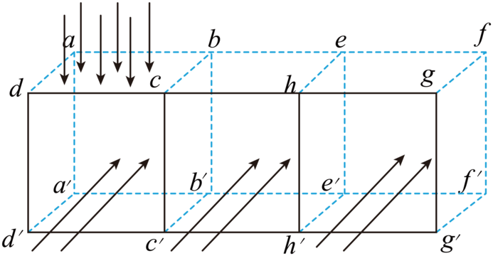

# Physics - 题目 210

**ID**: d99da87316334910a7c89265d200fbc3
**年级**: Grade 12
**难度**: Hard
**题型**: Calculation

## 题目
如图所示，三个相同的立方体并排放置，立方体的边长为L．有匀强磁场垂直于 $dcc^{′}d^{′}$ 面布满整个空间，磁场应强度大小为B，方向由c指向b。​​​​​​​‌最右边立方体的底面 $e^{′}f^{′}g^{′}h^{′}$ 放置有与底面等大的荧光屏，带电粒子打在荧光屏上会被吸收，并且荧光屏会发光。一束质量为m、电荷量为q的正电粒子，均匀分布于整个面 $abcd$ 垂直向下射入磁场。不计粒子的重力和粒子间的相互作用。求：（1）当粒子的速度为多大时，从c点入射的粒子能打在 $g^{′}$ 处？（2）当荧光屏上没有发光，即没有粒子打在荧光屏上时，粒子的速度范围为多少？（3）当粒子入射速度 $v=\frac {2\sqrt {3}qBL}{3m}$ ，空间施加一个与匀强磁场相同方向的匀强电场，电场强度的大小为 $E=\frac {3B{^{2}}qL}{2π{^{2}}m}$ 。此时荧光屏上的发光区域面积为多少？

## 解答

1. （1）从c入射的粒子运动到 $g^{′}$ ，如下图，有
2. $L{^{2}}+(2L-r{{}_{1}}){^{2}}=r{{}_{1}^{2}}$
3. 带电粒子做匀速圆周运动有 $qv{{}_{1}}B=\frac {mv{{}_{1}^{2}}}{r{{}_{1}}}$
4. 计算得 $v{{}_{1}}=\frac {5BLq}{4m}$
5. （2）当从c入射的粒子运动到 $h^{′}$ 时，如下图，几何分析有 $r{{}_{2}}=L$
6. 
7. 带电粒子做匀速圆周运动有 $qv{{}_{2}}B=\frac {mv{{}_{2}^{2}}}{r{{}_{2}}}$ ， $v{{}_{2}}=\frac {BLq}{m}$
8. 当从d入射的粒子运动到 $g^{′}$ 时，如下图，几何分析有 $L{^{2}}+(3L-r{{}_{3}}){^{2}}=r{{}_{3}^{2}}$
9. 
10. 带电粒子做匀速圆周运动有 $qv{{}_{3}}B=\frac {mv{{}_{3}^{2}}}{r{{}_{3}}}$ ， $v{{}_{3}}=\frac {5BLq}{3m}$
11. 当带电粒子的速度 $v<v{{}_{2}}$ 或 $v>v{{}_{3}}$ 时，没有粒子打在荧光屏上，所以当带电粒子的速度 $v<\frac {BLq}{m}$ 或 $v>\frac {5BLq}{3m}$ 时，荧光屏上没有发光。
12. （3）分析知，荧光屏发光区域为一长方形。当入射粒子的速度 $v=\frac {2\sqrt {3}qBL}{3m}$ 时，由 $qvB=\frac {mv{^{2}}}{r}$
13. 得粒子在磁场中圆周运动的半径 $r=\frac {2\sqrt {3}}{3}L$
14. 几何分析知，由c入射的粒子打在 $h^{′}$ 右侧 $\sqrt {3}L-L$ 处，则荧光屏上发光区域的宽为 $\sqrt {3}L-L$ ，如下图，打在荧光屏的粒子其在磁场中运动的圆弧对应圆心角为 $120{}\degree $
15. 
16. 粒子圆周运动的周期为 $T=\frac {2{\rm{π}}m}{qB}$
17. 则粒子从入射到打在荧光屏的时间 $t=\frac {1}{3}T$
18. 沿电场的方向，粒子做初速度为0的匀加速直线运动，加速度 $a=\frac {Eq}{m}$
19. 沿电场方向的位移 $y=\frac {1}{2}at{^{2}}$
20. 计算得 $y=\frac {1}{3}L$
21. 则荧光屏上发光区域的长为 $L-y=\frac {2}{3}L$
22. 所以荧光屏上发光区域的面积为 $S=\frac {2}{3}L(\sqrt {3}L-L)=\frac {2(\sqrt {3}-1)}{3}L{^{2}}$

## 知识点

**中文**:
  - 带电粒子在组合场中的运动

**English**:
  - Motion in Combined Fields

---
