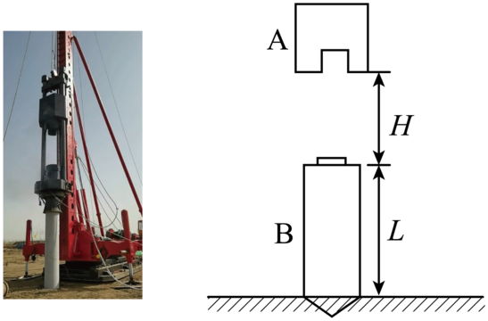

# Physics - 题目 96

**ID**: dc441d9fc9a54dfc869a931fd1b78c11
**年级**: Grade 12
**难度**: Hard
**题型**: Calculation

## 题目
建筑工地上有一种老式打桩机，如左图所示，它通过类似于柴油机压缩可燃气体做功和撞击，一点点把混凝土柱子打入土壤。​​​​​​​‌将打桩机工作的过程简化成如右图所示的模型，物体 ${\rm{A}}$ 为打桩机上方的重锤、物体 ${\rm{B}}$ 为下方置于水平地面上的混凝土柱子， ${\rm{A}}$ 的下端是汽缸， ${\rm{B}}$ 的上端是活塞（其长度可忽略不计），A、B中心在同一竖直线上。A从静止释放后自由下落，活塞恰好能进入汽缸并瞬间压缩内部气体，使A、B发生碰撞后立刻向汽缸内喷射燃油并点火使之爆燃做功，将内能转化成A、B的机械能，转化效率为 $50{\rm{\%}}$ ，这一过程A、B相互作用的时间极短。第一次爆燃后， ${\rm{A}}$ 恰好返回到了初始位置，下次碰撞前物体 ${\rm{B}}$ 已经停止运动。已知 ${\rm{A}}$ 的质量为 $m{{}_{{\rm{A}}}}=1000{\rm{k}}{\rm{g}}{\rm ，B}$ 的质量为 $m{{}_{{\rm{B}}}}=9000{\rm{k}}{\rm{g}}$ ，初始时 ${\rm{A}}$ 与 ${\rm{B}}$ 间的高度差为 $H=1.25{\rm{m}}$ ，混凝土柱子 ${\rm{B}}$ 长度为 $L=4.5{\rm{m}}$ （不计初始处于地面下的深度）。已知 ${\rm{B}}$ 进入地面后所受的阻力与 ${\rm{B}}$ 进入地面的深度 $h$ 满足 $f=\left ({\frac {0.8h}{L}+1}\right )m{{}_{{\rm{B}}}}g$ 。不计空气阻力，不计压缩气体时对气体做功和喷射燃油时做功。其中 $g=10{\rm{m}}/{\rm{s}}{^{2}},\sqrt {61}=7.81$ 。（1）求第一次爆燃产生的内能 $E$ 和爆燃后瞬间混凝土柱子 ${\rm{B}}$ 的速率；（2）在第二次碰撞前混凝土柱子 ${\rm{B}}$ 停止运动时进入地面的深度；（3）如果第一次爆燃后不再喷射燃油，在第二次碰撞后的足够长时间里混凝土柱子 ${\rm{B}}$ 进入地面的最大深度（保留3位有效数字）；如果每次碰撞后都喷射燃油，并且爆燃转化的机械能相同，要使混凝土柱子 ${\rm{B}}$ 全部进入地面，求需要爆燃的最少次数（不喷射燃油时 ${\rm{A}}$ 、 ${\rm{B}}$ 相互碰撞不计其能量的损失）；

## 解答

1. （1）第一次碰撞前，对 ${\rm{A}}$ 进行分析，由动能定理有 $m{{}_{{\rm{A}}}}gH=\frac {1}{2}m{{}_{{\rm{A}}}}v{{}_{0}^{2}}-0$
2. 解得 $v{{}_{0}}=5{\rm{m}}/{\rm{s}}$
3. ${\rm{A}}$ 、 ${\rm{B}}$ 碰撞瞬间由动量守恒有 $m{{}_{{\rm{A}}}}v{{}_{0}}=-m{{}_{{\rm{A}}}}v{{}_{{\rm{A}}}}+m{{}_{{\rm{B}}}}v{{}_{{\rm{B}}}}$
4. 由能量守恒有 $50{\rm{\%}}E=\frac {1}{2}m{{}_{{\rm{A}}}}v{{}_{{\rm{A}}}^{2}}+\frac {1}{2}m{{}_{{\rm{B}}}}v{{}_{{\rm{B}}}^{2}}-\frac {1}{2}m{{}_{{\rm{A}}}}v{{}_{0}^{2}}$
5. 因为 ${\rm{A}}$ 回到初始点，所以有 $v{{}_{{\rm{A}}}}=v{{}_{0}}=5{\rm{m}}/{\rm{s}}$
6. 解得 $v{{}_{{\rm{B}}}}=\frac {10}{9}{\rm{m}}/{\rm{s}}$ ， $E=\frac {1}{9}\times 10{^{5}}{\rm{J}}$
7. （2）第一次爆燃后到下次碰撞前，物体 ${\rm{B}}$ 向下做减速运动直到停止，设 ${\rm{B}}$ 下移的深度为 $h{{}_{{{0}}}}$ ，因物体 ${\rm{B}}$ 所受阻力与进入地面的深度成正比，则平均作用力做功表示克服阻力做的功，由动能定理有 $m{{}_{{\rm{B}}}}gh{{}_{0}}-\frac {1}{2}\left [\left ({\frac {0.8h{{}_{0}}}{L}+1}\right )m{{}_{{\rm{B}}}}g+m{{}_{{\rm{B}}}}g\right ]h{{}_{0}}=0-\frac {1}{2}m{{}_{{\rm{B}}}}v{{}_{{\rm{B}}}^{2}}$
8. 解得 $h{{}_{0}}=\frac {5}{6}{\rm{m}}$
9. （3）如果只喷射一次，假设 ${\rm{B}}$ 始终未全部进入地面，对整个过程，设 ${\rm{B}}$ 滑动的总距离为 $x{{}_{总}}$ ，由能量守恒有 $50{\rm{\%}}E+m{{}_{{\rm{A}}}}g\left ({H+h{{}_{总}}}\right )+m{{}_{{\rm{B}}}}gh{{}_{总}}=\frac {1}{2}\left [\left ({\frac {0.8h{{}_{总}}}{L}+1}\right )m{{}_{{\rm{B}}}}g+m{{}_{{\rm{B}}}}g\right ]h{{}_{总}}$
10. 舍去负值解得 $h{{}_{总}}=\frac {15\pm 5\sqrt {61}}{24}{\rm{m}}\approx 2.25{\rm{m}}<L$
11. 则假设成立。第二次碰撞后直到 ${\rm{B}}$ 最终停止， ${\rm{B}}$ 进入地面的最大深度约为 $2.25{\rm{m}}$ ，设喷射 $n$ 次恰好使 ${\rm{B}}$ 全部进入地面，即进入地面的深度为 $L$ ，由能量守恒有 $50{\rm{\%}}nE+m{{}_{{\rm{A}}}}g\left ({H+L}\right )+m{{}_{{\rm{B}}}}gL=\frac {1}{2}\left [\left ({\frac {0.8L}{L}+1}\right )m{{}_{{\rm{B}}}}g+m{{}_{{\rm{B}}}}g\right ]L$
12. 解得 $n=18.81$
13. 所以最少需要爆燃19次。

## 知识点

**中文**:
  - 动量和能量的综合应用

**English**:
  - Integration of Momentum and Energy

---
