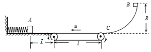

# Physics - 题目 826

**ID**: dd6ea57b25a14001ba1c591cadf30cbb
**年级**: Grade 12
**难度**: Hard
**题型**: Calculation

## 题目
如图所示，一轻质弹簧左端固定，右端连接着质量M=6kg的物块A。​​​​​​​‌A与传送带左端相距L=2m，装置的中间是水平传送带，它与左右两边的台面等高，并能平滑对接。传送带的皮带轮逆时针匀速转动，使传送带上表面以u=2m/s匀速运动。传送带的右边是一半径R=1.25m位于竖直平面内的光滑 $\frac {1}{4}$ 圆弧轨道。质量m=2kg的物块B从圆弧的最高处由静止释放。已知物块B与传送带之间的动摩擦因数μ=0.1，传送带两轴之间的距离l=4.5m。设第一次碰撞前，物块A静止，物块B与A发生碰撞后被弹回，物块A、B间的碰撞皆为弹性正碰。取g=10m/s^{2}。求：(1)物块B滑到圆弧的最低点C时对轨道的压力；(2)物块B与物块A第一次碰撞后弹簧的最大弹性势能；(3)如果物块A、B每次碰撞后，至再次相碰前A已回到平衡位置并被立即锁定，当A、B再次碰撞前瞬间解除锁定，求物块B从第一次与物块A碰撞后到第三次与物块A碰撞的时间。

## 解答

1. (1)物块B沿光滑曲面下滑过程中，根据机械能守恒
2. $mgR=\frac {1}{2}mv{{}_{0}^{2}}$
3. 解得
4. v_{0}=5m/s
5. 在圆弧最低点C，根据牛顿第二定律
6. $F-mg=\frac {mv{^{2}}}{R}$
7. 解得
8. F=60N
9. 由牛顿第三定律可知，物块B对轨道的压力大小
10. F′=F=60N
11. 方向：竖直向下。
12. (2)在传送带上，对物块B，根据牛顿第二定律
13. ${\rm μm}g=ma$
14. 设物块B通过传送带后运动速度大小为v，根据运动学公式
15. v^{2}-v_{0}^{2}=2al
16. 解得
17. v=4m/s
18. 由于
19. v＞u=2m/s
20. 所以B与A第一次碰撞前的速度为
21. v=4m/s
22. 设物块A、B第一次碰撞后的速度分别为v_{2}、v_{1}
23. mv=mv_{1}+Mv_{2}
24. $\frac {1}{2}mv{^{2}}=\frac {1}{2}mv{{}_{1}^{2}}+\frac {1}{2}Mv{{}_{2}^{2}}$
25. 解得
26. v_{1}=－2m/s，v_{2}=2m/s
27. 物块A的速度为零时弹簧压缩量最大，弹簧弹性势能最大
28. $E{{}_{{\rm{P}}}}=\frac {1}{2}Mv{{}_{2}^{2}}=12{\rm{J}}$
29. (3) 第一次碰撞后物块B沿水平台面向右匀速运动，设物块B在传送带上向右运动的最大位移为l′，根据动能定理
30. $-{\rm μm}gl^{′}=0-\frac {1}{2}mv{{}_{1}^{2}}$
31. 解得
32. l′=2m＜4.5m
33. 物块B不能通过传送带运动到右边的曲面上，当物块B在传送带上向右运动的速度为零后，将会沿传送带向左加速运动，可以判断，物块B运动到左边台面时的速度大小为v_{1}′=2m/s，继而与物块A发生第二次碰撞。
34. 设第1次碰撞到第2次碰撞之间，物块B在传送带上运动的时间为t_{1}。由动量定理得
35. μmgt_{1}=2mv_{1}
36. 解得
37. t_{1}=4s
38. 物块B在水平台面上运动的时间为t_{2}，则
39. $t{{}_{2}}=\frac {2L}{v{{}_{1}}}=2{\rm{s}}$
40. 设物块A、B第二次碰撞后的速度分别为v_{4}、v_{3}
41. $mv^{′}{{{}_{1}}}=mv{{}_{3}}+Mv{{}_{4}}$
42. $\frac {1}{2}mv^{′}{{{}_{1}}}{^{2}}=\frac {1}{2}mv{{}_{3}^{2}}+\frac {1}{2}Mv{{}_{4}^{2}}$
43. 解得
44. $v{{}_{3}}=-1{\rm{m}}{\rm{/}}{\rm{s}}$
45. 同理可得，第2次碰撞到第3次碰撞之间，物块B在传送带运动的时间为t_{3}
46. ${\rm μm}gt{{}_{3}}=2mv{{}_{3}}$
47. 解得
48. t_{3}=2s
49. 物块B在水平台面上运动的时间为t_{4}，则
50. $t{{}_{4}}=\frac {2L}{v{{}_{3}}}=4{\rm{s}}$
51. 物块B从第一次与物块A碰撞后到第三次与物块A碰撞的时间
52. t= t_{1}+t_{2}+t_{3}+t_{4}=12s

## 知识点

**中文**:
  - 动量和能量的综合应用
  - 动量守恒中的多次碰撞问题
  - 应用动能定理求解多阶段、多过程问题
  - 弹簧问题中机械能守恒定律的应用

**English**:
  - Integration of Momentum and Energy
  - Multiple Collisions in Momentum Conservation
  - Multi-stage/Multi-process Problems
  - Spring Problems

---
