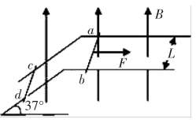

# Physics - 题目 1273

**ID**: e5a5ec6022ac49459b3c7fc26ba6f109
**年级**: Grade 12
**难度**: Hard
**题型**: Calculation

## 题目
两根相距为L的足够长的金属弯角光滑导轨如图所示放置，它们各有一边在同一水平面内，另一边与水平面的夹角为37°，质量相同的金属细杆ab、cd与导轨垂直接触形成闭合回路，导轨的电阻不计，回路总电阻为2R，整个装置处于磁感应强度大小为B，方向竖直向上的匀强磁场中，当ab杆在平行于水平导轨的拉力F作用下向右以速度v沿导轨匀速运动时，cd杆恰好处于静止状态，重力加速度为g。​​​​​​​‌求：（1）ab杆所受拉力F的大小；（2）金属细杆质量m；（3）回路中电流的总功率P。

## 解答

1. （1）回路中感应电流大小
2. $I=\frac {BLv}{2R}$
3. ab杆匀速运动，有
4. $F=BIL$
5. 解得
6. $F=\frac {B{^{2}}L{^{2}}v}{2R}$
7. （2）分析cd杆受力情况，由F_{合}=0有
8. $F{{}_{安}}=mg{\tan}37{}^\circ $
9. 又
10. $F{{}_{安}}=BIL$
11. 解得
12. $m=\frac {2B{^{2}}L{^{2}}v}{3gR}$
13. （3）回路中电流的总功率
14. $P=I{^{2}}\times 2R=\frac {B{^{2}}L{^{2}}v}{2R}$

## 知识点

**中文**:
  - 双杆模型
  - 电磁感应现象中的功能问题

**English**:
  - Double Rod Model
  - Work-Energy Problems in EM Induction

---
