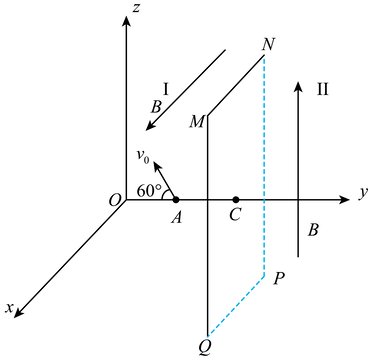

# Physics - 题目 1732

**ID**: e88f71ebce93492c8ad72b3d78d242c9
**年级**: Grade 12
**难度**: Hard
**题型**: Calculation

## 题目
如图所示，在空间直角坐标系中，无限大平面MNPQ（与y轴垂直且交于C点）左侧区域Ⅰ存在沿x轴正方向的匀强磁场， $OC=2L$ ，右侧区域Ⅱ存在沿z轴正方向的匀强磁场，左、右两侧磁场的磁感应强度大小相等；现从坐标为 $\left ({0,L,0}\right )$ 的A点沿yOz平面发射一质量为m，电荷量为 $+q$ 的粒子，粒子的初速度大小为 $v{{}_{0}}$ 、方向与y轴负方向的夹角为60°，经一段时间后粒子恰好垂直于平面MNPQ进入区域Ⅱ，不计粒子的重力，求：（1）磁感应强度B的大小；（2）粒子从A点出发至第2次到达平面MNPQ的时间；（3）若在区域Ⅱ加一电场强度为E、方向沿z轴负方向的匀强电场，求粒子从A点出发后第n次经过平面MNPQ时的速度大小。​​​​​​​‌

## 解答

1. （1）由题意可知， $l{{}_{AC}}=L$
2. 粒子的轨迹如图所示， $R\sin 60{}\degree =l{{}_{AC}}$
3. 
4. 由 $qv{{}_{0}}B=\frac {mv{{}_{0}^{2}}}{R}$
5. 可得： $B=\frac {\sqrt {3}mv{{}_{0}}}{2qL}$
6. （2）粒子以水平速度 $v{{}_{0}}$ 进入区域Ⅱ，粒子从A点出发至第2次到达平面MNPQ的轨迹如图所示，在区域Ⅰ中，轨迹的圆心角为120°，对应的时间为： $t{{}_{1}}=\frac {120{}\degree }{360{}\degree }T$
7. 
8. 在区域 $ΙΙ$ 中，轨迹为半圆，对应的时间为： $t{{}_{2}}=\frac {1}{2}T$
9. $T=\frac {2{\rm{π}}m}{qB}$
10. 得 $T=\frac {4\sqrt {3}{\rm{π}}L}{3v{{}_{0}}}$
11. ： $t=t{{}_{1}}+t{{}_{2}}=\frac {5}{6}T=\frac {10\sqrt {3}}{9}\frac {{\rm{π}}L}{v{{}_{0}}}$
12. （3）粒子第一次以水平速度 $v{{}_{0}}$ 进入在区域Ⅱ后，在平行于xoy平面的平面内做匀速圆周运动，在电场力作用下，沿z轴方向做加速度为a的匀加速直线运动，运动时间为 $\frac {1}{2}T$ ，粒子第1次经过平面MNPQ时的速度为 $v{{}_{0}}$ ，第2次经过平面MNPQ时获得了沿z轴负方向的速度 $v{{}_{z2}}$ ，由牛顿第二定律： $qE=ma$
13. $v{{}_{z2}}=a\frac {T}{2}$
14. 在区域Ⅰ以速度 $v{{}_{2}}$ 做匀速圆周运动，轨迹如图所示
15. 
16. 显然，第3次经过平面MNPQ时沿z轴负方向的速度 $v{{}_{z3}}=v{{}_{z2}}$
17. 再在区域Ⅱ中，在平行于xoy平面的平面内做匀速圆周运动，运动时间仍为 $\frac {1}{2}T$
18. 在电场力作用下，沿 $z$ 轴方向做加速度为a的匀加速直线运动
19. 第4次经过平面MMPQ时，沿z轴负方向的速度 $v{{}_{z4}}=v{{}_{z3}}+a\frac {T}{2}=2a\frac {T}{2}$
20. 第5次经过平面MNPQ时，沿z轴负方向的速度 $v{{}_{z5}}=v{{}_{z4}}$
21. 第6次经过平面MNPQ时，沿z轴负方向的速度 $v{{}_{z6}}=v{{}_{z5}}+a\frac {T}{2}=3a\frac {T}{2}$
22. 粒子的速度为： $v{{}_{n}}=\sqrt {v{{}_{0}^{2}}+v{{}_{zn}^{2}}}$
23. 依次类推可知：①当n为偶数时
24. 粒子第n次经过平面MNPQ时，沿z轴负方向的速度 $v{{}_{zn}}=\frac {n}{2}\cdot a\frac {T}{2}$
25. 解得： $v{{}_{n}}=\sqrt {v{{}_{0}^{2}}+\frac {n{^{2}}q{^{2}}E{^{2}}{\rm{π}}{^{2}}L{^{2}}}{3m{^{2}}v{{}_{0}^{2}}}}$
26. ②当n为奇数时
27. 粒子第n次经过平面MNPQ时，沿z轴负方向的速度 $v{{}_{zn}}=\frac {n-1}{2}\cdot a\frac {T}{2}$
28. 粒子的速度为： $v{{}_{n}}=\sqrt {v{{}_{0}^{2}}+v{{}_{zn}^{2}}}=\sqrt {v{{}_{0}^{2}}+\frac {{\left({n-1}\right)^{2}}q{^{2}}E{^{2}}{\rm{π}}{^{2}}L{^{2}}}{3m{^{2}}v{{}_{0}^{2}}}}$

## 知识点

**中文**:
  - 带电粒子在组合场中的运动

**English**:
  - Motion in Combined Fields

---
