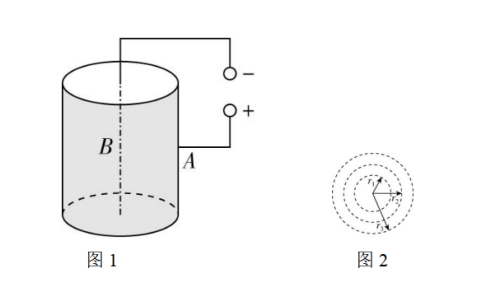

# Physics - 题目 411

**ID**: f3d49e57d9614f17a7452f2c2e73da41
**年级**: Grade 12
**难度**: Hard
**题型**: Calculation

## 题目
（12分）如图1所示，金属圆筒 $A$ 接高压电源的正极，其轴线上的金属线 $B$ 接负极。​​​​​​​‌（1） 设 $A$ 、 $B$ 两极间电压为 $U$ ，求在 $B$ 极附近电荷量为 $Q$ 的负电荷到达 $A$ 极过程中静电力做的功 $W$ 。（2） 已知筒内距离轴线 $r$ 处的电场强度大小 $E=k\frac{2\lambda }{r}$ ，其中 $k$ 为静电力常量， $\lambda $  为金属线 $B$ 单位长度的电荷量。如图2所示，在圆筒内横截面上，电荷量为 $q$ 、质量为 $m$ 的粒子绕轴线做半径不同的匀速圆周运动，其半径为 ${r}_{1}$ 、 ${r}_{2}$ 和 ${r}_{3}$ 时的总能量分别为 ${E}_{1}$ 、 ${E}_{2}$ 和 ${E}_{3}$ 。若 ${r}_{3}-{r}_{2}={r}_{2}-{r}_{1}$ ，推理分析并比较 $({E}_{3}-{E}_{2})$ 与 $({E}_{2}-{E}_{1})$ 的大小。（3） 图1实为某种静电除尘装置原理图，空气分子在 $B$ 极附近电离，筒内尘埃吸附电子而带负电，在电场作用下最终被 $A$ 极收集。使分子或原子电离需要一定条件。以电离氢原子为例。根据玻尔原子模型，定态氢原子中电子在特定轨道上绕核做圆周运动，处于特定能量状态，只有当原子获得合适能量才能跃迁或电离。若氢原子处于外电场中，推导说明外电场的电场强度多大能将基态氢原子电离。（可能用到：元电荷 $e=1.6×{10}^{-19}\mathrm{C}$ ，电子质量 $m=9.1×{10}^{-31}\mathrm{k}\mathrm{g}$ ，静电力常量 $k=9.0×{10}^{9}\mathrm{N}\cdot {\mathrm{m}}^{2}/{\mathrm{C}}^{2}$ ，基态氢原子轨道半径 $a=5.3×{10}^{-11}\mathrm{m}$ 和能量 ${E}_{0}=-13.6\mathrm{e}\mathrm{V}$ ）

## 解答

1. （1）  $B$ 极附近电荷量为 $Q$ 的负电荷到达 $A$ 极过程中，静电力做的功 $W=QU$ （2分）
2. （2） 粒子做半径为 $r$ 的匀速圆周运动，静电力提供向心力，
3. 由牛顿第二定律得 $qE=m\frac{{v}^{2}}{r}$ （1分）
4. $E=k\frac{2\lambda }{r}$ ，
5. 粒子的动能 ${E}_{\mathrm{k}}=\frac{1}{2}m{v}^{2}$ ，
6. 联立解得 ${E}_{\mathrm{k}}=k\lambda q$ （1分）
7. 设无穷远处电势为0，粒子从无穷远处移动到半径为 $r$ 处静电力做功为 $W\prime =q{\int }_{\mathrm{\infty }}^{r}E\mathrm{d}r=q{\int }_{\mathrm{\infty }}^{r}k\frac{2\lambda }{r}\mathrm{d}r=-2qk\lambda \ln r$ （1分）
8. $W\prime =-\mathrm{\Delta }{E}_{\mathrm{p}}$ ，
9. 则粒子在半径为 $r$ 处的电势能为 ${E}_{\mathrm{p}}=-W\prime =2qk\lambda \ln r$ ，
10. 粒子在半径为 $r$ 处的总能量为 $E=2qk\lambda \ln r+k\lambda q$ ，
11. ${E}_{2}-{E}_{1}=2k\lambda q(\ln {r}_{2}-\ln {r}_{1})$ （1分）
12. ${E}_{3}-{E}_{2}=2k\lambda q(\ln {r}_{3}-\ln {r}_{2})$ （1分）
13. ${r}_{3}-{r}_{2}={r}_{2}-{r}_{1}$ ，
14. 根据函数 $y=\ln x$ 的图像知，随 $x$ 增加 $y$ 增加得越来越慢，则
15. ${E}_{3}-{E}_{2}<{E}_{2}-{E}_{1}$ （1分）
16. （3） 电子绕核做匀速圆周运动，库仑力提供向心力，
17. 由牛顿第二定律得 $k\frac{{e}^{2}}{{a}^{2}}=m\frac{{v}^{2}}{a}$ （1分）
18. 电子从基态移动到无穷远处克服库仑力做功
19. ${W}_{1}={\int }_{a}^{\mathrm{\infty }}\frac{k{e}^{2}}{{r}^{2}}\mathrm{d}r=k\frac{{e}^{2}}{a}$ （1分）
20. 则电子在基态的电势能为 ${E}_{\mathrm{p}}=-{W}_{1}$ （1分）
21. 根据能量守恒定律知，将基态氢原子电离所需的能量 $\mathrm{\Delta }E$ 等于电子的动能和电势能之和的绝对值，即 $\mathrm{\Delta }E=\left|{E}_{\mathrm{k}}+{E}_{\mathrm{p}}\right|=k\frac{{e}^{2}}{2a}$ ，
22. 设外电场的电场强度为 $E$ ，电子在电场力作用下获得能量。当电子获得的能量等于基态氢原子电离所需的能量时，氢原子被电离。电子在外电场作用下获得的能量 $\mathrm{\Delta }E=eEa$ ，
23. 联立解得 $E=\frac{ke}{2{a}^{2}}\approx 2.56×{10}^{11}\mathrm{V}/\mathrm{m}$ （1分）

## 知识点

**中文**:
  - 带电体在库仑力作用下的运动问题
  - 能量转化基础问题

**English**:
  - Motion under Coulomb Force
  - Basic Energy Conversion Problems

---
