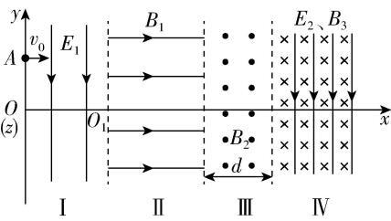

# Physics - 题目 1104

**ID**: f6ba9bfe461f41839e64e86786e96804
**年级**: Grade 12
**难度**: Hard
**题型**: Calculation

## 题目
（16分）如图所示，以 $O$ 为坐标原点建立 $O-xyz$ 坐标系， $x$ 轴正方向水平向右， $y$ 轴正方向竖直向上， $z$ 轴正方向垂直纸面向外（图中未画出），沿 $x$ 轴正方向从左到右依次存在四个区域，区域之间的边界均平行于 $yOz$ 平面。​​​​​​​‌Ⅰ区存在沿 $y$ 轴负方向的匀强电场，电场强度大小 ${E}_{1}=15\mathrm{N}/\mathrm{C}$ ;Ⅱ区存在沿 $x$ 轴正方向的匀强磁场,磁感应强度大小 ${B}_{1}=\sqrt{3}×{10}^{-2}\mathrm{T}$ ；Ⅲ区存在沿 $z$ 轴正方向的匀强磁场，磁感应强度大小 ${B}_{2}=\sqrt{3}×{10}^{-2}\mathrm{T}$ ;Ⅳ区存在沿 $y$ 轴负方向的匀强电场和沿 $z$ 轴负方向的匀强磁场，电场强度大小 ${E}_{2}=200\mathrm{N}/\mathrm{C}$ ，磁感应强度大小 ${B}_{3}=0.01\mathrm{T}$ ,Ⅳ区足够宽。Ⅰ区右边界与 $x$ 轴的交点为 ${O}_{1}$ , $y$ 轴上的 $A$ 点到 $O$ 点的距离 $ℎ=0.1\mathrm{m}$ 。一个比荷为 $\frac{q}{m}=1×{10}^{8}\mathrm{C}/\mathrm{k}\mathrm{g}$ 的带电粒子从 $A$ 点以速度 ${v}_{0}=1×{10}^{4}\mathrm{m}/\mathrm{s}$ 、沿 $x$ 轴正方向射入Ⅰ区，经 ${O}_{1}$ 点进入Ⅱ区时第一次穿过 $xOz$ 平面，进入Ⅲ区时恰好第二次穿过 $xOz$ 平面，进入Ⅳ区时恰好第三次穿过 $xOz$ 平面，之后在Ⅳ区内继续运动，不计粒子所受重力。求:（1） 带电粒子进入Ⅱ区时的速度;（2） 带电粒子第二次穿过 $xOz$ 平面时的位置坐标;（3） Ⅲ区的宽度 $d$ ;（4） 带电粒子在Ⅳ区运动时距 $xOz$ 平面的最大距离和每次穿过 $xOz$ 平面时距Ⅳ区左边界的距离。

## 解答

1. （1） 带电粒子进入Ⅰ区电场，根据动能定理得
2. $q{E}_{1}ℎ=\frac{1}{2}m{v}^{2}-\frac{1}{2}m{v}_{0}^{2}$ （1分）
3. 解得 $v=2×{10}^{4}\mathrm{m}/\mathrm{s}$ （1分）
4. 设速度方向与 $x$ 轴正方向夹角为 $\theta $  ，则
5. $\cos \theta =\frac{{v}_{0}}{v}=\frac{1}{2}$ ，
6. 则 $\theta ={60}^{\circ }$  （1分）
7. （2） 带电粒子进入Ⅱ区磁场时速度方向与磁场方向夹角为 $\theta $  ，则带电粒子做螺旋运动，沿 $x$ 轴正方向以 ${v}_{0}$ 做匀速运动，在 $yOz$ 平面做匀速圆周运动，做匀速圆周运动的速度大小为
8. ${v}_{y}=v\sin \theta =\sqrt{3}×{10}^{4}\mathrm{m}/\mathrm{s}$ ，
9. $q{v}_{y}B=m\frac{{v}_{y}^{2}}{{R}_{1}}$ ，
10. 解得 ${R}_{1}=1×{10}^{-2}\mathrm{m}$ （1分）
11. 做匀速圆周运动的周期大小
12. ${T}_{1}=\frac{2\mathrm{\pi }{R}_{1}}{{v}_{y}}=\frac{2\sqrt{3}\mathrm{\pi }}{3}×{10}^{-6}\mathrm{s}$ （1分）
13. 带电粒子第一次穿过 $xOz$ 平面时，根据类平抛运动的知识得 $\tan \theta =\frac{2ℎ}{{x}_{1}}$ ，
14. ${x}_{1}=\frac{\sqrt{3}}{15}\mathrm{m}$ （1分）
15. 带电粒子在Ⅱ区第二次穿过 $xOz$ 平面时沿 $x$ 轴正方向运动的距离
16. ${x}_{2}={v}_{0}\cdot \frac{{T}_{1}}{2}=\frac{\mathrm{\pi }\sqrt{3}}{3}×{10}^{-2}\mathrm{m}$ （1分）
17. 沿 $z$ 轴正方向运动的距离
18. ${z}_{1}=2{R}_{1}=0.02\mathrm{m}$ ，
19. 所以带电粒子第二次穿过 $xOz$ 平面时位置坐标分别为
20. $x={x}_{1}+{x}_{2}=\frac{20\sqrt{3}+\sqrt{3}\mathrm{\pi }}{300}\mathrm{m}$ ，
21. $y=0$ ，
22. $z=0.02\mathrm{m}$ （1分）
23. （3） 带电粒子进入Ⅲ区磁场时速度方向与磁场方向夹角为 $\theta $  ，
24. $qv{B}_{2}=m\frac{{v}^{2}}{{R}_{2}}$ ，
25. 解得 ${R}_{2}=\frac{2\sqrt{3}}{3}×{10}^{-2}\mathrm{m}$ （2分）
26. Ⅲ区磁场的宽度
27. $d=2{R}_{2}\sin {60}^{\circ }=2×{10}^{-2}\mathrm{m}$ （1分）
28. （4） 带电粒子进入Ⅳ区后，受到沿 $y$ 轴负方向的电场力，将其速度分解出水平向右的分速度 ${v}_{1}$ ，带电粒子因此受到竖直向上的洛伦兹力与电场力平衡，即 $q{v}_{1}{B}_{3}={E}_{2}q$ （1分）
29. 解得 ${v}_{1}=v$ ，
30. 由运动的合成与分解得另一分速度大小为 ${v}_{2}=v$ ，方向与 $y$ 轴负方向夹角为 ${30}^{\circ }$  ，偏向 $x$ 轴负方向，带电粒子以速度 ${v}_{2}$ 在 $xOy$ 平面内做匀速圆周运动
31. $q{v}_{2}{B}_{3}=m\frac{{v}_{2}^{2}}{{R}_{3}}$ ,
32. 解得 ${R}_{3}=2×{10}^{-2}\mathrm{m}$ ，
33. 带电粒子在Ⅳ区运动时距 $xOz$ 平面的最大距离
34. $\mathrm{\Delta }y={R}_{3}(1+\sin {30}^{\circ })=3×{10}^{-2}\mathrm{m}$ （1分）
35. ${T}_{2}=\frac{2\mathrm{\pi }m}{q{B}_{3}}=2\mathrm{\pi }×{10}^{-6}\mathrm{s}$ （1分）
36. 带电粒子在Ⅳ区运动时，从进入Ⅳ区到沿 $y$ 轴正方向穿过 $xOz$ 平面时的时间
37. $\mathrm{\Delta }t=\frac{2}{3}{T}_{2}+n{T}_{2}(n=0,1,2,3,\cdots )$ ,
38. 在此过程中带电粒子沿 $x$ 轴正方向运动的距离
39. ${x}_{3}=\sqrt{3}{R}_{3}+v\mathrm{\Delta }t$ ,
40. ${x}_{3}=0.02\sqrt{3}\mathrm{m}+(\frac{2}{3}+n)×4\mathrm{\pi }×{10}^{-2}\mathrm{m}(n=0,1,2,3,\cdots )$ （1分）
41. 带电粒子在Ⅳ区运动时，从进入Ⅳ区到沿 $y$ 轴负方向穿过 $xOz$ 平面时的时间
42. $\mathrm{\Delta }t\prime =n{T}_{2}(n=0,1,2,3,\cdots )$ ,
43. 在此过程中带电粒子沿 $x$ 轴正方向运动的距离
44. $x{\prime }_{3}=v\mathrm{\Delta }t\prime $ ，
45. $x{\prime }_{3}=4n\mathrm{\pi }×{10}^{-2}\mathrm{m}(n=0,1,2,3,\cdots )$ （1分）
46. 【思路引导】
47. 

## 知识点

**中文**:
  - 带电粒子在叠加场中的运动
  - 带电粒子在组合场中的运动

**English**:
  - Motion in Superimposed Fields
  - Motion in Combined Fields

---
