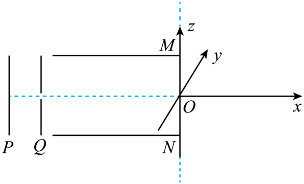

# Physics - 题目 1109

**ID**: fa71bd420cdf463d9715a15258e035a1
**年级**: Grade 12
**难度**: Hard
**题型**: Calculation

## 题目
如图所示，以O为坐标原点，建立Oxyz坐标系，有两个与x轴垂直的平行正对金属板P、Q，它们之间的电势差为U_{0}，Q板在与x轴的交点处有小孔。​​​​​​​‌长为L，距离为 $\frac {2}{3}L$ 的平行金属板M、N关于x轴对称，它们之间的电势差U_{MN}可调，MN间的电场方向平行于z轴。在x>0区域有沿y轴正方向、磁感应强度大小为 $\frac {2}{L}\sqrt {\frac {2mU{{}_{0}}}{q}}$ 的匀强磁场（图中未画出）。质量为m、电荷量为q的带正电粒子从金属板P与x轴交点处由静止释放，通过金属板Q上的小孔沿x轴向右进入MN之间。不计粒子所受重力。（1）若 $U{{}_{{\rm{M}}{\rm{N}}}}=0$ ，求粒子离开磁场区域时的坐标。（2）若 $U{{}_{{\rm{M}}{\rm{N}}}}=0.5U{{}_{0}}$ ，求粒子离开磁场区域时的坐标。（3）若 $U{{}_{{\rm{M}}{\rm{N}}}}=0.5U{{}_{0}}$ ，将磁场区域的磁感应强度方向调整为沿x轴正方向，磁感应强度大小保持不变，在 $x=\frac {3}{8}πL$ 处增加一个荧光屏，求粒子打在荧光屏上的位置坐标。

## 解答

1. （1）粒子从P到Q，由动能定理，有 $qU{{}_{0}}=\frac {1}{2}mv{{}_{0}}{^{2}}-0$ ，
2. 解得 $v{{}_{0}}=\sqrt {\frac {2qU{{}_{0}}}{m}}$ ，
3. 在平行金属板间匀速运动到O点沿x轴正方向进入磁场，由 $qv{{}_{0}}B=m\frac {v{{}_{0}}{^{2}}}{r}$ ，
4. 联立，解得转动半径 $r=\frac {L}{2}$ ，
5. 由几何关系，可知粒子在磁场中运动半周，从z轴上 $z=2r=L$ 处水平向左离开磁场，
6. 则离开时的坐标为（0，0，L）。。
7. （2）粒子在金属板间，水平方向，有 $L=v{{}_{0}}t{{}_{0}}$ ，
8. 解得 $t{{}_{0}}=\frac {L}{v{{}_{0}}}=L\sqrt {\frac {m}{2qU{{}_{0}}}}$ ，
9. 竖直方向，由牛顿第二定律，有 $q\frac {U{{}_{{\rm{M}}{\rm{N}}}}}{\frac {2}{3}L}=ma$ ，
10. 且 $-z{{}_{1}}=\frac {1}{2}at{{}_{0}}{^{2}}$ ，
11. 进入磁场时，速度与水平方向夹角为 $θ$ ，则 ${\tan}θ=\frac {at{{}_{0}}}{v{{}_{0}}}$ ，
12. 在磁场中运动如图所示
13. 
14. 联立，解得 $z{{}_{1}}=-\frac {3L}{16}$ ，
15. ${\tan}θ=\frac {3}{8}$ ， ${\cos}θ=\frac {8}{\sqrt {73}}$ ，
16. 速度大小 $v=\frac {v{{}_{0}}}{{\cos}θ}=\frac {1}{8}\sqrt {\frac {146qU{{}_{0}}}{m}}$ ，
17. 转动半径 $r{{}_{1}}=\frac {mv}{qB}=\frac {\sqrt {73}L}{16}$ ，
18. 则出射点在z轴上的坐标为 $z{{}_{2}}=z{{}_{1}}+2r{{}_{1}}{\cos}θ=\frac {13L}{16}$ ，
19. 则粒子离开磁场区域时的坐标为（0，0， $\frac {13L}{16}$ ）。
20. （3）将粒子在磁场中的等距螺旋运动分解为一个以速度 $v{{}_{0}}$ 水平向右的匀速直线运动和一个速度大小为 $v{{}_{1}}$ 的匀速圆周运动，如图所示
21. 
22. 从左侧向右看，如图所示
23. 
24. 由（2）可知， $v{{}_{1}}=v{{}_{0}}{\tan}θ=\frac {3}{8}\sqrt {\frac {2qU{{}_{0}}}{m}}$ ，
25. 粒子在磁场中运动到荧光屏，用时 $t=\frac {3πL}{8v{{}_{0}}}=\frac {3πL}{8}\sqrt {\frac {m}{2qU{{}_{0}}}}$ ，
26. 粒子转动半径 $r{{}_{2}}=\frac {mv{{}_{1}}}{qB}=\frac {3L}{16}$ ，
27. 转动周期 $T=\frac {2πm}{qB}=πL\sqrt {\frac {m}{2qU{{}_{0}}}}$ ，
28. 则 $t=\frac {3}{8}T$  ，
29. 则粒子匀速圆周运动的圆心角为 $α=\frac {t}{T}\times 360{^{\circ }}=135{^{\circ }}$ ，
30. 则角 $β=180{^{\circ }}-α=45{^{\circ }}$ ，
31. 则坐标 $z{{}_{3}}=z{{}_{1}}-r{{}_{2}}\sin β=-\frac {6+3\sqrt {2}}{32}L$ ，
32. $y{{}_{1}}=-r{{}_{2}}-r{{}_{2}}{\cos}β=-\frac {6+3\sqrt {2}}{32}L$ ，
33. 则粒子打在荧光屏上的位置坐标为（ $\frac {3π}{8}L$ ， $-\frac {6+3\sqrt {2}}{32}L$ ， $-\frac {6+3\sqrt {2}}{32}L$ ）。

## 知识点

**中文**:
  - 带电粒子在组合场中的运动

**English**:
  - Motion in Combined Fields

---
