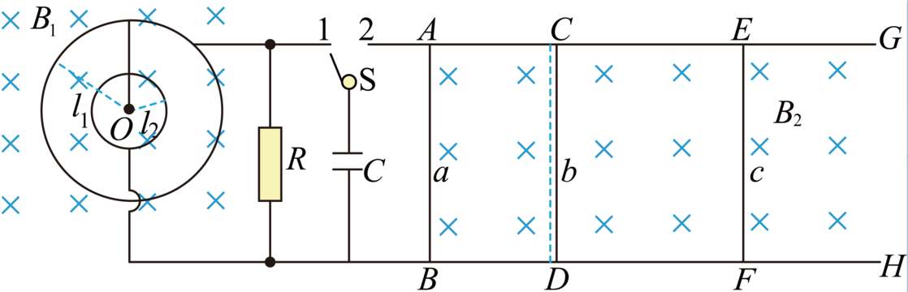

# Physics - 题目 1942

**ID**: ffbe23764f4b4c7db35822ca78577bea
**年级**: Grade 12
**难度**: Hard
**题型**: Calculation

## 题目
如图所示，两光滑圆形金属导轨固定在水平面内，圆心均为O点，半径分别为 $l_{1}=1{\rm{m}}$ ， $l_{2}={\rm{0}}{\rm{.}}{\rm{5}}{\rm{m}}$ ，两导轨通过导线与右侧电路相连，一长为 $l_{1}$ 、电阻为 $r=2Ω$ 的导体棒与两圆形导轨接触良好，导体棒一端固定在O点且以角速度 $ω=16{\rm{r}}{\rm{a}}{\rm{d}}{\rm{/}}{\rm{s}}$ 顺时针匀速转动，两圆形导轨所在区域存在方向竖直向下、磁感应强度大小 $B_{1}=2{\rm{T}}$ 的匀强磁场，定值电阻 $R=5Ω$ ，电容器的电容 $C=0.2{\rm{F}}$ 。​​​​​​​‌足够长的光滑平行金属导轨AG、BH固定于水平面内，相距为 $L=2{\rm{m}}$ ，处于竖直向下、大小为 $B_{2}=1{\rm{T}}$ 的匀强磁场中，轨道在C、D处各被一小段正对的绝缘材料隔开，质量为 $m_{a}=1{\rm{k}}{\rm{g}}$ 的金属棒a静置于导轨AB处，质量为 $m_{b}=3{\rm{k}}{\rm{g}}$ 的金属棒b紧贴CD右侧放置，质量为 $m_{c}=1{\rm{k}}{\rm{g}}$ 的金属棒c静置于b棒右侧 $s_{0}=2{\rm{m}}$ 的EF处．a、b棒的接入电阻相同， $R_{a}=R_{b}=2\Omega $ ，c棒的接入电阻 $R_{c}=4\Omega $ 。初始时单刀双掷开关S与触点“1”闭合，现将开关S拨到触点“2”，当金属棒a运动至CD时电容器的电压 $U={\rm{5}}{\rm{V}}$ ，此时a、b两棒相碰结合为一个“双棒”整体，最终各棒运动达到稳定状态，所有导轨的电阻均不计，求：（1）开关S与触点“1”闭合时，电容器所带的电荷量；（2）金属棒a刚运动至CD时的速度；（3）最终“双棒”整体与c棒的距离以及从a、b棒碰后到各棒稳定的过程中a棒中产生的焦耳热。

## 解答

1. （1）导体棒转动切割磁感线，其接入电路的部分感应电动势为
2. $E=\frac {1}{2}B_{1}ωl_{1}^{2}-\frac {1}{2}B_{1}ωl_{2}^{2}$
3. 闭合回路总电阻为
4. $R_{总}=R+\frac {r}{2}$
5. 回路电流
6. $I=\frac {E}{R_{总}}$
7. 电容器的电压
8. $U_{0}=IR$
9. 电容器的电荷量为
10. $Q=CU_{0}=2{\rm{C}}$
11. （2）开关S接2时，电容器向金属棒a放电，金属棒a受安培力运动，当金属棒a运动至CD处时电容器所带电荷量
12. $Q_{2}=CU$
13. 该过程流过金属棒a的电荷量
14. $q=Q_{2}-Q$
15. 由动量定理
16. $B_{2}Lq=m_{a}v_{0}$
17. 代入数据可得
18. $v_{0}=2{\rm{m}}{\rm{/}}{\rm{s}}$
19. （3）a棒与b棒发生碰撞过程，根据动量守恒
20. $m_{a}v_{0}=(m_{a}+m_{b})v_{1}$
21. “双棒”整体与c棒系统动量也守恒，最终达到共同速度
22. $(m_{a}+m_{b})v_{1}=(m_{a}+m_{b}+m_{c})v_{2}$
23. 对c棒使用动量定理
24. $\frac {B_{2}^{2}L^{2}}{R_{总}^{\prime }}s_{相对}=m_{c}v_{2}$
25. $R_{总}^{\prime }=R_{c}+\frac {R_{a}R_{b}}{R_{a}+R_{b}}$
26. $s=s_{0}-s_{相对}$
27. 解得
28. $s=1.5{\rm{m}}$
29. “双棒”整体与c棒运动至稳定过程中由能量守恒
30. $\frac {1}{2}(m_{a}+m_{b})v_{1}^{2}-\frac {1}{2}(m_{a}+m_{b}+m_{c})v_{2}^{2}=Q$
31. 其中
32. $Q_{a}=\frac {Q}{10}$
33. 代入数据可得
34. $Q_{a}=0.01{\rm{J}}$

## 知识点

**中文**:
  - 导体切割磁感线产生感应电动势（电流）的分析与计算
  - 电磁感应现象中的功能问题

**English**:
  - Analysis and Calculation of Cutting Magnetic Field Lines
  - Work-Energy Problems in EM Induction

---
