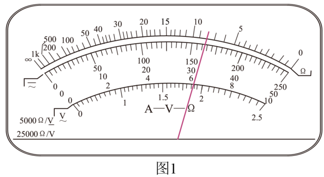
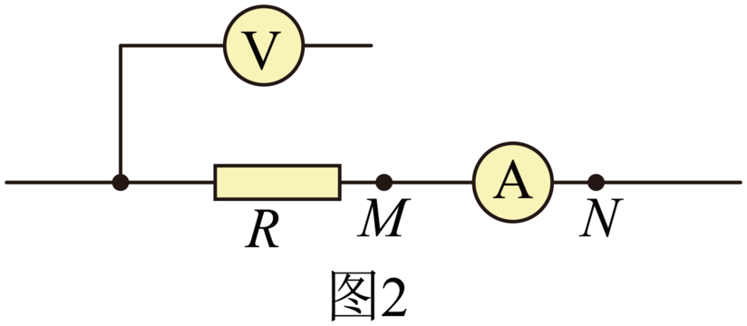
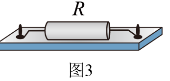

# Physics - 题目 2188

**ID**: cba937d13ce64632b6219f138037a4f5
**年级**: Grade 12
**难度**: Hard
**题型**: Experiment

## 题目
某同学在实验室进行测量电阻的实验。​​​​​​​‌（1）该同学先用欧姆表“ $\times 1$ ”挡粗测一个未知电阻R的阻值，示数如图1所示，对应的读数是$Ω$ 。（2）他进一步采用伏安法进行精确测量，测量电路如图2所示，其中电压表的内阻约为 $3{\rm{k}}Ω$ ，电流表的内阻约为 $0.1Ω$ ，为了尽量减小实验误差，电压表的右端应接在点（选填“M”或“N”）。（3）随着居民生活水平的提高，纯净水已经进入千家万户。电导率是检验纯净水是否合格的一项重要指标，它是电阻率的倒数。该同学为了测量某品牌纯净水样品的电导率，将采集的水样注满绝缘性能良好的横截面直径为几厘米的薄塑料圆柱形容器，容器两端用很薄的金属圆片电极密封，如图3所示。a.他先通过查阅资料估算出容器内水样的电阻约为十万欧，然后用伏安法进行测量。除开关和若干导线外，他还找到下表所示的器材，请选择合适的器材，设计测量该水样电阻的方案，在下图方框内画出电路图，并标注所选器材的代号，水样的电阻用 $R{{}_{x}}$ 表示。器材（代号）规格电源（ $E{{}_{1}}$ ）电动势约为3.0V，内阻可以忽略不计电源（ $E{{}_{2}}$ ）电动势约为15.0V，内阻可以忽略不计电压表（ ${\rm{V}}{{}_{1}}$ ）量程0~3V，内阻约 $3{\rm{k}}Ω$电压表（ ${\rm{V}}{{}_{2}}$ ）量程0~15V，内阻约 $15{\rm{k}}Ω$电流表（ ${\rm{A}}{{}_{1}}$ ）量程0~0.6A，内阻约 $0.1Ω$电流表（ ${\rm{A}}{{}_{2}}$ ）量程 $0\sim 200{\rm{μ}}{\rm{A}}$ ，内阻约 $500{\rm{Ω}}$滑动变阻器（R）总阻值约 $100Ω$b.测出水样的电阻 $R{{}_{x}}$ 后，为了测出样品的电导率，请写出该同学还需要测量的物理量，以及使用的测量工具和测量方法。

## 解答

1. （1）[1]该同学先用欧姆表“ $\times 1$ ”挡粗测一个未知电阻 $R$ 的阻值，由图1可知读数为
2. $R=8\times 1Ω=8Ω$
3. （2）[2]根据
4. $\frac {R{{}_{{\rm{V}}}}}{R}=\frac {3000}{8}>\frac {R}{R{{}_{{\rm{A}}}}}=\frac {8}{0.1}$
5. 为了尽量减小实验误差，电流表应采用外接法，则电压表的右端应接在M点。
6. （3）a[3]水样的电阻约为十万欧，若电源选择电动势为 $3{\rm{V}}$ 的 $E{{}_{1}}$ ，则最大电流为
7. $I{{}_{{\rm{1}}{\rm{m}}}}=\frac {E{{}_{1}}}{R}=\frac {3}{10\times 10{{}^{4}}}{\rm{A}}=30{\rm{μ}}{\rm{A}}$
8. 若电源选择电动势为 $15{\rm{V}}$ 的 $E{{}_{2}}$ ，则最大电流为
9. $I{{}_{{\rm{2}}{\rm{m}}}}=\frac {E{{}_{2}}}{R}=\frac {15}{10\times 10{{}^{4}}}{\rm{A}}=150{\rm{μ}}{\rm{A}}$
10. 则电流表应选择量程为 $0\sim 200{\rm{μ}}{\rm{A}}$ 的 ${\rm{A}}{{}_{2}}$ ；为了使电流表 ${\rm{A}}{{}_{2}}$ 读数超过量程的 $\frac {1}{3}$ ，电源应选择电动势为 $15{\rm{V}}$ 的 $E{{}_{2}}$ ，电压表应选择量程为 $0\sim 15{\rm{V}}$ 的 ${\rm{V}}{{}_{2}}$ ；由于待测电阻约为十万欧，远大于电流表内阻和滑动变阻器阻值，为了减小误差，电流表应采用内接法，滑动变阻器采用分压接法，电路图如图所示
11. 
12. b[4]根据电阻定律可得
13. $R{{}_{x}}=ρ\frac {L}{S}$
14. 又
15. $S=\frac {πd{{}^{2}}}{4}$
16. 可知
17. $ρ=\frac {R{{}_{x}}S}{L}=\frac {R{{}_{x}}πd{{}^{2}}}{4L}$
18. 则电导率为
19. $σ=\frac {1}{ρ}=\frac {4L}{R{{}_{x}}πd{{}^{2}}}$
20. 为了测出样品的电导率，还需要测量圆柱形容器的长度和横截面的直径；
21. 测量圆柱形容器的长度的工具和方法：用刻度尺测量圆柱形容器的长度，多次测量取平均值；
22. 测量圆柱形容器横截面直径的工具和方法：用游标卡尺测量圆柱形容器横截面直径，在圆柱形容器的不同位置多次测量取平均值。

## 知识点

**中文**:
  - 实验：电阻的测量

**English**:
  - Experiment: Measuring Resistance

---
