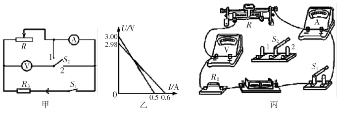

# Physics - 题目 2506

**ID**: fba475e55f064cc69fc7d0e433d1d15d
**年级**: Grade 12
**难度**: Hard
**题型**: Experiment

## 题目
为精确测量电源的电动势和内阻，实验小组设计了图甲所示电路，图中S_{2}为单刀双掷开关，定值电阻R_{0}=4 ${\rm{Ω}}$ ．实验时先闭合开关S_{1}，然后分别将S_{2}先后接到1和2，移动滑动变阻器滑片，记录多组电压表和电流表的读数U和I，最后通过描点得到图乙所的两条U-I关系图线。​​​​​​​‌（1）请根据图甲，在图丙中将单双掷开关连入电路。（2）若只考虑系统误差，当单刀双掷开关拨向1时，r_{测}r_{真}；当单刀双掷开关拨向2时，E_{测}E_{真}（填“大于”、“等于”、“小于”）。（3）根据图乙可知电源电动势E=V，内阻r=${\rm{Ω}}$ 。（结果均保留2位有效数字）

## 解答

1. （1）[1]电路连接如图；
2. 
3. （2）[2]当单刀双掷开关拨向1时，根据等效电路可知，电动势等于电源没有接入电路时电源两端电压，则电源电动势测量值与真实值相等，此时电源内阻测量值为电源内阻与电流表的内阻和定值电阻串联值，可知
4. r_{测}=r_{真}+r_{A}>r_{真}
5. 即偏大；
6. [3]当单刀双掷开关拨向2时，根据等效电路可知，电动势等于电源没有接入电路时电源两端电压
7. $E{{}_{测}}{\rm{=}}\frac {E{{}_{真}}R{{}_{V}}}{R{{}_{V}}+r}<E{{}_{真}}$
8. 电动势测量值等于电压表此时的示数，即小于电源电动势的真实值，此时电源内阻测量值为电源内阻与电压表阻值的并联总阻值，即偏小。
9. （3）[4][5]由于两次测量中，电动势测量值一次与真实值相等，一次比真实值小，由图乙可知，电动势应为
10. E=3.0V
11. 当开关接1时，由闭合电路欧姆定律有
12. E=U+I（r+R_{0}+R_{A}）
13. 当开关接2时，由闭合电路欧姆定律有
14. $E=U+(I+\frac {U}{R{{}_{V}}})(R{{}_{0}}+r)$
15. 即
16. $U=\frac {\hspace{-0.5em}\begin{array}{l}E\end{array}\hspace{-0.5em}}{1+\frac {R{{}_{0}}+r}{R{{}_{V}}}}-\frac {\hspace{-0.5em}\begin{array}{l}r+R{{}_{0}}\end{array}\hspace{-0.5em}}{1+\frac {r+R{{}_{0}}}{R{{}_{V}}}}I$
17. 由图 乙可知
18. $ \frac {3.00}{0.5}=r+R{{}_{0}}+R{{}_{A}}$
19. $\hspace{-0.5em} \begin{array}{l}\frac {E}{1+\frac {R{{}_{0}}+r}{R{{}_{V}}}}\end{array}\hspace{-0.5em}=2.98$
20. $ \frac {\hspace{-0.5em}\begin{array}{l}r+R{{}_{0}}\end{array}\hspace{-0.5em}}{1+\frac {R{{}_{0}}+r}{R{{}_{V}}}}=\frac {2.98}{0.6}$
21. 联立解得
22. r=1.0Ω

## 知识点

**中文**:
  - 实验：电池电动势和内阻的测量—伏安法测量电源电动势与内阻

**English**:
  - V-A Method for EMF and Internal Resistance

---
