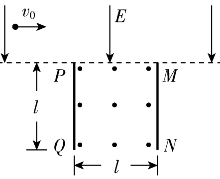

# Physics - 题目 1618

**ID**: 03500e7394004a55a7c7e273fc95a739
**年级**: Grade 12
**难度**: Hard
**题型**: 非选择题：共62分。第9～12题为必考题，每个试题考生都必须作答。第13～14题为选考题，考生根

## 题目
(20分)如图，长度均为l的两块挡板竖直相对放置，间距也为l，两挡板上边缘P和M处于同一水平线上，在该水平线的上方区域有方向竖直向下的匀强电场，电场强度大小为E；两挡板间有垂直纸面向外、磁感应强度大小可调节的匀强磁场。​​​​​​​‌一质量为m、电荷量为q(q＞0)的粒子自电场中某处以大小为v_{0}的速度水平向右发射，恰好从P点处射入磁场，从两挡板下边缘Q和N之间射出磁场，运动过程中粒子未与挡板碰撞。已知粒子射入磁场时的速度方向与PQ的夹角为60°，不计粒子重力。(1)求粒子发射位置到P点的距离；(2)求磁感应强度大小的取值范围；(3)若粒子正好从QN的中点射出磁场，求粒子在磁场中的轨迹与挡板MN的最近距离。

## 解答

1. 本题考查电场与磁场组合的相关计算。
2. (1)粒子在电场中做类平抛运动，沿电场方向有Eq＝ma，y＝ $\frac {1}{2}$at^{2}，v_{y}＝at，
3. 垂直电场方向有x＝v_{0}t，
4. 又v_{y}＝ $\frac {v{{}_{0}}}{{\rm{t}}{\rm{a}}{\rm{n}}60^\circ }$ ，v＝ $\frac {v{{}_{0}}}{{\rm{s}}{\rm{i}}{\rm{n}}60^\circ }$ ，s＝ $\sqrt {x{^{2}}+y{^{2}}}$ ，
5. 解得粒子发射位置到P点的距离s＝ $\frac {\sqrt {13}mv{{}_{0}}{^{2}}}{6Eq}$ 。
6. (2)粒子在磁场中做圆周运动，由洛伦兹力提供向心力可得Bqv＝m$\frac {v{^{2}}}{r}$ ，
7. B最小时r最大，粒子从N点射出磁场；B最大时r最小，粒子从Q点射出磁场，如图甲所示，由几何知识可得 $\frac {\sqrt {3}}{3}$l<r<( $\sqrt {3}$ ＋1)l，联立解得磁感应强度大小的取值范围为 $\frac {2mv{{}_{0}}}{(3+\sqrt {3})ql}$ <B< $\frac {2mv{{}_{0}}}{ql}$ 。
8. 
9. (3)由题意可知，粒子在磁场内的运动轨迹如图所示，设QN的中点为A，PQ与PA之间的夹角为θ，
10. 
11. 根据几何关系有sinθ＝ $\frac {\sqrt {5}}{5}$ ，cosθ＝ $\frac {2\sqrt {5}}{5}$ ，cos(∠OPQ＋∠APQ)＝ $\frac {2\sqrt {15}-\sqrt {5}}{10}$ ，
12. 若粒子的运动轨迹半径为R，结合几何关系有
13. R·cos(∠OPQ＋∠APQ)＝ $\frac {\sqrt {5}}{4}$l，
14. 解得R＝ $\frac {5(2\sqrt {3}+1）}{22}$l，
15. 则由几何关系可得，轨迹与挡板MN的最近距离x＝l－(R－Rsin 30°)＝ $\frac {39-10\sqrt {3}}{44}$l。
16. 一题多解：(3)在计算出粒子运动的轨迹半径R之后，根据洛伦兹力提供向心力有qBv＝m$\frac {v{^{2}}}{R}$ ，解得B＝ $\frac {（24-4\sqrt {3}）mv{{}_{0}}}{15ql}$ ，
17. 设P′点到MN挡板的距离最近，且PP′的水平距离为x。
18. 因粒子在磁场中运动过程中仅受洛伦兹力作用，根据动量定理可知，洛伦兹力沿竖直方向分力的冲量满足qv_{x}B·t＝qBx＝mv－mvcos 60°，
19. 解x＝ $\frac {10\sqrt {3}+5}{44}$l，
20. 则P′到MN距离为d＝l－x＝ $\frac {39-10\sqrt {3}}{44}$l。

## 知识点

**中文**:
  - 带电粒子在组合场中的运动

**English**:
  - Motion in Combined Fields

---
