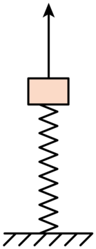

# Physics - 题目 2266

**ID**: 100d8827e0d4448b8e75c5e35288575a
**年级**: Grade 12
**难度**: Hard
**题型**: Multiple-choice

## 题目
如图所示，竖直轻弹簧一端与地面相连，另一端与物块相连，物块处于静止状态。​​​​​​​‌现对物块施加一个竖直向上的拉力 $F$ ，使物块向上做初速度为零的匀加速直线运动，此过程中弹簧的形变始终在弹性限度内，则拉力 $F$ 随时间 $t$ 变化的图像可能正确的是（      ）

## 解答

1. 物块处于静止状态时，弹簧弹力等于重力，弹簧处于压缩状态
2. $mg=kx_{0}$
3. 现给物体施加一个竖直向上的拉力 $F$ ，做匀加速直线运动则有
4. $F_{0}+kx_{0}-mg=ma$
5. 当物体向上位移x，则有
6. $F+k\left ({x_{0}-x}\right )-mg=ma$
7. 整理得
8. $F-kx=ma$
9. 物块做匀加速直线运动，有
10. $x=\frac {1}{2}at^{2}$
11. 联立可得
12. $F=\frac {1}{2}kat^{2}+ma$
13. 可知拉力与时间图像呈抛物线形状。
14. 故选A。

## 知识点

**中文**:
  - 共点力与共点力平衡的条件
  - 匀变速直线运动的位移—时间公式及其应用

**English**:
  - Concurrent Forces and Equilibrium Conditions
  - Displacement-Time Formula and Applications

---
