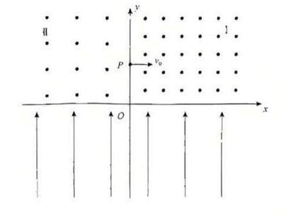

# Physics - 题目 205

**ID**: 8878c9d0d36948389b3a6f4a6cd60dcc
**年级**: Grade 12
**难度**: Hard
**题型**: 非选择题：本题共5小题，共54分。

## 题目
（17分）如图所示，在平面直角坐标系 ${xOy}$ 的第一象限内有垂直于坐标平面向外的匀强磁场 $\text{I}$ ，在第二象限内有垂直于坐标平面向外的匀强磁场 $\text{II}$ ，在第三、四象限内有沿 $y$ 轴正方向的匀强电场。​​​​​​​‌在 $y$ 轴上坐标为 $(0，d)(d{>0})$ 的 $P$ 点，沿 $x$ 轴正方向以初速度 ${v}_{0}$ 射出一带正电的粒子，粒子质量为 $m、$ 电荷量为 $q$ .粒子经磁场 $\text{I}$ 偏转后从 $x$ 轴正半轴上距坐标原点 $\frac{\sqrt{3}}{3}d$ 处进入电场，经电场偏转后进人磁场 $\text{II}$ ，经磁场 $\text{II}$ 偏转后从 $y$ 轴上坐标为 $(0，6d)$ 的 $Q$ 点（图中未画出）垂直 $y$ 轴再次进人磁场 $\text{I}$ ，不计粒子的重力。求：（1）磁场 $\text{I}$ 的磁感应强度的大小：（2）匀强电场的电场强度大小：（3）粒子从 $P$ 点射出后，第 $n(n{>1})$ 次经过 $y$ 轴的位置到 $O$ 点的距离（粒子离开 $P$ 点，经过 $y$ 轴负半轴时 $n{=1}）$ 。

## 解答

1. （1）设粒子在磁场 $I$ 中做圆周运动的半径为 ${r}_{1}$ ，根据几何关系有 ${r}_{1}+\sqrt{{r}_{1}^{2}-{\left(\frac{\sqrt{3}}{3}d\right)^{2}}}=d$ （2分）
2. 解得 ${r}_{1}=\frac{2}{3}d$ （1分）
3. 根据牛顿第二定律 $q{v}_{0}{B}_{1}=m\frac{{v}_{0}^{2}}{{r}_{1}}$ （1分）
4. 解得 ${B}_{1}=\frac{3m{v}_{0}}{2{qd}}$ （1分）
5. （2）粒子经电场偏转后进入磁场 ${II}$ ，说明粒子进入电场时速度有指向 $x$ 轴负方向的分量。设粒子进电场时速度方向与 $x$ 轴负方向的夹角为 $\mathit{\theta }$ ，根据几何关系有
6. $\mathrm{\sin }\mathit{\theta }=\frac{\frac{\sqrt{3}}{3}d}{{r}_{1}}=\frac{\sqrt{3}}{2}$ （1分）
7. 解得 $\mathit{\theta }{=6}{0}^{∘}$ ，即粒子进入电场时速度方向与 $x$ 轴负方向的夹角为 $6{0}^{∘}$ 。设粒子第一次进磁场 ${II}$ 的位置到坐标原点的距离为 $s$ ，根据对称性，粒子第一次进磁场 ${II}$ 时的速度大小仍为 ${v}_{0}$ ，速度与 $x$ 轴负方向的夹角为 $6{0}^{∘}$ ，设粒子在磁场 ${II}$ 中做圆周运动的半径为 ${r}_{2}$ ，根据几何关系有 ${r}_{2}+{r}_{2}\mathrm{\cos 6}{0}^{∘}{=6}d$ （1分）
8. 解得 ${r}_{2}{=4}d$ （1分）
9. 则 $s={r}_{2}\mathrm{\sin 6}{0}^{∘}{=2}\sqrt{3}d$ （1分）
10. 粒子在电场中做类斜上抛运动，设电场强度为 $E$ ，则有
11. $s+\frac{\sqrt{3}}{3}d={v}_{0}\mathrm{\cos 6}{0}^{∘}⋅t$ （1分）
12. $2{v}_{0}\mathrm{\sin 6}{0}^{∘}={at}$ （1分）
13. 根据牛顿第二定律 ${qE}={ma}$ （1分）
14. 解得 $E=\frac{3m{v}_{0}^{2}}{{14}{qd}}$ （1分）
15. （3）粒子在磁场 ${II}$ 偏转后经过 $Q$ 点 $(0，6d)$ ，之后在第一、二象限内交替做圆周运动，在第一象限内的运动半径为 ${r}_{1}=\frac{2}{3}d$ ，在第二象限内的运动半径为 ${r}_{2}{=4}d$ ，不再经过第三、四象限。
16. 当 $n$ 为偶数时，粒子在第一、二象限各做 $\frac{n{-2}}{2}$ 个半圆周运动，粒子经过 $y$ 轴时的位置到坐标原点的距离 ${y}_{1}{=6}d+\frac{n{-2}}{2}(2{r}_{2}{-2}{r}_{1}){=6}d+\frac{{10}(n{-2})}{3}d=\frac{({10}n{-2})d}{3}(n{=2}，4，6，⋯)$
17. （2分）
18. 当 $n$ 为大于1的奇数时，粒子在第一象限做 $({1+}\frac{n{-3}}{2})$ 个半圆周运动，在第二象限内做 $\frac{n{-3}}{2}$ 个半圆周运动，粒子经过 $y$ 轴时的位置到坐标原点的距离 ${y}_{2}{=6}d{-2}{r}_{1}+\frac{n{-3}}{2}(2{r}_{2}{-2}{r}_{1})=\frac{14}{3}d+\frac{{10}(n{-3})}{3}d=\frac{({10}n{-16})d}{3}(n{=3}，5，7，⋯)$ （2分）

## 知识点

**中文**:
  - 带电粒子在组合场中的运动

**English**:
  - Motion in Combined Fields

---
