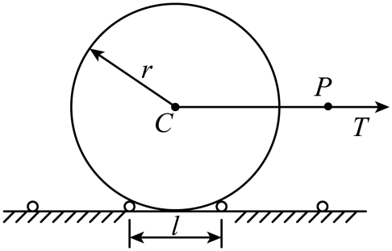

# Physics - 题目 233

**ID**: b337689e655943f6a7a4d56c0178a0ee
**年级**: Grade 12
**难度**: Hard
**题型**: Multiple-choice

## 题目
如图所示，在水平地面上用彼此平行、相邻间距为l的水平小细杆构成一排固定的栅栏。​​​​​​​‌栅栏上方有一个质量为m、半径为 $r\gg l$ 的匀质圆板，圆板不会与地面接触。一根细长的轻绳穿过板的中央小孔C，一半在图的背面，一半在图的正面，绳的两头合在一起记为P端。在P端用力沿水平方向朝右拉动圆板，使板沿栅栏无跳动、无相对滑动地朝右滚动。圆板水平方向朝右的平均速度可近似处理为圆板中心C在最高位置时的速度大小v，设v是不变量。略去绳与板间所有接触部位的摩擦，施加于P端的平均拉力T为（      ）

## 解答

1. 取栅栏中相邻两根小细杆A，B，板心C从位于杆A的正上方到位于杆B的正上方。圆板绕杆定轴转动惯量为 $I{{}_{杆}}=I{{}_{C}}+mr{^{2}}=\frac {3}{2}mr{^{2}}$C位于A正上方时圆板动能为 $E{{}_{{\rm{k}}}}=\frac {1}{2}I{{}_{杆}}{\left({\frac {v}{r}}\right)^{2}}=\frac {3}{4}mv{^{2}}$ ，C到达A、B杆连线中点正上方前瞬间，速度为 $v^{′}$ ，动能为 $\frac {3}{4}mv{^{^{′}2}}=E{{}_{{\rm{k}}}}+mgr\left ({1-{\cos}\frac {θ}{2}}\right )+T\cdot \frac {l}{2}$ ，将圆板与 $B$ 杆完全非弹性碰撞后瞬间，绕 $B$ 杆的转动角速度记为 $ω{{}_{B}}$ ，据角动量守恒，有 $I{{}_{B}}ω{{}_{B}}=I{{}_{C}}ω{{}_{C}}+rmv{{}_{0}^{^{′}}}$ ， $ω{{}_{C}}=\frac {v^{′}}{r}$ ， $v{{}_{0}^{^{′}}}=v^{′}{{\rm c}}{\rm os}θ$ ，可得 $\frac {3}{2}mr{^{2}}ω{{}_{B}}=\frac {1}{2}mr{^{2}}\frac {v^{′}}{r}+rmv^{′}{{\rm c}}{\rm os}θ=\frac {1}{2}mrv^{′}+mrv^{′}{{\rm c}}{\rm os}θ=mrv^{′}{\left ({\frac {1}{2}+{\cos}θ}\right )}$ ，则有 $ω{{}_{B}}r=\frac {2}{3}v^{′}{\left ({\frac {1}{2}+{\cos}θ}\right )}$ ，此时圆盘动能为 $\frac {1}{2}I{{}_{B}}ω{{}_{B}^{2}}=\frac {3}{4}mv{^{^{′}2}}\cdot \frac {4}{9}{\left({\frac {1}{2}+{\cos}θ}\right)^{2}}$ ，C转动B杆正上方时，速度又增为 $v$ ，由机械能定理得 $\frac {3}{4}mv{^{2}}=\frac {1}{2}I{{}_{B}}ω{{}_{B}^{2}}-mgr\left ({1-{\cos}\frac {θ}{2}}\right )+\frac {1}{2}Tl$ ，联立以上各式，消去 $\frac {3}{4}mv^{′}{{^{2}}}$ ，可得 $\frac {3}{4}mv{^{2}}=\frac {3}{4}mv{^{2}}\cdot \frac {4}{9}{\left({\frac {1}{2}+{\cos}θ}\right)^{2}}+mgr\left ({1-{\cos}\frac {θ}{2}}\right )\cdot \frac {4}{9}{\left({\frac {1}{2}+{\cos}θ}\right)^{2}}+\frac {1}{2}Tl\cdot \frac {4}{9}{\left({\frac {1}{2}+{\cos}θ}\right)^{2}}-mgr\left ({1-{\cos}\frac {θ}{2}}\right )+\frac {1}{2}Tl$ 取近似 ${\left({\frac {1}{2}+{\cos}θ}\right)^{2}}={\left({\frac {3}{2}-\frac {1}{2}θ{^{2}}}\right)^{2}}=\frac {9}{4}-\frac {3}{2}θ{^{2}}$ ，又有 $1-{\cos}\frac {θ}{2}=\frac {1}{8}θ{^{2}}$ ， $θ=\frac {l}{r}$ 代入上式，并忽略高阶小量，得 $T=\frac {1}{2}mv{^{2}}\frac {l}{r{^{2}}}$ ，A正确，BCD错误。

## 知识点

**中文**:
  - 动量和能量的综合应用
  - 动量守恒的判定与应用

**English**:
  - Integration of Momentum and Energy
  - Judgment and Application of Momentum Conservation

---
