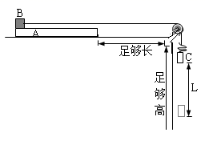

# Physics - 题目 821

**ID**: 01adf50395c642bda878c02f94b9e6b3
**年级**: Grade 12
**难度**: Medium
**题型**: Calculation

## 题目
如图所示，在足够高的光滑水平台面上静置一质量为m的木板A，在木板的左端静置一质量为5m可视为质点的小物体B，A、B间的滑动摩擦系数μ=0.2，且认为最大静摩擦力等于滑动摩擦力。​​​​​​​‌离A右端足够远的平台边缘有一光滑定滑轮，用不可伸长的轻绳绕过定滑轮连接B和质量也为m的物体C，现由静止释放C，当它自由下落L时轻绳绷紧，C绷紧后速度是绷紧前速度的 $\frac {1}{6}$ 。当B与A相对静止时刚好到达A的右端．若重力加速度为g，不计空气阻力，不考虑A与滑轮碰撞及之后的情形。求：(1)轻绳绷紧后瞬间物体C的速度大小；(2)绳绷紧后木板A和小物体B的加速度大小；(3)木板A的长度。

## 解答

1. (1)自由释放C至绳绷紧前瞬间
2. $mgL=\frac {1}{2}mv{{}_{0}^{2}}$
3. 绳绷紧前后瞬间
4. $v{{}_{1}}=\frac {v{{}_{0}}}{6}$
5. 得
6. $v{{}_{1}}=\frac {1}{6}\sqrt {2gL}$
7. (2)绳绷紧后，对B和C系统
8. $mg-5{\rm μm}g=6ma{{}_{1}}$
9. 得
10. $a{{}_{1}}=0$
11. 二者匀速运动
12. 对A
13. $5{\rm μm}g=ma{{}_{2}}$
14. 得
15. $a{{}_{2}}=g$
16. 匀加速运动
17. (3)从绳绷紧至二者共速
18. $a{{}_{2}}t=v{{}_{1}}$
19. A板的长度即为二者相对位移
20. $x{{}_{A}}=v{{}_{1}}t-\frac {1}{2}v{{}_{1}}t=\frac {L}{36}$

## 知识点

**中文**:
  - 单一物体机械能守恒定律的应用
  - 连接体问题（整体和隔离法）、临界问题

**English**:
  - Applications for Single Body
  - Connected Bodies Problems (Whole/Isolation Method), Critical Problems

---
