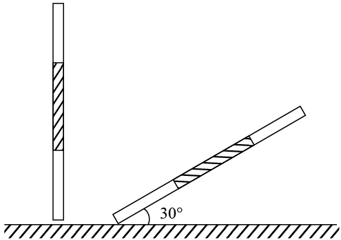

# Physics - 题目 2390

**ID**: 0f57dee7f85945a9ab897c8d98896e6b
**年级**: Grade 12
**难度**: Medium
**题型**: Calculation

## 题目
某同学利用如图所示的装置测量山顶处的大气压强，上端开口、下端封闭的长直玻璃管竖直放置，用h=40.00cm的某种液体封闭一段空气柱，利得气柱长度l_{1}=20.00cm。​​​​​​​‌再将玻璃管缓慢倾斜至与水平面成30°角，液体没有溢出，测得空气柱长度变为l_{2}=24.50cm。已知液体的密度 $ρ=13.6\times 10{^{3}}{\rm{k}}{\rm{g}}{\rm{/}}{\rm{m}}{^{{\rm{3}}}}$ ，山顶处重力加速度g=9.80m/s^{2}，计算结果均保留3位有效数字，求:（1）玻璃管竖直放置时，液柱由于重力产生的压强p；（2）山顶的大气压强 $p{{}_{0}}$

## 解答

1. （1）玻璃管竖直放置时，液柱由于重力产生的压强
2. $p=ρgh=13.6\times 10{^{3}}\times 9.80\times 0.4{\rm{P}}{\rm{a}}={\rm{5}}{\rm{.}}{\rm{3}}{\rm{3}}\times {\rm{1}}{\rm{0}}{^{4}}{\rm{P}}{\rm{a}}$
3. （2）山顶的大气压为 $p{{}_{0}}$  ，根据波意耳定律
4. $(p{{}_{0}}+ρgh)l{{}_{1}}S=(p{{}_{0}}+ρgh{\sin}30{}^\circ )l{{}_{2}}S$
5. 解得
6. $p{{}_{0}}=9.18\times 10{^{4}}{\rm{P}}{\rm{a}}$

## 知识点

**中文**:
  - 气体等温变化与玻意耳定律

**English**:
  - Isothermal Change and Boyle's Law

---
