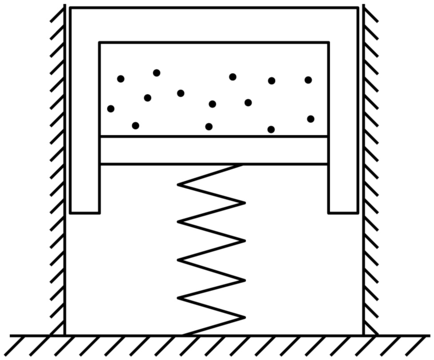

# Physics - 题目 1746

**ID**: 11504144142d458ca25f1360b885f627
**年级**: Grade 12
**难度**: Medium
**题型**: Calculation

## 题目
如图所示，倒立汽缸的活塞压在劲度系数为 $k$ 的竖直轻弹簧上，汽缸在两个固定的竖直光滑挡板之间悬空而静止，活塞与汽缸之间封闭有理想气体，气体高度为 $h$ 。​​​​​​​‌不计活塞的质量和厚度，汽缸的质量为 $m$ ，活塞和汽缸壁导热性能良好。重力加速度为 $g$ ，环境温度为 $T{{}_{0}}$ ，大气压强为 $p{{}_{0}}$ ，活塞面积为 $S$ ，活塞与汽缸间的摩擦不计。现在汽缸顶部缓慢加细沙，当细沙的质量为 $0.5m$ 时，求：（1）汽缸内气体的高度 $h^{′}$ ；（2）为使汽缸恢复到原来的位置，应使周围环境的温度上升至多少？

## 解答

1. （1）对汽缸，加上细沙前，对气缸受力分析，由平衡条件得 $pS=p{{}_{0}}S+mg$ ，加上细沙后，对气缸受力分析，由平衡条件得 $p^{′}S=p{{}_{0}}S+1.5mg$ ，对气体，由波意耳定律得 $phS=p^{′}h^{′}S$ ，解得 $h^{′}=\frac {p{{}_{0}}S+mg}{p{{}_{0}}S+1.5mg}h$
2. （2）开始时弹簧弹力 $kx{{}_{1}}=mg$ ，加上细沙后弹簧弹力 $kx{{}_{2}}=1.5mg$ ，气体做等压变化使气缸恢复到原来的位置有 $\frac {h^{′}S}{T{{}_{0}}}=\frac {\left ({h+x{{}_{2}}-x{{}_{1}}}\right )S}{T}$ ，解得 $T=\frac {\left ({2kh+mg}\right )\left ({p{{}_{0}}S+1.5mg}\right )}{2kh\left ({p{{}_{0}}S+mg}\right )}T{{}_{0}}$

## 知识点

**中文**:
  - 气体等温变化与玻意耳定律

**English**:
  - Isothermal Change and Boyle's Law

---
