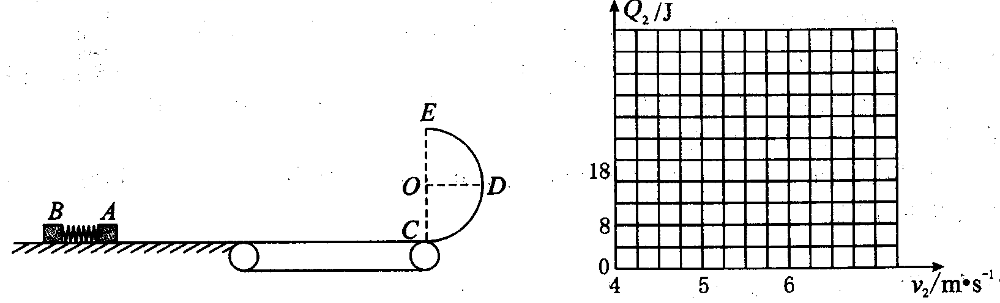

# Physics - 题目 2841

**ID**: 173ae4872348451d8da7d5548111e761
**年级**: Grade 12
**难度**: Medium
**题型**: Calculation

## 题目
如图所示，足够长的光滑水平桌面与长度L=5.​​​​​​​‌4m 的水平传送带平滑连接，传送带右端与半径r= 0.5m的光滑半圆轨道相切，半圆的直径CE竖直．A、B两小物块的质量分别为m_{A}=4kg、m_{B}=2kg，物块之间压缩着一根轻弹簧并用细绳锁定．当A、B在桌面上向右运动的速度υ_{1}＝1m/s时，细线断裂，弹簧脱离两物块后，A继续向右运动，并在静止的传送带上滑行了s=1.8m．已知物块与传送带间的动摩擦因数μ=0.25，重力加速度g= 10m/s^{2}．求(1)细线断裂后，弹簧释放的弹性势能E_{P}；(2)若在物块A滑上传送带时，传送带立即以速度υ_{1}＝1m/s逆时针匀速运动，求物块与传送带之间因摩擦产生的热量Q_{1}；(3)若物块A滑仁传送带时，传送带立即以速度υ_{2}顺时针匀速运动，为使A能冲上圆轨道，并通过最高点E，求υ_{2}的取值范围，并作出物块与传送带之间因摩擦产生的热量Q_{2}与υ_{2}的关系图．（作图不需要推导过程，标示出关键点的横、纵坐标）

## 解答

1. （1）设A、B与弹簧分离时的速度分别为v_{A}、v_{B}，以向右为正方向，由动量守恒定律
2. （m_{A}+m_{B}）v=m_{A}v_{A}+m_{B}v_{B}_{ }
3. A在桌面上运动，由动能定理
4. -μm_{A}gs=0- $\frac {1}{2}m{{}_{A}}v{{}_{A}^{2}}$
5. 联立解得
6. v_{A}=3m/s
7. v_{B}=-3m/s
8. 弹簧释放的弹性势能为
9. E_{p}= $\frac {1}{2}m{{}_{A}}v{{}_{A}^{2}}$ + $\frac {1}{2}m{{}_{B}}v{{}_{B}^{2}}$ - $\frac {1}{2}（m{{}_{A}}+m{{}_{B}})v{{}^{2}}$
10. 解得E_{p}=24J ；
11. （2）A在传送带上向右减速，速度减为零后又向左加速，直到与传送带共速，之后向左离开传送带．设相对运动的时间为M加速度大小为
12. a=μg=2.5m/s^{2}
13. 由运动学公式
14. -v_{1}=v_{A}-at_{1}
15. A的位移
16. $x{{}_{1}}=\frac {v{{}_{A}}+(-v{{}_{1}})}{2}t{{}_{1}}$
17. 传送带的位移
18. x_{带}_{1}=（-v_{1}）·t_{1}
19. 滑块与传送带问的相对运动的路程为s_{1}=x_{1}-x_{带}_{1 }
20. 解得
21. 摩擦生热Q_{1}=μm_{A}gs_{1}=32J
22. （3）若传送带速度足够大，A将一直加速，此时A冲上圆轨道的速度最大．由运动学公式
23. $v{{}_{{\rm \max }}^{2}}-v{{}_{A}^{2}}=2aL$
24. 解得v_{max}=6m/s
25. 当A刚好能到达E点时，A冲上圆轨道的速度最小．在E点，由牛顿第二定律
26. mg=m$\frac {v{{}_{E}^{2}}}{r}$
27. A由C运动到E，由机械能守恒定律
28. mg·2r= $\frac {1}{2}mv{{}_{{\rm \min }}^{2}}-\frac {1}{2}mv{{}_{E}^{2}}$
29. 联立解得v_{min}=5m/s
30. 综上，v_{2}≥5m/s
31. 摩擦生热Q_{2}与v_{2}的关系如图
32. （i）当5m/s≤v_{2}＜6m/s时，A在传送带上先加速后匀速运动．A加速的位移
33. x_{2}= $\frac {v{{}_{2}^{2}}-v{{}_{A}^{2}}}{2a}$
34. A加速的时间t_{2}= $\frac {v{{}_{2}}-v{{}_{A}}}{a}$
35. 传送带的位移x_{带}_{2}=v_{2}t_{2}= $\frac {v{{}_{2}}({{}_{2}}-v{{}_{A}})}{a}$
36. A传送带的相对运动的路程
37. s_{2}=x_{带}_{2}-x_{2}= $\frac {v{{}_{2}^{2}}-2v{{}_{A}}v{{}_{2}}+v{{}_{A}^{2}}}{2a}$
38. 解得Q_{2}=μm_{A}gs_{2}=2 $(v{{}_{2}}-3){^{2}}$ J
39. （ii）当v_{2}＞6m/s时，A在传送带上将一直加速．
40. 
41. A加速的位移 $x{{}_{2}^{\prime }}$ =L=5.4m
42. A加速度的时间 $t^{′}{{{}_{2}}}$ = $\frac {v{{}_{{\rm \max }}}-v{{}_{A}}}{a}$ =1.2s
43. 传送带的位移x_{带}_{2}′=v_{2}t_{2}′=1.2v_{2}
44. A和传送带的相对运动的路程
45. s_{2}′=x_{带}_{2}′- $x{{}_{2}^{\prime }}$ =（1.2v_{2}-5.4）m
46. 解得Q_{2}′=μm_{A}gs_{2}′=（12v_{2}-54）J
47. 综上，Q_{2}=2 $(v{{}_{2}}-3){^{2}}$ J（5m/s≤v_{2}＜6m/s），（12v_{2}-54）J（v_{2}≥6m/s）．

## 知识点

**中文**:
  - 动量和能量的综合应用
  - 动量守恒与弹簧相结合

**English**:
  - Integration of Momentum and Energy
  - Momentum Conservation with Springs

---
