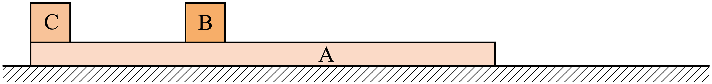

# Physics - 题目 1590

**ID**: 1dc6a2463f9346ae8a5b77c7dbe797ac
**年级**: Grade 12
**难度**: Medium
**题型**: Calculation

## 题目
如图所示，一质量为m_{A}=2kg的木板A置于水平面上，板与水平面间的动摩擦因数µ_{1}=0.1，板上放着可视为质点的滑块B、C，其质量为m_{B}=m_{C}=1kg，滑块B、C与木板间的动摩擦因数均为µ_{2}=0.6，滑块C在木板A最左端，B、C间距离为L，现让滑块B、C分别以初速度v_{B}=2m/s，v_{C}=4m/s同时向右运动，最终两滑块恰好不相撞且都没有脱离长木板，取重力加速度g=10m/s^{2}。​​​​​​​‌求：（1）滑块B、C刚开始滑动时木板A的加速度a；（2）滑块B、C间的距离L。

## 解答

1. （1）对木板A受力分析知 $μ{{}_{2}}m{{}_{{\rm{B}}}}g+μ{{}_{2}}m{{}_{{\rm{C}}}}g-μ{{}_{1}}(m{{}_{{\rm{A}}}}+m{{}_{{\rm{B}}}}+m{{}_{{\rm{C}}}})g=m{{}_{{\rm{A}}}}a$
2. 解得 $a=4{\rm{m}}{\rm{/}}{\rm{s}}{^{{{2}}}}$
3. （2）对滑块B、C分别受力分析知，滑块B、C先一起在木板A上向右减速，A向右加速，当滑块B减速到与木板A共速后，滑块C继续在木板A上向右减速，滑块B与木板A一起向右加速，当滑块C与AB整体共速时，若滑块B与C没有碰撞，则此后滑块B、C与木板A一起向右减速，不会碰撞，设滑块B运动时间t_{1}与木板A共速，共同速度为v_{1}，此过程滑块B的加速度为a_{1}，滑块C的加速度为a_{2}，设滑块B与A共速时滑块C的速度为v_{2}，则 $μ{{}_{2}}m{{}_{{\rm{B}}}}g=m{{}_{{\rm{B}}}}a{{}_{1}}$ ， $μ{{}_{2}}m{{}_{{\rm{C}}}}g=m{{}_{{\rm{C}}}}a{{}_{2}}$ ， $v{{}_{1}}=at{{}_{1}}=v{{}_{{\rm{B}}}}-a{{}_{1}}t{{}_{1}}$ ， $v{{}_{2}}=v{{}_{{\rm{C}}}}-a{{}_{2}}t{{}_{1}}$
4. 解得 $v{{}_{1}}=0.8{\rm{m}}{\rm{/}}{\rm{s}}$ ， $t{{}_{1}}=0.2{\rm{s}}$
5. 设滑块C继续运动时间t_{2}与AB整体共速，共同速度为v_{3}，设AB整体加速度为a_{3}，则 $μ{{}_{2}}m{{}_{{\rm{C}}}}g-μ{{}_{1}}(m{{}_{{\rm{A}}}}+m{{}_{{\rm{B}}}}+m{{}_{{\rm{C}}}})g=(m{{}_{{\rm{A}}}}+m{{}_{{\rm{B}}}})a{{}_{3}}$ ， $v{{}_{3}}=v{{}_{1}}+a{{}_{3}}t{{}_{2}}=v{{}_{2}}-a{{}_{2}}t{{}_{2}}$
6. 解得 $v{{}_{3}}=1{\rm{m}}{\rm{/}}{\rm{s}}$ ， $t{{}_{2}}=0.3{\rm{s}}$
7. 设滑块B在t_{1}时间和t_{2}时间内的总位移为x_{1}，滑块C在t_{1}时间与t_{2}时间内的总位移为x_{2}，则 $x{{}_{1}}=\frac {v{{}_{{\rm{B}}}}+v{{}_{1}}}{2}t{{}_{1}}+\frac {v{{}_{1}}+v{{}_{3}}}{2}t{{}_{2}}$ ， $x{{}_{2}}=\frac {v{{}_{{\rm{C}}}}+v{{}_{3}}}{2}(t{{}_{1}}+t{{}_{2}})$
8. 解得 $x{{}_{1}}=0.55{\rm{m}}$ ， $x{{}_{2}}=1.25{\rm{m}}$
9. 所以 $L=x{{}_{2}}-x{{}_{1}}=0.7{\rm{m}}$

## 知识点

**中文**:
  - 板块模型

**English**:
  - Plate Model

---
