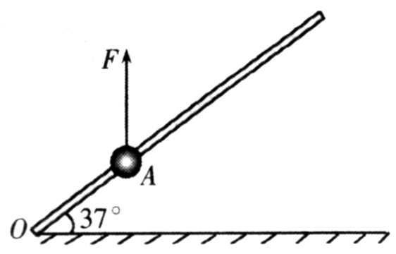

# Physics - 题目 1965

**ID**: 1e81b1790c3443e49c36c1fd682293c0
**年级**: Grade 12
**难度**: Medium
**题型**: Calculation

## 题目
如图所示，质量为2kg的有孔小球套在固定的长直杆上，杆与水平方向成 $37^\circ $ 角，球与杆间的动摩擦因数μ=0.25。​​​​​​​‌小球在竖直向上大小为30N的拉力F作用下，从A点由静止开始向上运动，经过1s撤去拉力，取g=10m/s^{2}，sin $37^\circ $ =0.6，cos $37^\circ $ =0.8，求：(1)撤去拉力前瞬间拉力F的功率；(2)小球返回A点时的速度。

## 解答

1. (1)小球在拉力作用下受力情况如图甲，有以下关系式
2. 
3. $(F-mg){\sin}37^\circ -μ(F-mg){\cos}37^\circ =ma{{}_{1}}$
4. $v{{}_{1}}=a{{}_{1}}t{{}_{1}}$
5. 功率
6. $P=Fv{{}_{1}}{\cos}53^\circ $
7. 解得
8. P=36W
9. (2)撤去拉力时，沿杆向上的位移 $x{{}_{1}}=\frac {1}{2}a{{}_{1}}t{{}_{1}^{2}}$ ，撤去外力后，向上运动时，受力如图乙，有
10. 
11. $mg{\sin}37^\circ +{\rm μm}g{\cos}37^\circ =ma{{}_{2}}$
12. $x{{}_{2}}=\frac {v{{}_{1}^{2}}}{2a{{}_{2}}}$
13. 从最高点下滑时受力如图丙
14. 
15. 设滑回A点时的速度为v_{2}，由动能定理得
16. $mg(x{{}_{1}}+x{{}_{2}}){\sin}37^\circ -{\rm μm}g(x{{}_{1}}+x{{}_{2}}){\cos}37^\circ =\frac {1}{2}mv{{}_{2}^{2}}$
17. 解得
18. $v{{}_{2}}=\sqrt {10}$ m/s

## 知识点

**中文**:
  - 功和功率
  - 用正交分解法分析问题
  - 动能定理的简单应用

**English**:
  - Work and Power
  - Problem Analysis using Orthogonal Decomposition
  - Simple Applications of Work-Energy Theorem

---
