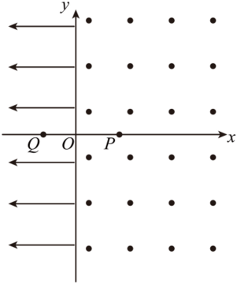

# Physics - 题目 204

**ID**: 1ff655b993ee4454b01c708bac453103
**年级**: Grade 12
**难度**: Medium
**题型**: Calculation

## 题目
如图所示的Oxy坐标系中，y轴的右侧存在垂直纸面向外的匀强磁场，磁感应强度大小为B=1 T，y轴的左侧存在沿 $x$ 轴负方向的匀强电场。​​​​​​​‌P点为x轴上的点， $OP=20\sqrt {3}{\rm{\;}}{\rm{c}}{\rm{m}}$ ，一比荷为10 C/kg的负粒子由P点沿x轴的正方向射入磁场，经过一段时间粒子通过y轴进入电场，速度方向与y轴的负方向成α=30°，粒子在电场中垂直x轴经过Q点。忽略粒子的重力。求：（结果可用分式或带根号）（1）粒子射入磁场的初速度大小以及电场强度E的大小；（2）粒子第一次经过y轴到第三次经过y轴的时间。

## 解答

1. （1）带电粒子在磁场中做匀速圆周运动，作出运动轨迹示意图，如图所示，
2. 
3. 由几何关系得 $R{\rm{c}}{\rm{o}}{\rm{s}}30{}\degree =20\sqrt {3}{\rm{c}}{\rm{m}}$ ，解得 $R=0.4{\rm{\;}}{\rm{m}}$ ，根据洛伦兹力提供向心力，有 $qvB=m\frac {v{^{2}}}{R}$ ，解得 $v=\frac {qBR}{m}=4{\rm{m}}{\rm{/}}{\rm{s}}$ ，带电粒子在电场中运动时，沿y轴方向做匀速直线运动，有 $R+R\sin 30{}\degree =v{\cos}30{}\degree \cdot t{{}_{2}}$ ，沿x轴方向做匀变速直线运动，有 $v{\rm{s}}{\rm{i}}{\rm{n}}30{}\degree =at{{}_{2}}$ ，其中 $a=\frac {qE}{m}$ ，解得 $t{{}_{2}}=\frac {\sqrt {3}}{10}{\rm{s}}$ ， $E=\frac {2\sqrt {3}}{3}{\rm{V}}{\rm{/}}{\rm{m}}$ ；
4. （2）带电粒子在电场中运动的时间为 $2t{{}_{1}}=\frac {\sqrt {3}}{5}{\rm{s}}$ ，带电粒子再次进入磁场后转过的角度为300°，所用时间为 $t{{}_{2}}=\frac {5}{6}T=\frac {5{\rm{π}}m}{3qB}=\frac {{\rm{π}}}{{{6}}}{\rm{s}}$ ，则带电粒子从开始运动到第三次经过y轴所用的时间为 $t=2t{{}_{1}}+t{{}_{2}}={\rm{(}}\frac {{\rm{π}}}{{{6}}}+\frac {\sqrt {3}}{5}{\rm{)}}{\rm{s}}$ 。

## 知识点

**中文**:
  - 带电粒子在组合场中的运动

**English**:
  - Motion in Combined Fields

---
