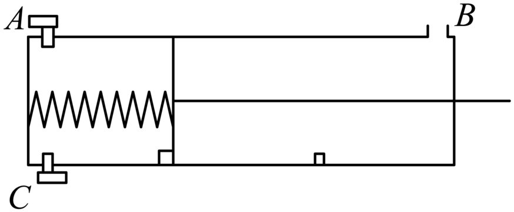

# Physics - 题目 2094

**ID**: 21d46da1c02e458db6ea943397a3bcad
**年级**: Grade 12
**难度**: Medium
**题型**: Calculation

## 题目
气压传动是以压缩空气为动力源来驱动和控制各种机械设备的技术。​​​​​​​‌图示为某气动元件的结构简图，长度为3L的汽缸被两立柱均分为3份，轻质活塞可在立柱间保持竖直左右自由活动，体积不计的轻质弹簧两端分别固定在左缸底和活塞左侧，弹簧原长为L，劲度系数 $k=\frac {pS}{L}$ ，由活塞右侧固定的轻杆对外输出动力，A端与高压气源相连，B、C端与大气相连，通过A、C处阀门的开闭，使活塞在两立柱间做往复运动，且对立柱无作用力，已知汽缸的横截面积为S，轻杆对活塞的作用力始终为2pS，大气压强为p，汽缸导热性能良好且外界温度恒定。(1)活塞对左侧立柱恰无作用力时，求左侧缸内气体压强；(2)正常工作过程关闭C，缓慢打开A，求活塞从左侧立柱缓慢运动到右侧立柱过程气源充入左缸的气体在压强为p时的体积；(3)正常工作过程关闭A，缓慢打开C，求活塞从右侧立柱缓慢运动到左侧立柱过程左缸气体与外界交换的热量。

## 解答

1. （1）根据题意可知，当活塞对左侧立柱恰无作用力时，有 $p{{}_{左}}S=2pS+pS$ ，解得 $p{{}_{左}}=3p$ 。
2. （2）当活塞从左侧立柱缓慢运动到右侧立柱时，有 $p^{′}{{{}_{左}}}S=2pS+pS+kL$ ，
3. 设充入气体在压强为p时的体积为V，则对左侧缸内气体和充入的气体有 $p{{}_{左}}SL+pV=2p^{′}{{{}_{左}}}SL$ ，
4. 联立解得 $V=5SL$ 。
5. （3）活塞从右侧立柱缓慢移动到左侧立柱的过程，活塞对气体的作用力由4pS随位移线性减为3pS，则活塞对左侧气缸内的气体做功为 $W{{}_{1}}=\frac {4pS+3pS}{2}L=3.5pSL$ ，
6. 从C处阀门排出的气体在大气压强下的体积为V，对外界做功为 $W{{}_{2}}=pV=5pSL$ ，
7. 则该过程中左侧缸内气体从外界吸收的热量为 $Q=W{{}_{2}}-W{{}_{1}}=1.5pSL$ 。

## 知识点

**中文**:
  - 热力学第一定律与理想气体状态方程的综合应用

**English**:
  - Integrated Application of 1st Law and Ideal Gas Law

---
