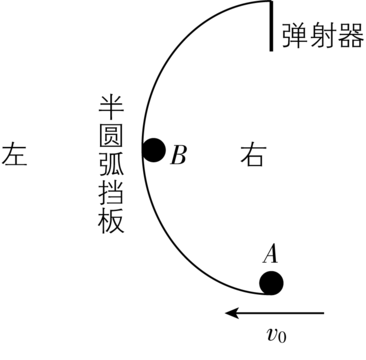

# Physics - 题目 2675

**ID**: 23741361a327436cadfc693c3d5e197f
**年级**: Grade 12
**难度**: Medium
**题型**: Calculation

## 题目
如图所示（俯视图），光滑水平面上固定放置着半圆弧光滑挡板，两个可视为质点的小球A、B可沿半圆弧挡板内侧在水平面内做圆周运动，A、B两球的质量分别为m_{A}=3 kg、m_{B}=2 kg，半圆弧挡板半径为R=3 m。​​​​​​​‌半圆弧挡板的另一端安装有一个弹射器，B球与其碰撞后可原速率弹回。初始时，B球静止放在半圆弧挡板的最左端，A球以v_{0}=5 m/s的速度从挡板一端沿半圆弧运动，并与B球发生弹性碰撞。求：（1）A球和B球第一次碰撞前瞬间，半圆弧挡板对A球支持力N的大小；（2）A球和B球第一次碰撞后，二者速度v_{1}、v_{2}的大小；（3）若A球和B球第二次碰撞后，立即被锁定在一起，求该碰撞过程系统损失的机械能。

## 解答

1. （1）A、B第一次碰撞前瞬间，对A由牛顿第二定律有
2. ${\rm \mathit{N}=\mathit{m}\mathit{_{A}}}\frac{{v}_{0}^{2}}{R}$
3. 解得N=25 N
4. （2）A、B第一次碰撞，由动量守恒定律和能量守恒定律得
5. m_{A}v_{0}=m_{A}v_{1}+m_{B}v_{2}
6. $\frac{1}{2}{\rm \mathit{m}\mathit{_{A}}}$  ${v}_{0}^{2}{\rm =}$  $\frac{1}{2}{\rm \mathit{m}\mathit{_{A}}}$  ${v}_{1}^{2}{\rm +}$  $\frac{1}{2}{\rm \mathit{m}\mathit{_{B}}}$  ${v}_{2}^{2}$
7. 解得v_{1}=1 m/s，v_{2}=6 m/s
8. （3）A、B第二次碰撞，以碰前B的速度方向为正方向，由动量守恒定律得
9. m_{B}v_{2}-m_{A}v_{1}=（m_{A}+m_{B}）v
10. 解得v=1.8 m/s
11. 第二次碰撞过程中系统损失的机械能为
12. ${\rm Δ\mathit{E}=}\frac{1}{2}{\rm \mathit{m}\mathit{_{A}}}$  ${v}_{1}^{2}{\rm +}$  $\frac{1}{2}{\rm \mathit{m}\mathit{_{B}}}$  ${v}_{2}^{2}{\rm -}$  $\frac{1}{2}{\rm （\mathit{m}\mathit{_{A}}+\mathit{m}\mathit{_{B}}）\mathit{v}^{2}}$
13. 解得ΔE=29.4 J

## 知识点

**中文**:
  - 求解弹性碰撞问题

**English**:
  - Solving Elastic Collision Problems

---
