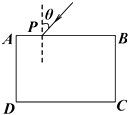

# Physics - 题目 763

**ID**: 2e3d1297623c4eebb30caedccfe76bfd
**年级**: Grade 12
**难度**: Medium
**题型**: Calculation

## 题目
如图所示，将一个折射率为 $n=\frac {\sqrt {7}}{2}$  的透明长方体放在空气中，矩形ABCD是它的一个截面，一单色细光束入射到P点，入射角为θ． $AD=\sqrt {6}AP$  ，求：（1）若要使光束进入长方体后能射至AD面上，角θ的最小值；​​​​​​​‌（2）若要此光束在AD面上发生全反射，角θ的范围．

## 解答

1. ①要使光束进入长方体后能射至AD面上，设最小折射角为α，如图甲所示，根据几何关系有： ${\sin}α=\frac {d}{\sqrt {d{^{2}}+{\left({\sqrt {6}d}\right)^{2}}}}=\frac {\sqrt {7}}{7}$ ，
2. 根据折射定律有 $n=\frac {{\sin}θ}{{\sin}α}$ ，解得角θ的最小值为θ=30°；
3. 
4. ②如图乙，要使光速在AD面发生全反射，则要使射至AD面上的入射角β满足关系式： ${\sin}β\geqslant {\sin}C$ ；
5. 又 ${\sin}C=\frac {1}{n}$ ， ${\sin}C=\frac {1}{n}{\sin}β={\cos}α=\sqrt {1-{\sin}{^{2}}α}=\sqrt {1-(\frac {{\sin}θ}{n}){^{2}}}$ ；
6. 解得 $θ\leqslant 60{}^\circ $ ，因此角θ的范围为 $30{}^\circ \leqslant θ\leqslant 60{}^\circ $ ．
7. 【点睛】解决光学问题的关键要掌握全反射的条件、折射定律 $n=\frac {{\sin}i}{{\sin}r}$ 、临界角公式 ${\sin}C=\frac {1}{n}$ 、光速公式 $v=\frac {c}{n}$ ，运用几何知识结合解决这类问题．

## 知识点

**中文**:
  - 全反射与折射的综合应用

**English**:
  - Comprehensive Application of Total Reflection and Refraction

---
